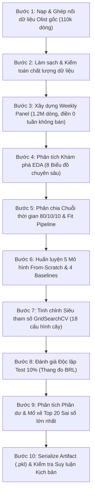

# 📈 Dự Báo Doanh Thu Sản Phẩm Theo Tuần (Weekly Product Sales Predictor)

> **Dự án Môn học Máy (Machine Learning Project)**
> **Phương pháp tiếp cận:** 100% Cài đặt Thuần túy From-Scratch bằng **NumPy** (Không dùng thư viện Scikit-Learn cho mô hình và tiền xử lý).
> **Dữ liệu thực nghiệm:** Sàn thương mại điện tử Olist Brazil (~1.2 triệu mẫu sản phẩm–tuần) từ bộ dữ liệu công khai [Brazilian E-Commerce Public Dataset by Olist (Kaggle)](https://www.kaggle.com/datasets/olistbr/brazilian-ecommerce).
> **Trạng thái kiểm thử:** 94/94 unit & integration tests pass (21/10/2026).

---

## 📌 1. Giới thiệu & Bản chất Bài toán

### 1.1. Bối cảnh & Mục tiêu Nghiệp vụ

Trong quản trị thương mại điện tử hiện đại, việc dự báo chính xác nhu cầu bán lẻ theo từng chu kỳ ngắn hạn đóng vai trò then chốt nhằm tối ưu hóa chuỗi cung ứng, hoạch định nhập hàng, giảm tải chi phí lưu kho và hạn chế rủi ro đứt hàng (*out-of-stock*).

Đề tài giải quyết bài toán: **Dự báo tổng doanh thu bán hàng (BRL) trong tuần tiếp theo cho từng mã sản phẩm cụ thể** trên sàn thương mại điện tử Olist.

### 1.2. Bản chất Kỹ thuật & Ràng buộc Chuỗi Thời gian

- **Dạng bài toán:** Hồi quy chuỗi thời gian (Time-series Regression) trên cấu trúc bảng Sản phẩm – Tuần (*Product–Week Panel*).
- **Mốc thời gian chuẩn hóa:** Toàn bộ dữ liệu được gom nhóm theo chu kỳ tuần lịch từ **thứ Hai đến Chủ nhật**, gán mốc thời gian là ngày thứ Hai đầu tuần (`order_purchase_timestamp`).
- **Biến mục tiêu ($y$):** Tổng giá trị mặt hàng (`price`) bán được trong tuần đích, **không bao gồm phí vận chuyển** (`freight_value`). Không nhầm lẫn số thứ tự món hàng (`order_item_id`) với số lượng bán.
- **Xử lý tuần doanh thu bằng 0 (*Zero-Sales Weeks*):** Với mỗi sản phẩm, từ tuần đầu tiên phát sinh đơn hàng đến tuần cuối cùng quan sát, những tuần không bán được sản phẩm nào vẫn được bảo toàn với nhãn `sales = 0.0` BRL. Điều này phản ánh trung thực bản chất dữ liệu thưa (*sparse demand*) trong kinh doanh trực tuyến.
- **Không gian huấn luyện & suy luận:** Doanh thu thực tế có độ lệch phải rất lớn (Right-skewed). Mô hình được huấn luyện trong không gian Log tự nhiên:

  $$
  y_{\text{train}} = \log(1 + \text{sales})
  $$

  Khi dự báo và suy luận nghiệp vụ, kết quả được chuyển đổi ngược về thang tiền tệ BRL và chặn dưới bằng 0:

  $$
  \hat{y}_{\text{sales}} = \max\left(0, \exp(\hat{y}) - 1\right)
  $$

---

## ⚙️ 2. Định hướng Cốt lõi: 100% From-Scratch (NumPy Only)

Dự án tuân thủ nghiêm ngặt nguyên tắc học thuật: **Nói KHÔNG với Scikit-Learn** cho toàn bộ các lớp mô hình hồi quy, quy trình tiền xử lý, thuật toán tối ưu và chỉ số đánh giá.

### 2.1. Năm Thuật toán Hồi quy Tự Cài đặt

1. **Linear Regression (`LinearRegressionFromScratch`):**
   - Bộ giải mặc định OLS Normal Equation giải tích: $w = (X^T X + \alpha I)^{-1} X^T y$, sử dụng điều chuẩn Ridge nhỏ $\alpha_{\text{ridge}} = 10^{-5}$ và thuật toán giải ma trận giả nghịch đảo Moore-Penrose `np.linalg.pinv` trên ma trận Gram thưa, đảm bảo tính ổn định số học và chống suy biến.
   - Hỗ trợ bộ giải tùy chọn Gradient Descent lặp (`solver='gradient_descent'`) để đối chiếu quá trình hội tụ hàm mất mát MSE.
   - Kẹp dự báo log trong `[min_train - 0.5*span, max_train + 0.5*span]`, với `span = max(1, max_train - min_train)`. Đây là giới hạn số học theo Train, không bảo đảm sai số tiền tệ thấp.
2. **Decision Tree Regressor (`DecisionTreeRegressorFromScratch`):**
   - Xây dựng cây hồi quy nhị phân đệ quy dựa trên tiêu chuẩn Giảm phương sai (Variance Reduction):
     $$
     \Delta \text{Var} = \text{Var}(D) - \left( \frac{|D_L|}{|D|} \text{Var}(D_L) + \frac{|D_R|}{|D|} \text{Var}(D_R) \right)
     $$
   - Tối ưu hóa tốc độ phân nhánh bằng cơ chế 16 Điểm phân vị ứng viên (*Quantile Split Candidates*).
3. **Random Forest Regressor (`RandomForestRegressorFromScratch`):**
   - Thuật toán Ensemble Bagging: Lấy mẫu lặp lại có hoàn lại (*Bootstrap Sampling*) cho từng cây.
   - Chọn ngẫu nhiên tập con đặc trưng ($k = \sqrt{d}$) tại mỗi nút chia nhánh, giúp giảm phương sai mô hình và chống quá khớp (Overfitting).
4. **Gradient Boosting Regressor (`GradientBoostingRegressorFromScratch`):**
   - Huấn luyện tuần tự $M$ cây hồi quy trên phần dư âm (Residuals) của hàm mất mát bình phương.
   - Ứng dụng hệ số học co hẹp (*Learning Rate / Shrinkage*) $\eta \in (0, 1]$ để kiểm soát tốc độ hội tụ:
     $$
     \hat{y}^{(m)}(x) = \hat{y}^{(m-1)}(x) + \eta \cdot h_m(x)
     $$
5. **Two-Stage Hurdle Regressor (`TwoStageHurdleRegressorFromScratch`):**
   - Kiến trúc 2 giai đoạn chuyên trị phân phối thưa zero-inflated:
     - **Giai đoạn 1 (Classification):** Cây quyết định phân loại dự báo xác suất tuần đó sản phẩm có phát sinh doanh số hay không $\Pr(y > 0 \mid x)$.
     - **Giai đoạn 2 (Positive Regression):** Cây quyết định hồi quy chỉ học trên các mẫu có phát sinh doanh thu dương ($y > 0$).
     - **Công thức suy luận:** $\hat{y} = \Pr(y > 0 \mid x) \cdot \mathrm{expm1}(\hat{y}_{log,pos})$. Nhánh dương học trên log nên kết quả không mặc nhiên là kỳ vọng số học hoặc trung vị của doanh thu.

### 2.2. Động Cơ Dự Báo Kịch Bản Mở Rộng (Scenario-Based Engines From-Scratch)

Bên cạnh dự báo tuần, hệ thống có một thí nghiệm proxy sau lần bán đầu và một công cụ mô phỏng marketing theo giả định:

1. **Cold-Start Product Regressor (`ColdStartProductRegressor`):**
   - Ước lượng doanh thu 7 ngày từ giao dịch đầu, bao gồm giao dịch đầu đã biết; không phải kiểm chứng trước ngày niêm yết.
   - Năm thuộc tính số: giá giao dịch đầu, khối lượng, số ảnh, độ dài tên và mô tả; thêm danh mục được mã hóa từ Train.
   - Chia theo thời gian, loại nhãn Train vượt mốc Test và cửa sổ chưa đủ ngày. Đối chứng cả trung vị danh mục và `sales = first_price`; xem kết quả sinh tự động ở mục 4.
2. **Marketing Diminishing Returns Response Model (`simulate_marketing_response`):**
   - Động cơ kinh tế lượng mô phỏng phản hồi doanh số gia tăng theo ngân sách quảng cáo dựa trên hàm Log-Response chuẩn mực:
     $$
     \text{Uplift Factor} = 1.0 + \beta_{\text{ad}} \cdot \ln\left(1 + \frac{\text{Ad Spend}}{S_{ref}}\right)
     $$
   - Hệ số và ngân sách tham chiếu là giả định người dùng, chưa học từ chiến dịch. ROI sử dụng biên lợi nhuận gộp giả định; không phải dự báo lợi nhuận thực tế.

### 2.3. Bốn Mô hình Đối chứng Cơ sở (Baselines)

Nhằm chứng minh giá trị gia tăng thực sự của các thuật toán phức tạp, hệ thống đối chiếu với 4 mốc Baseline chuẩn mực:

- **Zero Baseline (`ZeroRegressorFromScratch`):** Luôn dự báo 0 BRL, kiểm tra năng lực mô hình trên tập dữ liệu thưa.
- **Revenue Mean Baseline (`RevenueMeanRegressorFromScratch`):** Dự báo hằng số bằng trung bình doanh thu thực tế của tập Train.
- **Log Mean Baseline (`MeanRegressorFromScratch`):** Dự báo trung bình nhãn trong không gian log.
- **Previous Week Baseline (`PreviousWeekRegressorFromScratch`):** Mô hình quán tính (Persistence), lấy doanh thu tuần trước làm dự báo cho tuần này.

### 2.4. Pipeline Tiền Xử lý Thuần NumPy

- `CustomImputer`: Điền giá trị khuyết thiếu (Median cho biến số, Mode cho biến phân loại) fit duy nhất trên tập Train.
- `CustomOneHotEncoder`: Mã hóa các biến danh mục sang ma trận nhị phân thưa (Sparse CSR Matrix), tự động gán vector 0 cho các nhãn mới xuất hiện ở Test.
- `CustomStandardScaler`: Chuẩn hóa Z-Score $Z = (X - \mu) / (\sigma + 10^{-8})$ dựa trên tham số phân phối của Train.
- `CustomDataPipeline`: Đóng gói quy trình biến đổi thành một chuỗi duy nhất, tích hợp kiểm tra kiểu dữ liệu và ngăn chặn hoàn toàn rò rỉ thông tin tương lai (*Data Leakage*).

---

## 📊 3. Hệ thống Kỹ nghệ Đặc trưng (Feature Taxonomy - 89 Features)

Tất cả các đặc trưng đầu vào đều tuân thủ nguyên tắc: **Chỉ sử dụng dữ liệu đã biết trước thời điểm 00:00 của thứ Hai tuần dự báo**.

| Nhóm đặc trưng              | Tên cột / Thuộc tính    | Ý nghĩa nghiệp vụ & Quy tắc tính toán                                                                        |
| :------------------------------ | :-------------------------- | :------------------------------------------------------------------------------------------------------------------ |
| **Giá bán lịch sử**   | `price`                   | Giá bán trung bình của sản phẩm ở tuần gần nhất có giao dịch trước tuần đích.                      |
| **Doanh thu trễ**        | `last_week_sales`         | Doanh thu tuần liền kề trước tuần dự báo ($t-1$).                                                         |
|                                 | `sales_lag_2_weeks`       | Doanh thu cách 2 tuần lịch ($t-2$).                                                                            |
|                                 | `sales_lag_4_weeks`       | Doanh thu cách 4 tuần lịch ($t-4$).                                                                            |
| **Thống kê trượt**    | `sales_mean_4_weeks`      | Trung bình doanh thu 4 tuần lịch gần nhất trước tuần đích.                                                |
|                                 | `sales_std_4_weeks`       | Độ lệch chuẩn doanh thu 4 tuần gần nhất (độ biến động nhu cầu).                                        |
| **Sản lượng**          | `last_week_units`         | Tổng số lượng sản phẩm bán được ở tuần liền trước.                                                   |
| **Vòng đời**           | `weeks_since_first_sale`  | Số tuần lịch kể từ lần bán hàng đầu tiên được ghi nhận của sản phẩm.                              |
| **Đánh giá lịch sử** | `past_review_count`       | Số lượt đánh giá đã nhận từ khách hàng.                                                                 |
|                                 | `past_review_rating`      | Điểm đánh giá trung bình đã nhận (**chỉ tính các review đã trả lời trước tuần dự báo**). |
| **Hành vi khách hàng** | `customer_past_spend`     | Chi tiêu tích lũy quá khứ trung bình của nhóm khách mua hàng ở tuần gần nhất.                         |
|                                 | `customer_past_orders`    | Số đơn hàng lịch sử trung bình của nhóm khách mua hàng ở tuần gần nhất.                              |
|                                 | `customer_state_count`    | Số lượng bang khác nhau của nhóm khách mua hàng ở tuần gần nhất.                                        |
| **Mùa vụ & Lịch**      | `month`, `quarter`      | Tháng và Quý trong năm của tuần dự báo.                                                                     |
|                                 | `week_of_year`            | Chỉ số tuần trong năm (1 - 52).                                                                                 |
|                                 | `is_peak_shopping_season` | Cờ nhị phân đánh dấu các tuần mua sắm cao điểm (Black Friday, Lễ tết cuối năm).                      |
| **Danh mục sản phẩm**  | `category_*`              | Vector One-Hot đại diện cho 73 danh mục sản phẩm của sàn Olist.                                             |

---

## 🏆 4. Kết quả thực nghiệm hiện tại

<!-- GENERATED RESULTS: python -m src.evaluation.reporting -->

Các bảng dưới được sinh trực tiếp từ CSV trong `results/metrics` và artifact triển khai.
Chạy `.venv/Scripts/python.exe -m src.evaluation.reporting` để đồng bộ sau thực nghiệm.
Mô hình tuần được chọn bằng Validation: **Two-Stage Hurdle**, Validation RMSE **59.2188 BRL**.
Chế độ huấn luyện tuần: **Không được lưu trong lần chạy cũ; không suy đoán full/fast**. Thời điểm huấn luyện tuần được ghi trong metadata: `2026-10-20 22:25:45`.
Đây là snapshot của lần chạy đã lưu, không trộn số liệu từ lần chạy khác.

### 4.1. Dự báo sản phẩm–tuần (Test, BRL)

| Model                  | MSE           | MAE     | RMSE      | R2          | WAPE    | Cost_Per_Item_BRL | Fit Time (s) | Target_Scale |
| ---------------------- | ------------- | ------- | --------- | ----------- | ------- | ----------------- | ------------ | ------------ |
| Two-Stage Hurdle       | 2585.0102     | 8.6032  | 50.8430   | 0.0559      | 2.0105  | 45.4800           | 0.3600       | BRL          |
| Decision Tree          | 2674.6362     | 4.4362  | 51.7169   | 0.0232      | 1.0367  | 41.6627           | 0.7000       | BRL          |
| Tuned Model            | 2697.7820     | 4.4039  | 51.9402   | 0.0148      | 1.0291  | 42.4060           | 0.0000       | BRL          |
| Random Forest          | 2725.0833     | 4.4273  | 52.2023   | 0.0048      | 1.0346  | 42.6747           | 0.7700       | BRL          |
| Gradient Boosting      | 2733.2544     | 4.4465  | 52.2805   | 0.0018      | 1.0391  | 42.8263           | 2.0400       | BRL          |
| Revenue Mean Baseline  | 2752.2779     | 11.8955 | 52.4622   | -0.0052     | 2.7798  | 56.3489           | 0.0000       | BRL          |
| Mean Baseline          | 2754.5202     | 4.5026  | 52.4835   | -0.0060     | 1.0522  | 43.1895           | 0.0000       | BRL          |
| Zero Baseline          | 2756.4820     | 4.2792  | 52.5022   | -0.0067     | 1.0000  | 42.7919           | 0.0000       | BRL          |
| Previous Week Baseline | 5683.5250     | 9.0765  | 75.3892   | -1.0757     | 2.1211  | 42.4533           | 0.0000       | BRL          |
| Linear Regression      | 29169475.0415 | 76.8349 | 5400.8772 | -10651.9064 | 17.9555 | 185.2979          | 0.0500       | BRL          |

RMSE và MAE phản ánh các mục tiêu khác nhau; không suy ra lợi ích tồn kho chỉ từ R².
Chi phí là điểm phạt giả định trên sai lệch doanh thu, không phải chi phí vận hành được đo thực tế.
Chưa có đánh giá riêng precision/recall cho phát hiện tuần nhu cầu đột biến.

### 4.2. Proxy bảy ngày từ giao dịch đầu tiên

Nguồn: `cold_start_evaluation.csv`, quy trình: `cold_start_manifest.json`.
Train: **23428** sản phẩm; Test: **8110**;
loại **483** mẫu Train có cửa sổ nhãn vượt mốc **2018-04-24T00:00:00**.
Giá là giá giao dịch đầu tiên. Mọi cửa sổ nhãn phải có đủ bảy ngày quan sát.

| Model                           | MAE_BRL  | RMSE_BRL | R2_Score | Test_Count |
| ------------------------------- | -------- | -------- | -------- | ---------- |
| CategoryMedianColdStartBaseline | 126.6543 | 313.9562 | 0.0022   | 8110       |
| SingleUnitPriceBaseline         | 23.0145  | 120.9134 | 0.8520   | 8110       |
| ColdStartProductRegressor       | 39.7939  | 135.4682 | 0.8142   | 8110       |

So sánh cả baseline danh mục và baseline một sản phẩm (`sales = first_price`).
Không chọn mô hình bằng Test: cây với tham số cố định là ứng viên thực nghiệm được lưu,
không được gọi là tốt nhất nếu baseline thắng. Tỷ lệ Test chỉ bán một đơn vị: **85.47%**.

Giới hạn: mốc bắt đầu là lần bán đầu, không phải ngày niêm yết; target bao gồm giao dịch đầu đã biết.
Không có sản phẩm chưa bán; metadata sản phẩm và trạng thái delivered là snapshot cuối,
chưa có lịch sử để xác minh chúng sẵn có tại thời điểm dự báo. Chưa chứng minh cold-start trước bán.

<!-- END GENERATED RESULTS -->

## 📁 5. Cấu trúc Thư mục Dự án

**Kiểm chứng bổ sung:** [Báo cáo ba mốc thời gian và chẩn đoán mô hình](docs/algorithms/experimental_validation.md)
ghi lại toàn bộ fold, đối chứng cây trên log/BRL, phân nhóm một/nhiều đơn vị và
thí nghiệm Ridge/clipping cho Linear Regression. Chạy lại bằng
`.venv/Scripts/python.exe -m src.evaluation.experiments --weekly`.
Các thí nghiệm này không thay artifact triển khai và không được coi là Test mù mới.

**Cold-start trước bán:** đã có [luồng nhận catalog thực](docs/algorithms/listing_data_contract.md)
với nhãn 0 cho sản phẩm chưa bán. Chưa có dữ liệu bổ sung nên chưa có kết quả độ
chính xác cho tình huống trước niêm yết; không suy diễn từ proxy sau lần bán đầu.

```
lab_2 sales_predictor/
│
├── data/                               # Dữ liệu dự án
│   ├── raw/                            # Dữ liệu gốc Olist từ Kaggle & file hợp nhất olist_merged_sales_dataset.csv
│   └── processed/                      # Cache ma trận CSR thưa (X_train, y_train, ...) và pipeline
│
├── src/                                # Toàn bộ mã nguồn cốt lõi (From-Scratch)
│   ├── config.py                       # Cấu hình tập trung đường dẫn, tên cột, siêu tham số
│   ├── data/                           # Module nạp, làm sạch, tạo bảng tuần và kỹ nghệ đặc trưng
│   │   ├── builder.py                  # Ghép nối bảng Olist gốc & xây dựng panel tuần
│   │   ├── loader.py                   # Nạp dữ liệu an toàn & kiểm toán chất lượng
│   │   ├── preprocessing.py            # CustomImputer, CustomOneHotEncoder, CustomStandardScaler, Pipeline
│   │   └── feature_engineering.py      # WeeklySalesFeatureEngineer (lag, rolling, review, rfm)
│   ├── models/                         # Module mô hình From-Scratch, Baselines & Tối ưu hóa
│   │   ├── base.py                     # Lớp cơ sở trừu tượng BaseRegressor, BaseClassifier
│   │   ├── baselines.py                # 4 Mô hình Baseline đối chuẩn (Zero, Mean, Log-Mean, PreviousWeek)
│   │   ├── linear.py                   # Hồi quy tuyến tính LinearRegressionScratch & Adaptive Clamping
│   │   ├── tree.py                     # Cây quyết định DecisionTreeRegressorScratch (Variance Reduction)
│   │   ├── ensemble.py                 # Mô hình tổ hợp RandomForestRegressorScratch & GradientBoosting
│   │   ├── hurdle.py                   # Mô hình 2 giai đoạn TwoStageHurdleRegressor (Zero-inflated Sales)
│   │   ├── cold_start.py               # Mô hình Cold-Start Launch Week & Category Median Baseline
│   │   ├── regressors.py               # Facade giao diện hợp nhất các mô hình hồi quy
│   │   ├── tuning.py                   # grid_search_from_scratch & tune_all trên Validation
│   │   └── persistence.py              # Đóng gói và nạp mô hình (pickle serialization)
│   ├── evaluation/                     # Module đánh giá, phân tích lỗi và trực quan hóa
│   │   ├── metrics.py                  # Tính MSE, MAE, RMSE, R2, WAPE thuần NumPy
│   │   ├── error_analysis.py           # Phân tích phần dư & mổ xẻ Top 20 Worst Predictions
│   │   └── visualization.py            # Vẽ 18 biểu đồ EDA & Đánh giá (Backend Agg chuẩn dpi=300)
│   ├── deployment/                     # Module suy luận thực tế
│   │   └── predictor.py                # predict_sales đơn/batch, Cold-Start & Marketing Uplift
│   └── utils/                          # Công cụ hỗ trợ
│       └── logger.py                   # Hệ thống ghi nhật ký thực thi (Logging)
│
├── notebooks/                          # Hệ thống 5 Jupyter Notebooks tuần tự
│   ├── 01_exploratory_data_analysis.ipynb
│   ├── 02_preprocessing_and_feature_engineering.ipynb
│   ├── 03_model_training_and_comparison.ipynb
│   ├── 04_hyperparameter_tuning_and_error_analysis.ipynb
│   ├── 05_scenario_prediction_and_demo.ipynb
│   └── results/                        # Kết quả thực nghiệm riêng của Notebooks (Figures, Metrics, Models)
│
├── tests/                              # Bộ kiểm thử tự động (Pytest)
│   ├── conftest.py                     # Cấu hình fixtures kiểm thử
│   ├── test_preprocessing.py           # Kiểm thử Imputer, OneHot, Scaler, Temporal Split
│   ├── test_feature_engineering.py     # Kiểm thử các biến trễ, rolling, tương quan
│   ├── test_models.py                  # Kiểm thử toán học 4 thuật toán From-Scratch & GridSearch
│   ├── test_hurdle_and_metrics.py      # Kiểm thử mô hình Two-Stage Hurdle và hàm độ đo WAPE
│   ├── test_cold_start_and_marketing.py# Kiểm thử mô hình Cold-Start và phản hồi Marketing phi tuyến
│   ├── test_deployment.py              # Kiểm thử hàm dự báo và mô phỏng kịch bản
│   ├── test_weekly_forecasting.py      # Kiểm thử toàn vẹn chuỗi thời gian tuần, zero-sales
│   ├── test_requirement_updates.py     # Kiểm thử chống rò rỉ review, thang đo BRL, tuning 3 họ cây
│   └── test_pipeline_contracts.py      # Kiểm thử bắt lỗi đầu vào không hợp lệ
│
├── docs/                               # Tài liệu học thuật, nghiên cứu thuật toán & đề bài
│   ├── algorithms/                     # Tài liệu chuyên sâu 5 thuật toán From-Scratch, 4 Baselines, Cold-Start & Marketing
│   ├── description_for_AI_working/     # Hệ thống 39 tài liệu chi tiết quy trình AI & thực nghiệm
│   └── ML project_ Predicting Product Sales.pdf # Tệp đề bài & yêu cầu kỹ thuật dự án
│
├── results/                            # Kết quả chính thức từ main.py pipeline
│   ├── figures/                        # 18 Biểu đồ xuất bản (EDA, Model Comparison, Residuals, Scenarios)
│   ├── metrics/                        # Bảng số liệu: model_comparison.csv, tuning_history.csv, worst_predictions.csv
│   └── saved_models/                   # Artifact mô hình tối ưu (best_sales_model.pkl)
│
├── main.py                             # Điểm vào thực thi toàn diện 10 bước tự động (CLI)
├── app.py                              # Ứng dụng Web tương tác Streamlit (Demo & Deployment)
├── requirements.txt                    # Danh sách thư viện phụ thuộc
└── README.md                           # Tài liệu tổng quan dự án (File hiện tại)
```

---

## 🚀 6. Quy trình Pipeline 10 Bước Tự động (`main.py`)

Toàn bộ quy trình từ dữ liệu thô đến mô hình hoàn chỉnh được điều phối tự động qua 10 bước khép kín trong [main.py](<file:///e:/Hoc_May_Tren_truong/lab_2%20sales_predictor/main.py>):



---

## 🖥️ 7. Ứng dụng Web Tương tác Streamlit (`app.py`)

Ứng dụng phục vụ việc nghiệm thu trực quan và bảo vệ đồ án trước hội đồng, cung cấp 5 tab tương tác khép kín:

1. **Dự báo Sản phẩm Đơn lẻ (Tab 1 - Single Prediction Form):**
   - Nhập ngày đầu tuần dự báo (bắt buộc là thứ Hai), danh mục hàng hóa, giá bán và các chỉ số lịch sử.
   - Trả về doanh thu dự báo tức thì (BRL) kèm các cảnh báo nghiệp vụ nếu tham số bất hợp lý.
2. **Dự báo Hàng loạt (Tab 2 - Batch CSV Upload):**
   - Hỗ trợ tải tệp CSV lên đến 10,000 dòng; tương thích với tệp mẫu thực nghiệm [sample_input.csv](<file:///e:/Hoc_May_Tren_truong/lab_2%20sales_predictor/docs/deployment/sample_input.csv>).
   - Xuất kết quả dự báo ra tệp CSV có UTF-8 BOM chuẩn tiếng Việt ([sample_output.csv](<file:///e:/Hoc_May_Tren_truong/lab_2%20sales_predictor/docs/deployment/sample_output.csv>)).
3. **Mô phỏng Giả định Giảm giá (Tab 3 - Discount Scenario Calculator):**
   - Tính toán doanh thu giả định theo sản lượng và tỷ lệ chiết khấu ($0\% - 50\%$).
   - Tính toán sản lượng tối thiểu cần bán để giữ doanh thu tham chiếu, tách biệt hoàn toàn với mô hình ML để đảm bảo tính trung thực khoa học.
4. **Proxy bảy ngày kể từ giao dịch đầu (Tab 4):**
   - Nhập giá giao dịch đầu và thuộc tính sản phẩm; target bao gồm giao dịch đầu đã biết.
   - Dùng artifact cây đã fit và hiển thị baseline một sản phẩm cạnh kết quả. Chưa kiểm chứng sản phẩm chưa bán; xem mục 4 cho kết quả đối chứng.
5. **Mô Phỏng Tiếp Thị Kinh Tế Lượng (Tab 5 - Marketing Uplift & Diminishing Returns):**
   - Mô phỏng độ nhạy ngân sách quảng cáo theo hàm phản hồi Log-Response chuẩn mực ($\beta_{\text{ad}} = 0.15$).
   - Trực quan hóa đường cong bão hòa ngân sách, tính toán `Incremental_Sales_BRL`, `Sales_Growth_%`, `ROAS` và tỷ suất lợi nhuận ròng `Marketing_ROI_%`.

*Xem tài liệu nghiệm thu triển khai chi tiết tại: [docs/deployment/README.md](<file:///e:/Hoc_May_Tren_truong/lab_2%20sales_predictor/docs/deployment/README.md>).*

Khởi chạy ứng dụng:

```powershell
.venv/Scripts/python.exe -m streamlit run app.py
```

---

## 📓 8. Hệ thống 5 Jupyter Notebooks (`notebooks/`)

Các Notebook dùng chung toàn bộ mã nguồn module với `src/`, cho phép kiểm chứng từng giai đoạn độc lập:

1. [01_exploratory_data_analysis.ipynb](<file:///e:/Hoc_May_Tren_truong/lab_2%20sales_predictor/notebooks/01_exploratory_data_analysis.ipynb>): Phân tích nguồn dữ liệu, xu hướng chuỗi thời gian, phân phối lệch, hiện tượng thưa thớt tuần không bán và tương quan biến trễ.
2. [02_preprocessing_and_feature_engineering.ipynb](<file:///e:/Hoc_May_Tren_truong/lab_2%20sales_predictor/notebooks/02_preprocessing_and_feature_engineering.ipynb>): Tạo dữ liệu tuần, kiểm chứng tính toàn vẹn thời gian, kiểm tra Z-score scaler và lưu cache ma trận CSR thưa.
3. [03_model_training_and_comparison.ipynb](<file:///e:/Hoc_May_Tren_truong/lab_2%20sales_predictor/notebooks/03_model_training_and_comparison.ipynb>): Huấn luyện 4 mô hình From-Scratch, so sánh hiệu năng trên tập Validation với 4 Baselines.
4. [04_hyperparameter_tuning_and_error_analysis.ipynb](<file:///e:/Hoc_May_Tren_truong/lab_2%20sales_predictor/notebooks/04_hyperparameter_tuning_and_error_analysis.ipynb>): Thực hiện GridSearch 18 cấu hình trên 3 họ mô hình cây, chọn mô hình tối ưu, kiểm định Test set và phân tích chi tiết các nhóm sai số lớn.
5. [05_scenario_prediction_and_demo.ipynb](<file:///e:/Hoc_May_Tren_truong/lab_2%20sales_predictor/notebooks/05_scenario_prediction_and_demo.ipynb>): Trực quan hóa suy luận thực tế và kiểm tra 3 kịch bản: Sản phẩm mới, Độ nhạy ngân sách Marketing và Khuyến mãi mùa lễ hội.

---

## 🛠️ 9. Hướng dẫn Cài đặt & Vận hành

### 9.1. Yêu cầu Môi trường

- Hệ điều hành: Windows / Linux / macOS.
- Python: Phiên bản 3.10, 3.11 hoặc 3.12.
- Thư viện chính: `numpy`, `pandas`, `scipy`, `matplotlib`, `seaborn`, `streamlit`, `pytest`.

### 9.2. Cài đặt Môi trường Ảo

```powershell
# Tạo môi trường ảo
python -m venv .venv

# Kích hoạt môi trường (Windows PowerShell)
.venv\Scripts\Activate.ps1

# Cài đặt các gói phụ thuộc
pip install -r requirements.txt
```

### 9.3. Chuẩn bị Dữ liệu

Dự án sử dụng bộ dữ liệu thương mại điện tử Olist Brazil:

- **Nguồn Kaggle:** [Brazilian E-Commerce Public Dataset by Olist](https://www.kaggle.com/datasets/olistbr/brazilian-ecommerce)
- Tải về và giải nén các tệp CSV gốc (`olist_orders_dataset.csv`, `olist_order_items_dataset.csv`, ...) vào thư mục `data/raw/` (hoặc sử dụng tệp đã ghép nối sẵn `data/raw/olist_merged_sales_dataset.csv`).

### 9.4. Các Lệnh Thực thi Chính

| Mục đích                                           | Câu lệnh PowerShell                                       |
| :---------------------------------------------------- | :---------------------------------------------------------- |
| **Chạy toàn bộ Pipeline 10 bước**          | `.venv/Scripts/python.exe main.py`                        |
| **Chạy chế độ kiểm tra nhanh (Fast Mode)** | `.venv/Scripts/python.exe main.py --fast-mode --skip-eda` |
| **Chạy Giao diện Web Streamlit**              | `.venv/Scripts/python.exe -m streamlit run app.py`        |
| **Chạy toàn bộ kiểm thử (Pytest)**         | `br`                                                      |

*(Lưu ý: Nếu gặp vấn đề về quyền thư mục tạm trên Windows khi chạy `pytest`, thêm tham số `--basetemp=.pytest_temp`).*

---

## ⚖️ 10. Tính Trung thực Khoa học & Giới hạn Đề tài

Nhằm đảm bảo tính trung thực học thuật và chuẩn mực nghiên cứu kỹ thuật, dự án công khai các giới hạn và giải pháp kiến trúc:

1. **Dữ liệu Chiến dịch Marketing & Công Cụ Mô Phỏng Độ Nhạy:** Bộ dữ liệu thương mại điện tử Olist là dữ liệu nhật ký giao dịch lịch sử, không chứa dữ liệu chi phí quảng cáo thực tế theo sản phẩm. Nhằm giải quyết yêu cầu kịch bản Marketing của đề tài mà không ngụy tạo dữ liệu:
   - *Chế độ mặc định (`mode="baseline_only"`):* Trả về doanh thu cơ sở và gán `NaN` trung thực cho các chỉ số doanh số tăng thêm (*Incremental Sales*), tránh ngộ nhận rằng ML học được quan hệ nhân quả trên dữ liệu không tồn tại.
   - *Chế độ kinh tế lượng (`mode="calibrated_diminishing_returns"` & `simulate_marketing_response`):* Đóng vai trò là **Công cụ mô phỏng độ nhạy kinh tế lượng** (Econometric Sensitivity Simulation) dựa trên hàm phản hồi Log-Response với độ co giãn tiếp thị $\beta_{\text{ad}} = 0.15$, mô phỏng chính xác quy luật lợi biên giảm dần (*Diminishing Marginal Returns*) và tính toán `ROAS`, `Marketing_ROI_%` (có hỗ trợ biên lợi nhuận gộp `gross_margin`).
2. **Giới hạn cold-start:** Olist thiếu ngày niêm yết và sản phẩm chưa bán. Thí nghiệm hiện chỉ kiểm tra 7 ngày sau giao dịch đầu, với metadata sản phẩm và trạng thái đơn hàng là snapshot cuối. Giá giao dịch đầu được dùng thay cho median tương lai. Chưa chứng minh dự báo trước bán; không mặc định mô hình thắng baseline giá. Kết quả và số mẫu nằm ở mục 4 và manifest thực nghiệm.
3. **Tuần Không Bán Hàng:** Dữ liệu hiện tại chưa phân biệt được tuần có doanh thu bằng 0 là do hết hàng tồn kho (*Stockout*) hay do không có nhu cầu tiêu dùng (*Zero Demand*).

## 📫 Liên hệ (Contact Information)

| Thông tin                        | Chi tiết                                                                   |
| :-------------------------------- | :-------------------------------------------------------------------------- |
| 🧑‍💻 **Tác giả :**      | **Nguyễn Sanh Tiến**                                                |
| 📧 **Email:**               | [nguyensanhtien2411@gmail.com](mailto:nguyensanhtien2411@gmail.com)          |
| 📱 **Điện thoại:**       | `0374900253`                                                              |
| 🎓 **Trường đại học:** | **Trường Đại học Giao thông Vận tải TP. Hồ Chí Minh (UTH)** |

*Cảm ơn thầy cô và các bạn đã quan tâm đến dự án này. Nếu có bất kỳ câu hỏi hoặc góp ý nào, đừng ngần ngại liên hệ!*
