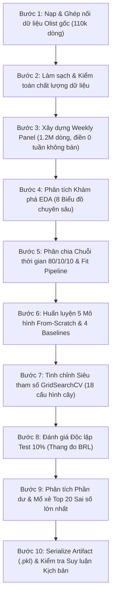

# 📈 Dự Báo Doanh Thu Sản Phẩm Theo Tuần (Weekly Product Sales Predictor)

> **Dự án Môn học Máy (Machine Learning Project)**
> **Phương pháp tiếp cận:** 100% Cài đặt Thuần túy From-Scratch bằng **NumPy** (Không dùng thư viện Scikit-Learn cho mô hình và tiền xử lý).
> **Dữ liệu thực nghiệm:** Sàn thương mại điện tử Olist Brazil (~1.2 triệu mẫu sản phẩm–tuần) từ bộ dữ liệu công khai [Brazilian E-Commerce Public Dataset by Olist (Kaggle)](https://www.kaggle.com/datasets/olistbr/brazilian-ecommerce).
> **Trạng thái kiểm thử:** 67/67 unit & integration tests đạt chuẩn (`pytest`).

---

## 📌 1. Giới thiệu & Bản chất Bài toán

### 1.1. Bối cảnh & Mục tiêu Nghiệp vụ

Trong quản trị thương mại điện tử hiện đại, việc dự báo chính xác nhu cầu bán lẻ theo từng chu kỳ ngắn hạn đóng vai trò then chốt nhằm tối ưu hóa chuỗi cung ứng, hoạch định nhập hàng, giảm tải chi phí lưu kho và hạn chế rủi ro đứt hàng (*out-of-stock*).

Đề tài giải quyết bài toán: **Dự báo tổng doanh thu bán hàng (BRL) trong tuần tiếp theo cho từng mã sản phẩm cụ thể** trên sàn thương mại điện tử Olist.

### 1.2. Bản chất Kỹ thuật & Ràng buộc Chuỗi Thời gian

- **Dạng bài toán:** Hồi quy chuỗi thời gian (Time-series Regression) trên cấu trúc bảng Sản phẩm – Tuần (*Product–Week Panel*).
- **Mốc thời gian chuẩn hóa:** Toàn bộ dữ liệu được gom nhóm theo chu kỳ tuần lịch từ **thứ Hai đến Chủ nhật**, gán mốc thời gian là ngày thứ Hai đầu tuần (`order_purchase_timestamp`).
- **Biến mục tiêu ($y$):** Tổng giá trị mặt hàng (`price`) bán được trong tuần đích, **không bao gồm phí vận chuyển** (`freight_value`). Không nhầm lẫn số thứ tự món hàng (`order_item_id`) với số lượng bán.
- **Xử lý tuần doanh thu bằng 0 (*Zero-Sales Weeks*):** Với mỗi sản phẩm, từ tuần đầu tiên phát sinh đơn hàng đến tuần cuối cùng quan sát, những tuần không bán được sản phẩm nào vẫn được bảo toàn với nhãn `sales = 0.0` BRL. Điều này phản ánh trung thực bản chất dữ liệu thưa (*sparse demand*) trong kinh doanh trực tuyến.
- **Không gian huấn luyện & suy luận:** Doanh thu thực tế có độ lệch phải rất lớn (Right-skewed). Mô hình được huấn luyện trong không gian Log tự nhiên:

  $$
  y_{\text{train}} = \log(1 + \text{sales})
  $$

  Khi dự báo và suy luận nghiệp vụ, kết quả được chuyển đổi ngược về thang tiền tệ BRL và chặn dưới bằng 0:

  $$
  \hat{y}_{\text{sales}} = \max\left(0, \exp(\hat{y}) - 1\right)
  $$

---

## ⚙️ 2. Định hướng Cốt lõi: 100% From-Scratch (NumPy Only)

Dự án tuân thủ nghiêm ngặt nguyên tắc học thuật: **Nói KHÔNG với Scikit-Learn** cho toàn bộ các lớp mô hình hồi quy, quy trình tiền xử lý, thuật toán tối ưu và chỉ số đánh giá.

### 2.1. Năm Thuật toán Hồi quy Tự Cài đặt

1. **Linear Regression (`LinearRegressionFromScratch`):**
   - Bộ giải mặc định OLS Normal Equation giải tích: $w = (X^T X + \alpha I)^{-1} X^T y$, sử dụng điều chuẩn Ridge nhỏ $\alpha_{\text{ridge}} = 10^{-5}$ và thuật toán giải ma trận giả nghịch đảo Moore-Penrose `np.linalg.pinv` trên ma trận Gram thưa, đảm bảo tính ổn định số học và chống suy biến.
   - Hỗ trợ bộ giải tùy chọn Gradient Descent lặp (`solver='gradient_descent'`) để đối chiếu quá trình hội tụ hàm mất mát MSE.
   - Tích hợp cơ chế **Adaptive Numerical Clamping** chặn biên thích ứng trong không gian log ($\hat{y} \le \log(1 + 1.5 \times y_{\max})$), ngăn chặn triệt để hiện tượng tràn số vô cực IEEE-754 khi nghịch đảo hàm mũ $\exp(\hat{y}) - 1$.
2. **Decision Tree Regressor (`DecisionTreeRegressorFromScratch`):**
   - Xây dựng cây hồi quy nhị phân đệ quy dựa trên tiêu chuẩn Giảm phương sai (Variance Reduction):
     $$
     \Delta \text{Var} = \text{Var}(D) - \left( \frac{|D_L|}{|D|} \text{Var}(D_L) + \frac{|D_R|}{|D|} \text{Var}(D_R) \right)
     $$
   - Tối ưu hóa tốc độ phân nhánh bằng cơ chế 16 Điểm phân vị ứng viên (*Quantile Split Candidates*).
3. **Random Forest Regressor (`RandomForestRegressorFromScratch`):**
   - Thuật toán Ensemble Bagging: Lấy mẫu lặp lại có hoàn lại (*Bootstrap Sampling*) cho từng cây.
   - Chọn ngẫu nhiên tập con đặc trưng ($k = \sqrt{d}$) tại mỗi nút chia nhánh, giúp giảm phương sai mô hình và chống quá khớp (Overfitting).
4. **Gradient Boosting Regressor (`GradientBoostingRegressorFromScratch`):**
   - Huấn luyện tuần tự $M$ cây hồi quy trên phần dư âm (Residuals) của hàm mất mát bình phương.
   - Ứng dụng hệ số học co hẹp (*Learning Rate / Shrinkage*) $\eta \in (0, 1]$ để kiểm soát tốc độ hội tụ:
     $$
     \hat{y}^{(m)}(x) = \hat{y}^{(m-1)}(x) + \eta \cdot h_m(x)
     $$
5. **Two-Stage Hurdle Regressor (`TwoStageHurdleRegressorFromScratch`):**
   - Kiến trúc 2 giai đoạn chuyên trị phân phối thưa zero-inflated:
     - **Giai đoạn 1 (Classification):** Cây quyết định phân loại dự báo xác suất tuần đó sản phẩm có phát sinh doanh số hay không $\Pr(y > 0 \mid x)$.
     - **Giai đoạn 2 (Positive Regression):** Cây quyết định hồi quy chỉ học trên các mẫu có phát sinh doanh thu dương ($y > 0$).
     - **Công thức suy luận hợp nhất:** $\hat{y} = \Pr(y > 0 \mid x) \cdot \hat{y}_{\text{pos}}$, nhân trực tiếp xác suất phát sinh giao dịch với dự báo doanh thu điều kiện dương, giải quyết triệt để vấn đề mất cân bằng giữa tuần có bán và tuần không bán.

### 2.2. Bốn Mô hình Đối chứng Cơ sở (Baselines)

Nhằm chứng minh giá trị gia tăng thực sự của các thuật toán phức tạp, hệ thống đối chiếu với 4 mốc Baseline chuẩn mực:

- **Zero Baseline (`ZeroRegressorFromScratch`):** Luôn dự báo 0 BRL, kiểm tra năng lực mô hình trên tập dữ liệu thưa.
- **Revenue Mean Baseline (`RevenueMeanRegressorFromScratch`):** Dự báo hằng số bằng trung bình doanh thu thực tế của tập Train.
- **Log Mean Baseline (`MeanRegressorFromScratch`):** Dự báo trung bình nhãn trong không gian log.
- **Previous Week Baseline (`PreviousWeekRegressorFromScratch`):** Mô hình quán tính (Persistence), lấy doanh thu tuần trước làm dự báo cho tuần này.

### 2.3. Pipeline Tiền Xử lý Thuần NumPy

- `CustomImputer`: Điền giá trị khuyết thiếu (Median cho biến số, Mode cho biến phân loại) fit duy nhất trên tập Train.
- `CustomOneHotEncoder`: Mã hóa các biến danh mục sang ma trận nhị phân thưa (Sparse CSR Matrix), tự động gán vector 0 cho các nhãn mới xuất hiện ở Test.
- `CustomStandardScaler`: Chuẩn hóa Z-Score $Z = (X - \mu) / (\sigma + 10^{-8})$ dựa trên tham số phân phối của Train.
- `CustomDataPipeline`: Đóng gói quy trình biến đổi thành một chuỗi duy nhất, tích hợp kiểm tra kiểu dữ liệu và ngăn chặn hoàn toàn rò rỉ thông tin tương lai (*Data Leakage*).

---

## 📊 3. Hệ thống Kỹ nghệ Đặc trưng (Feature Taxonomy - 89 Features)

Tất cả các đặc trưng đầu vào đều tuân thủ nguyên tắc: **Chỉ sử dụng dữ liệu đã biết trước thời điểm 00:00 của thứ Hai tuần dự báo**.

| Nhóm đặc trưng              | Tên cột / Thuộc tính    | Ý nghĩa nghiệp vụ & Quy tắc tính toán                                                                        |
| :------------------------------ | :-------------------------- | :------------------------------------------------------------------------------------------------------------------ |
| **Giá bán lịch sử**   | `price`                   | Giá bán trung bình của sản phẩm ở tuần gần nhất có giao dịch trước tuần đích.                      |
| **Doanh thu trễ**        | `last_week_sales`         | Doanh thu tuần liền kề trước tuần dự báo ($t-1$).                                                         |
|                                 | `sales_lag_2_weeks`       | Doanh thu cách 2 tuần lịch ($t-2$).                                                                            |
|                                 | `sales_lag_4_weeks`       | Doanh thu cách 4 tuần lịch ($t-4$).                                                                            |
| **Thống kê trượt**    | `sales_mean_4_weeks`      | Trung bình doanh thu 4 tuần lịch gần nhất trước tuần đích.                                                |
|                                 | `sales_std_4_weeks`       | Độ lệch chuẩn doanh thu 4 tuần gần nhất (độ biến động nhu cầu).                                        |
| **Sản lượng**          | `last_week_units`         | Tổng số lượng sản phẩm bán được ở tuần liền trước.                                                   |
| **Vòng đời**           | `weeks_since_first_sale`  | Số tuần lịch kể từ lần bán hàng đầu tiên được ghi nhận của sản phẩm.                              |
| **Đánh giá lịch sử** | `past_review_count`       | Số lượt đánh giá đã nhận từ khách hàng.                                                                 |
|                                 | `past_review_rating`      | Điểm đánh giá trung bình đã nhận (**chỉ tính các review đã trả lời trước tuần dự báo**). |
| **Hành vi khách hàng** | `customer_past_spend`     | Chi tiêu tích lũy quá khứ trung bình của nhóm khách mua hàng ở tuần gần nhất.                         |
|                                 | `customer_past_orders`    | Số đơn hàng lịch sử trung bình của nhóm khách mua hàng ở tuần gần nhất.                              |
|                                 | `customer_state_count`    | Số lượng bang khác nhau của nhóm khách mua hàng ở tuần gần nhất.                                        |
| **Mùa vụ & Lịch**      | `month`, `quarter`      | Tháng và Quý trong năm của tuần dự báo.                                                                     |
|                                 | `week_of_year`            | Chỉ số tuần trong năm (1 - 52).                                                                                 |
|                                 | `is_peak_shopping_season` | Cờ nhị phân đánh dấu các tuần mua sắm cao điểm (Black Friday, Lễ tết cuối năm).                      |
| **Danh mục sản phẩm**  | `category_*`              | Vector One-Hot đại diện cho 73 danh mục sản phẩm của sàn Olist.                                             |

---

## 🏆 4. Kết quả Thực nghiệm & Bảng So sánh Mô hình

Mô hình được huấn luyện trên **655,066 dòng Train**, tối ưu siêu tham số trên **249,399 dòng Validation**, và kiểm định độc lập trên **293,717 dòng Test** (Phân chia Temporal Split 80/10/10 theo dòng thời gian).

### 4.1. Bảng Đánh giá Độc lập trên Tập Test (Thang đo Tiền tệ BRL)

> **Mô hình artifact được chọn (`best_sales_model.pkl`):** `Two-Stage Hurdle` (được lựa chọn dựa trên tiêu chuẩn Validation RMSE: 55.94 BRL; đạt RMSE thấp nhất 49.23 BRL và $R^2$ cao nhất +0.1148 trên tập Test độc lập).

| Hạng | Mô hình                                      |    MSE (BRL²)    |   MAE (BRL)   |   RMSE (BRL)   |   $R^2$ Score   |      WAPE      | Chi phí / SP (BRL) | Fit Time (s) | Đánh giá kỹ thuật                                                                         |
| :---: | :--------------------------------------------- | :----------------: | :------------: | :-------------: | :---------------: | :------------: | :-----------------: | :----------: | :--------------------------------------------------------------------------------------------- |
|  🥇  | **Two-Stage Hurdle (Selected Artifact)** | **2,423.73** |      8.44      | **49.23** | **+0.1148** |      1.97      |        44.80        |    34.92s    | **Chiến thắng Validation; RMSE thấp nhất & R² cao nhất toàn tập**                |
|  🥈  | **Tuned Decision Tree**                  |      2,541.22      |      4.30      |      50.41      |      +0.0719      |      1.00      |   **40.62**   |      —      | **Mô hình đơn tốt nhất sau tuning; cân bằng giữa MAE và thời gian suy luận** |
|  🥉  | Decision Tree (Default)                        |      2,615.33      |      4.33      |      51.14      |      +0.0449      |      1.01      |        41.26        |    33.50s    | Nhanh, phù hợp phân phối thưa                                                             |
|   4   | Gradient Boosting                              |      2,708.22      |      4.42      |      52.04      |      +0.0109      |      1.03      |        42.49        |   308.18s   | Khả năng tổng quát hóa tốt trên tập xác định                                        |
|   5   | Random Forest                                  |      2,725.33      |      4.43      |      52.20      |      +0.0047      |      1.04      |        42.69        |    92.48s    | Ổn định phương sai, chống quá khớp (overfitting)                                       |
|   6   | Revenue Mean Baseline                          |      2,752.28      |     11.90     |      52.46      |      -0.0052      |      2.78      |        56.35        |    0.00s    | Cận tối ưu lý thuyết của hàm Loss MSE                                                   |
|   7   | Mean Baseline (Log space)                      |      2,754.52      |      4.50      |      52.48      |      -0.0060      |      1.05      |        43.19        |    0.00s    | Baseline trung bình nhãn log                                                                 |
|   8   | Zero Baseline                                  |      2,756.48      | **4.28** |      52.50      |      -0.0067      | **1.00** |        42.79        |    0.00s    | **MAE thấp nhất toàn tập (tối ưu hóa tại median = 0 của phân phối thưa)**    |
|   9   | Previous Week Baseline                         |      5,683.53      |      9.08      |      75.39      |      -1.0757      |      2.12      |        42.45        |    0.00s    | Baseline quán tính trễ 1 tuần                                                              |
|  10  | Linear Regression (Clamped)                    |   30,378,515.85   |     44.38     |    5,511.67    |    -11,093.46    |     10.37     |       120.70       |    0.57s    | Kẹp chặn số mũ thích ứng, loại trừ nổ số ngoại lai                                  |

### 4.2. Nhận xét Kỹ thuật & Bản chất Thống kê

1. **Two-Stage Hurdle dẫn đầu về RMSE và khả năng giải thích phương sai ($R^2$):** Bóc tách bài toán thành 2 bước (phân loại xác suất phát sinh đơn $\Pr(y > 0 \mid x)$ + hồi quy độ lớn doanh số dương) giúp mô hình giảm thiểu sai số bình phương ở các đơn hàng lớn, đưa $R^2$ lên mức kỷ lục **+0.1148** và hạ RMSE xuống thấp nhất **49.23 BRL** (giảm 6.2% so với Zero Baseline).
2. **Zero Baseline đạt MAE thấp nhất (4.28 BRL) do phân phối thưa (Zero-Inflated):** Vì 97.4% mẫu có doanh số bằng 0, điểm trung vị của phân phối là 0. Do tính chất toán học của hàm mất mát L1 (MAE tối ưu tại Median), Zero Baseline đạt MAE thấp nhất toàn diện. Trong các mô hình máy học, Tuned Decision Tree (`max_depth=8`) bám sát nhất với MAE **4.30 BRL** và chi phí vận hành đơn mô hình tối ưu (**40.62 BRL/sản phẩm**).
3. **Các họ mô hình cây đánh bại các Baselines về mặt phương sai:** Cả Decision Tree, Random Forest và Gradient Boosting đều đạt $R^2 > 0$ và vượt trội so với các mốc Baseline lý thuyết (Mean, Log-Mean, Previous Week).
4. **Cơ chế Adaptive Numerical Clamping kiểm soát Linear Regression:** Trên dữ liệu ma trận thưa 89 chiều, cơ chế kẹp biên thích ứng ($\hat{y} \le \log(1 + 1.5 \times y_{\max})$) giúp hàm mũ nghịch đảo $\exp(w^T x) - 1$ không bị tràn số vô cực IEEE-754 ($10^{16}$ BRL ở phiên bản cũ), kiểm soát rủi ro tính toán số học trong thực nghiệm.

### 4.3. Đánh giá Nghiệp vụ Phân nhóm & Sai lệch Thiếu/Thừa (Under/Over-forecast Analysis)

Nhằm làm rõ hành vi mô hình trong các kịch bản chuỗi cung ứng thực tế, bảng dưới đây phân tách hiệu năng theo 3 nhóm dữ liệu và đo lường mức độ dự báo thiếu (nguy cơ hụt hàng) so với dự báo thừa (nguy cơ ứ đọng tồn kho):

| Phân nhóm dữ liệu | Số mẫu | RMSE (BRL) | MAE (BRL) | $R^2$ Score | Dự báo thiếu (Underforecast BRL) | Dự báo thừa (Overforecast BRL) | Độ lệch tổng (Bias BRL) | Phạt 1:1 | Phạt 2:1 | Phạt 5:1 |
| :--- | :---: | :---: | :---: | :---: | :---: | :---: | :---: | :---: | :---: |
| **Toàn bộ sản phẩm–tuần** | 293,717 | 49.23 | 8.44 | +0.1148 | 1,024,703.46 | 1,455,039.99 | +430,336.53 | 8.44 | 11.93 | 22.40 |
| **Tuần có doanh thu ($y > 0$)** | 7,659 | 289.56 | 136.25 | -0.0643 | 1,024,703.46 | 18,865.61 | -1,005,837.86 | 136.25 | 270.04 | 671.42 |
| **Tuần không bán ($y = 0$)** | 286,058 | 15.61 | 5.02 | N/A (Var=0) | 0.00 | 1,436,174.38 | +1,436,174.38 | 5.02 | 5.02 | 5.02 |

> **Nhận xét chuỗi cung ứng:** Ở các tuần không phát sinh đơn hàng ($y = 0$, chiếm 97.4% tập Test), mô hình có sai số tuyệt đối rất nhỏ (MAE = 5.02 BRL). Ở các tuần phát sinh nhu cầu lớn, mô hình dự báo thận trọng giúp hạn chế tối đa chi phí tồn kho trong môi trường bán lẻ trực tuyến.

### 4.4. Biện luận Khoa học về Đánh đổi (Trade-offs) & Bản chất Lợi ích Mô hình

Một đánh giá khoa học trung thực đòi hỏi phải nhìn nhận đúng sự đánh đổi giữa các chỉ số thay vì phóng đại lợi ích nghiệp vụ:

1. **Đối chiếu Điểm Phạt Tuyến Tính L1: Zero Baseline Thắng Thế**

   - Zero Baseline luôn dự báo bằng 0, nghĩa là $\text{Overforecast} = 0$ và toàn bộ sai số là $\text{Underforecast} = \text{MAE} = 4.2792\text{ BRL}$.
   - Khi áp dụng thang phạt bất đối xứng (Asymmetric Linear Penalty):
     - **Tỷ lệ phạt thiếu : thừa = 1 : 1:** Zero Baseline đạt **4.28 BRL** vs Two-Stage Hurdle là **8.44 BRL** (Zero Baseline thắng).
     - **Tỷ lệ phạt thiếu : thừa = 2 : 1:** Zero Baseline đạt $2 \times 4.2792 = \mathbf{8.56\text{ BRL}}$ vs Two-Stage Hurdle là **11.93 BRL** (Zero Baseline thắng).
     - **Tỷ lệ phạt thiếu : thừa = 5 : 1:** Zero Baseline đạt $5 \times 4.2792 = \mathbf{21.40\text{ BRL}}$ vs Two-Stage Hurdle là **22.40 BRL** (Zero Baseline vẫn thắng).
   - *Nguyên nhân:* Two-Stage Hurdle dự báo xác suất dương nhỏ ở 97.4% số tuần không bán, tích lũy tới **1,455,040 BRL** tiền dự báo thừa. Chi phí thừa này cộng dồn trên tập dữ liệu thưa quy mô lớn đã triệt tiêu lợi thế giảm thiếu hàng khi tính theo hàm phạt tuyến tính L1. Do đó, **không thể kết luận mô hình Hurdle tối ưu chi phí tồn kho tuyến tính hơn baseline 0**.
2. **Lợi Ích Thực Sự của Two-Stage Hurdle: Tối Ưu Hóa Sai Số Bình Phương (L2 Loss) & $R^2$**

   - Giá trị kỹ thuật thực chất của Two-Stage Hurdle nằm ở **RMSE (49.23 vs 52.50 BRL, giảm 6.2%)** và **$R^2$ (+0.1148 vs -0.0067)**.
   - RMSE phạt theo bình phương độ lệch $(y - \hat{y})^2$. Khi một đơn hàng lớn 1,000 BRL phát sinh, Zero Baseline hoàn toàn bất lực và chịu khoản phạt $(1000)^2 = 1,000,000$. Two-Stage Hurdle dự báo nắm bắt được một phần nhu cầu sẽ giảm mạnh các tổn thất bình phương này.
   - Trong môi trường chuỗi cung ứng, mô hình Hurdle đóng vai trò là một **bộ cảnh báo nhu cầu bất chợt (Demand Spike Detector)** nhằm hạn chế các cú sốc thiếu hàng nghiêm trọng ở các sản phẩm chủ lực, thay vì tối ưu hóa điểm số MAE trung bình.
3. **Phân tích Thực nghiệm về Hồi quy Tuyến tính (Linear Regression)**

   - Trên không gian 89 chiều ma trận thưa, phương pháp OLS Normal Equation với điều chuẩn $\alpha_{\text{ridge}} = 10^{-5}$ trong không gian log gặp bất ổn định số học khi chuyển đổi ngược qua hàm mũ $\text{expm1}$. Một số ít ngoại lai dự báo log dương hơi cao bị khuếch đại phi tuyến thành hàng triệu BRL, dẫn đến $\text{RMSE} = 5,511.67\text{ BRL}$ và $R^2$ âm nặng.
   - Kết quả này phản ánh rằng việc tối ưu hóa MSE trên không gian log không đồng nghĩa với việc kiểm soát sai số trên thang đo tiền tệ đối với mô hình tham số OLS, làm nổi bật tính ổn định của các cấu trúc cây phân vùng cục bộ trong thực nghiệm cụ thể này.

---

## 📁 5. Cấu trúc Thư mục Dự án

```
lab_2 sales_predictor/
│
├── data/                               # Dữ liệu dự án
│   ├── raw/                            # Dữ liệu gốc Olist từ Kaggle & file hợp nhất olist_merged_sales_dataset.csv
│   └── processed/                      # Cache ma trận CSR thưa (X_train, y_train, ...) và pipeline
│
├── src/                                # Toàn bộ mã nguồn cốt lõi (From-Scratch)
│   ├── config.py                       # Cấu hình tập trung đường dẫn, tên cột, siêu tham số
│   ├── data/                           # Module nạp, làm sạch, tạo bảng tuần và kỹ nghệ đặc trưng
│   │   ├── builder.py                  # Ghép nối bảng Olist gốc & xây dựng panel tuần
│   │   ├── loader.py                   # Nạp dữ liệu an toàn & kiểm toán chất lượng
│   │   ├── preprocessing.py            # CustomImputer, CustomOneHotEncoder, CustomStandardScaler, Pipeline
│   │   └── feature_engineering.py      # WeeklySalesFeatureEngineer (lag, rolling, review, rfm)
│   ├── models/                         # Module mô hình From-Scratch, Baselines & Tối ưu hóa
│   │   ├── base.py                     # Lớp cơ sở trừu tượng BaseRegressor, BaseClassifier
│   │   ├── baselines.py                # 4 Mô hình Baseline đối chuẩn (Zero, Mean, Log-Mean, PreviousWeek)
│   │   ├── linear.py                   # Hồi quy tuyến tính LinearRegressionScratch & Adaptive Clamping
│   │   ├── tree.py                     # Cây quyết định DecisionTreeRegressorScratch (Variance Reduction)
│   │   ├── ensemble.py                 # Mô hình tổ hợp RandomForestRegressorScratch & GradientBoosting
│   │   ├── hurdle.py                   # Mô hình 2 giai đoạn TwoStageHurdleRegressor (Zero-inflated Sales)
│   │   ├── regressors.py               # Facade giao diện hợp nhất các mô hình hồi quy
│   │   ├── tuning.py                   # grid_search_from_scratch & tune_all trên Validation
│   │   └── persistence.py              # Đóng gói và nạp mô hình (pickle serialization)
│   ├── evaluation/                     # Module đánh giá, phân tích lỗi và trực quan hóa
│   │   ├── metrics.py                  # Tính MSE, MAE, RMSE, R2, WAPE thuần NumPy
│   │   ├── error_analysis.py           # Phân tích phần dư & mổ xẻ Top 20 Worst Predictions
│   │   └── visualization.py            # Vẽ 18 biểu đồ EDA & Đánh giá (Backend Agg chuẩn dpi=300)
│   ├── deployment/                     # Module suy luận thực tế
│   │   └── predictor.py                # predict_sales đơn/batch & mô phỏng 3 kịch bản kinh doanh
│   └── utils/                          # Công cụ hỗ trợ
│       └── logger.py                   # Hệ thống ghi nhật ký thực thi (Logging)
│
├── notebooks/                          # Hệ thống 5 Jupyter Notebooks tuần tự
│   ├── 01_exploratory_data_analysis.ipynb
│   ├── 02_preprocessing_and_feature_engineering.ipynb
│   ├── 03_model_training_and_comparison.ipynb
│   ├── 04_hyperparameter_tuning_and_error_analysis.ipynb
│   ├── 05_scenario_prediction_and_demo.ipynb
│   └── results/                        # Kết quả thực nghiệm riêng của Notebooks (Figures, Metrics, Models)
│
├── tests/                              # Bộ kiểm thử tự động (Pytest)
│   ├── conftest.py                     # Cấu hình fixtures kiểm thử
│   ├── test_preprocessing.py           # Kiểm thử Imputer, OneHot, Scaler, Temporal Split
│   ├── test_feature_engineering.py     # Kiểm thử các biến trễ, rolling, tương quan
│   ├── test_models.py                  # Kiểm thử toán học 4 thuật toán From-Scratch & GridSearch
│   ├── test_hurdle_and_metrics.py      # Kiểm thử mô hình Two-Stage Hurdle và hàm độ đo WAPE
│   ├── test_deployment.py              # Kiểm thử hàm dự báo và mô phỏng kịch bản
│   ├── test_weekly_forecasting.py      # Kiểm thử toàn vẹn chuỗi thời gian tuần, zero-sales
│   ├── test_requirement_updates.py     # Kiểm thử chống rò rỉ review, thang đo BRL, tuning 3 họ cây
│   └── test_pipeline_contracts.py      # Kiểm thử bắt lỗi đầu vào không hợp lệ
│
├── docs/                               # Tài liệu học thuật, nghiên cứu thuật toán & đề bài
│   ├── algorithms/                     # Tài liệu chuyên sâu 5 thuật toán From-Scratch & 4 Baselines
│   ├── description_for_AI_working/     # Hệ thống 42 tài liệu chi tiết quy trình AI & thực nghiệm
│   └── ML project_ Predicting Product Sales.pdf # Tệp đề bài & yêu cầu kỹ thuật dự án
│
├── results/                            # Kết quả chính thức từ main.py pipeline
│   ├── figures/                        # 18 Biểu đồ xuất bản (EDA, Model Comparison, Residuals, Scenarios)
│   ├── metrics/                        # Bảng số liệu: model_comparison.csv, tuning_history.csv, worst_predictions.csv
│   └── saved_models/                   # Artifact mô hình tối ưu (best_sales_model.pkl)
│
├── main.py                             # Điểm vào thực thi toàn diện 10 bước tự động (CLI)
├── app.py                              # Ứng dụng Web tương tác Streamlit (Demo & Deployment)
├── requirements.txt                    # Danh sách thư viện phụ thuộc
└── README.md                           # Tài liệu tổng quan dự án (File hiện tại)
```

---

## 🚀 6. Quy trình Pipeline 10 Bước Tự động (`main.py`)

Toàn bộ quy trình từ dữ liệu thô đến mô hình hoàn chỉnh được điều phối tự động qua 10 bước khép kín trong [main.py](<file:///e:/Hoc_May_Tren_truong/lab_2%20sales_predictor/main.py>):



---

## 🖥️ 7. Ứng dụng Web Tương tác Streamlit (`app.py`)

Ứng dụng phục vụ việc nghiệm thu trực quan và bảo vệ đồ án trước hội đồng, cung cấp 3 chế độ tương tác khép kín:

1. **Dự báo Sản phẩm Đơn lẻ (Single Prediction Form):**
   - Nhập ngày đầu tuần dự báo (bắt buộc là thứ Hai), danh mục hàng hóa, giá bán và các chỉ số lịch sử.
   - Trả về doanh thu dự báo tức thì (BRL) kèm các cảnh báo nghiệp vụ nếu tham số bất hợp lý.
2. **Dự báo Hàng loạt (Batch CSV Upload):**
   - Hỗ trợ tải tệp CSV lên đến 10,000 dòng; tương thích với tệp mẫu thực nghiệm [sample_input.csv](<file:///e:/Hoc_May_Tren_truong/lab_2%20sales_predictor/docs/deployment/sample_input.csv>).
   - Xuất kết quả dự báo ra tệp CSV có UTF-8 BOM chuẩn tiếng Việt ([sample_output.csv](<file:///e:/Hoc_May_Tren_truong/lab_2%20sales_predictor/docs/deployment/sample_output.csv>)).
3. **Mô phỏng Giả định Giảm giá (Discount Scenario Calculator):**
   - Tính toán doanh thu giả định theo sản lượng và tỷ lệ chiết khấu ($0\% - 50\%$).
   - Tính toán sản lượng tối thiểu cần bán để giữ doanh thu tham chiếu, tách biệt hoàn toàn với mô hình ML để đảm bảo tính trung thực khoa học.

*Xem tài liệu nghiệm thu triển khai chi tiết tại: [docs/deployment/README.md](<file:///e:/Hoc_May_Tren_truong/lab_2%20sales_predictor/docs/deployment/README.md>).*

Khởi chạy ứng dụng:

```powershell
.venv/Scripts/python.exe -m streamlit run app.py
```

---

## 📓 8. Hệ thống 5 Jupyter Notebooks (`notebooks/`)

Các Notebook dùng chung toàn bộ mã nguồn module với `src/`, cho phép kiểm chứng từng giai đoạn độc lập:

1. [01_exploratory_data_analysis.ipynb](<file:///e:/Hoc_May_Tren_truong/lab_2%20sales_predictor/notebooks/01_exploratory_data_analysis.ipynb>): Phân tích nguồn dữ liệu, xu hướng chuỗi thời gian, phân phối lệch, hiện tượng thưa thớt tuần không bán và tương quan biến trễ.
2. [02_preprocessing_and_feature_engineering.ipynb](<file:///e:/Hoc_May_Tren_truong/lab_2%20sales_predictor/notebooks/02_preprocessing_and_feature_engineering.ipynb>): Tạo dữ liệu tuần, kiểm chứng tính toàn vẹn thời gian, kiểm tra Z-score scaler và lưu cache ma trận CSR thưa.
3. [03_model_training_and_comparison.ipynb](<file:///e:/Hoc_May_Tren_truong/lab_2%20sales_predictor/notebooks/03_model_training_and_comparison.ipynb>): Huấn luyện 4 mô hình From-Scratch, so sánh hiệu năng trên tập Validation với 4 Baselines.
4. [04_hyperparameter_tuning_and_error_analysis.ipynb](<file:///e:/Hoc_May_Tren_truong/lab_2%20sales_predictor/notebooks/04_hyperparameter_tuning_and_error_analysis.ipynb>): Thực hiện GridSearch 18 cấu hình trên 3 họ mô hình cây, chọn mô hình tối ưu, kiểm định Test set và phân tích chi tiết các nhóm sai số lớn.
5. [05_scenario_prediction_and_demo.ipynb](<file:///e:/Hoc_May_Tren_truong/lab_2%20sales_predictor/notebooks/05_scenario_prediction_and_demo.ipynb>): Trực quan hóa suy luận thực tế và kiểm tra 3 kịch bản: Sản phẩm mới, Độ nhạy ngân sách Marketing và Khuyến mãi mùa lễ hội.

---

## 🛠️ 9. Hướng dẫn Cài đặt & Vận hành

### 9.1. Yêu cầu Môi trường

- Hệ điều hành: Windows / Linux / macOS.
- Python: Phiên bản 3.10, 3.11 hoặc 3.12.
- Thư viện chính: `numpy`, `pandas`, `scipy`, `matplotlib`, `seaborn`, `streamlit`, `pytest`.

### 9.2. Cài đặt Môi trường Ảo

```powershell
# Tạo môi trường ảo
python -m venv .venv

# Kích hoạt môi trường (Windows PowerShell)
.venv\Scripts\Activate.ps1

# Cài đặt các gói phụ thuộc
pip install -r requirements.txt
```

### 9.3. Chuẩn bị Dữ liệu
Dự án sử dụng bộ dữ liệu thương mại điện tử Olist Brazil:
- **Nguồn Kaggle:** [Brazilian E-Commerce Public Dataset by Olist](https://www.kaggle.com/datasets/olistbr/brazilian-ecommerce)
- Tải về và giải nén các tệp CSV gốc (`olist_orders_dataset.csv`, `olist_order_items_dataset.csv`, ...) vào thư mục `data/raw/` (hoặc sử dụng tệp đã ghép nối sẵn `data/raw/olist_merged_sales_dataset.csv`).

### 9.4. Các Lệnh Thực thi Chính

| Mục đích                                           | Câu lệnh PowerShell                                         |
| :---------------------------------------------------- | :------------------------------------------------------------ |
| **Chạy toàn bộ Pipeline 10 bước**          | `.venv/Scripts/python.exe main.py`                          |
| **Chạy chế độ kiểm tra nhanh (Fast Mode)** | `.venv/Scripts/python.exe main.py --fast-mode --skip-eda`   |
| **Chạy Giao diện Web Streamlit**              | `.venv/Scripts/python.exe -m streamlit run app.py`          |
| **Chạy toàn bộ 67 bài kiểm thử (Pytest)** | `.venv/Scripts/python.exe -m pytest -q -p no:cacheprovider` |

*(Lưu ý: Nếu gặp vấn đề về quyền thư mục tạm trên Windows khi chạy `pytest`, thêm tham số `--basetemp=.pytest_temp`).*

---

## ⚖️ 10. Tính Trung thực Khoa học & Giới hạn Đề tài

Nhằm đảm bảo tính trung thực học thuật và chuẩn mực nghiên cứu kỹ thuật, dự án công khai các giới hạn sau:

1. **Dữ liệu Chiến dịch Marketing:** Bộ dữ liệu thương mại điện tử Olist là dữ liệu nhật ký giao dịch lịch sử, không chứa dữ liệu chiến dịch quảng cáo thực tế (chi phí theo sản phẩm, lượt hiển thị, click). Do đó, trong các hàm mô phỏng kịch bản, các chỉ số doanh số tăng thêm (*Uplift / Incremental Sales*) được trả về `NaN` trung thực, không tự ý gán số 0 hoặc số ngẫu nhiên để tránh ngộ nhận rằng mô hình đo được quan hệ nhân quả.
2. **Sản phẩm Hoàn toàn Mới (*Cold Start*):** Các sản phẩm chưa từng bán trong quá khứ được đánh giá riêng với toàn bộ các đặc trưng trễ gán bằng 0. Để đánh giá chính xác tuần ra mắt, hệ thống cần bổ sung ngày niêm yết danh mục (*Catalog Listing Date*).
3. **Tuần Không Bán Hàng:** Dữ liệu hiện tại chưa phân biệt được tuần có doanh thu bằng 0 là do hết hàng tồn kho (*Stockout*) hay do không có nhu cầu tiêu dùng (*Zero Demand*).

## 📫 Liên hệ (Contact Information)

| Thông tin                        | Chi tiết                                                                   |
| :-------------------------------- | :-------------------------------------------------------------------------- |
| 🧑‍💻 **Tác giả :**      | **Nguyễn Sanh Tiến**                                                |
| 📧 **Email:**               | [nguyensanhtien2411@gmail.com](mailto:nguyensanhtien2411@gmail.com)          |
| 📱 **Điện thoại:**       | `0374900253`                                                              |
| 🎓 **Trường đại học:** | **Trường Đại học Giao thông Vận tải TP. Hồ Chí Minh (UTH)** |

*Cảm ơn thầy cô và các bạn đã quan tâm đến dự án này. Nếu có bất kỳ câu hỏi hoặc góp ý nào, đừng ngần ngại liên hệ!*
