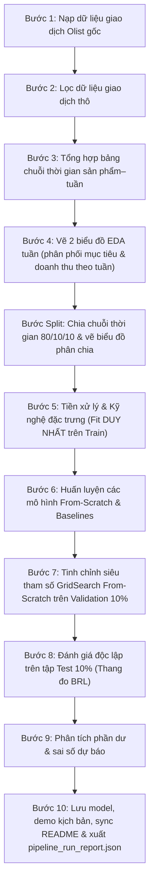

# 📈 Dự Báo Doanh Thu Sản Phẩm Theo Tuần (Weekly Product Sales Predictor)

> **Bài Lab Môn Học Máy (Machine Learning Lab Project)**
> **Phương pháp tiếp cận:** Cài đặt thuật toán từ đầu (From-Scratch) bằng **NumPy**, không sử dụng thư viện Scikit-Learn cho phần thuật toán mô hình và các bước tiền xử lý.
> **Tập dữ liệu:** Dữ liệu thương mại điện tử Olist Brazil (1.198.182 dòng sản phẩm–tuần từ 31.835 sản phẩm qua 98 tuần) từ bộ dữ liệu công khai [Brazilian E-Commerce Public Dataset by Olist (Kaggle)](https://www.kaggle.com/datasets/olistbr/brazilian-ecommerce).
> **Trạng thái kiểm thử:** 100 passed, 8 subtests passed qua 12 tệp kiểm thử (11/11/2026).

---

## 📌 1. Giới thiệu Bài toán

### 1.1. Bối cảnh & Mục tiêu Bài lab

Trong bài lab này, mục tiêu là xây dựng mô hình học máy để giải quyết bài toán: **Dự báo tổng doanh thu bán hàng (BRL) trong tuần tiếp theo cho từng sản phẩm** trên sàn thương mại điện tử Olist.

### 1.2. Dữ liệu & Ràng buộc Chuỗi Thời gian

- **Dạng bài toán:** Hồi quy chuỗi thời gian (Time-series Regression) trên bảng dữ liệu Sản phẩm – Tuần (*Product–Week Panel*).
- **Chu kỳ tuần:** Dữ liệu được tổng hợp theo tuần lịch từ **thứ Hai đến Chủ nhật**, mốc thời gian lấy ngày thứ Hai đầu tuần (`order_purchase_timestamp`).
- **Biến mục tiêu ($y$):** Tổng giá bán các món hàng (`price`) trong tuần đích, **không bao gồm phí vận chuyển** (`freight_value`). Số thứ tự món hàng (`order_item_id`) không phải là số lượng bán.
- **Xử lý tuần không phát sinh doanh số:** Với mỗi sản phẩm, từ tuần đầu tiên bán được đến tuần cuối quan sát, những tuần không bán được món nào vẫn được giữ lại với nhãn `sales = 0.0` BRL (phản ánh đặc tính thực tế của dữ liệu bán lẻ).
- **Không gian biến đổi:** Doanh thu có độ lệch lớn, nên mô hình được huấn luyện trong không gian Log:

```math
y_{\text{train}} = \log(1 + \text{sales})
```

  Khi dự báo và đánh giá, kết quả được chuyển ngược về đơn vị tiền tệ BRL và chặn dưới bằng 0:

```math
\hat{y}_{\text{sales}} = \max\left(0, \exp(\hat{y}) - 1\right)
```

---

## ⚙️ 2. Các Thuật Toán Tự Cài Đặt (From-Scratch bằng NumPy)

Bài lab yêu cầu tự cài đặt các lớp mô hình hồi quy, thuật toán tối ưu, độ đo đánh giá và pipeline tiền xử lý bằng NumPy/Pandas thuần túy, không dùng Scikit-Learn.

### 2.1. Năm Thuật toán Hồi quy

1. **Hồi quy Tuyến tính (`LinearRegressionFromScratch`):**
   - Giải phương trình OLS Normal Equation: $w = (X^T X + \alpha I)^{-1} X^T y$ với điều chuẩn Ridge nhỏ $\alpha_{\text{ridge}} = 10^{-5}$ để giữ tính ổn định số học.
   - Hỗ trợ thêm bộ giải Gradient Descent lặp (`solver='gradient_descent'`) để quan sát quá trình hội tụ.
   - Kẹp biên thích ứng trên thang log theo $[y_{\min} - 0.5\cdot\text{span}, y_{\max} + 0.5\cdot\text{span}]$ dựa trên tập Train; tuy nhiên ở lần chạy full, biên trên vẫn cho phép đạt `14.0248` ($\approx 1{,}23$ triệu BRL khi nghịch đảo `expm1`) nên vẫn còn sai lệch lớn ở các mẫu đuôi.
2. **Cây Quyết định (`DecisionTreeRegressorFromScratch`):**
   - Xây dựng cây hồi quy nhị phân đệ quy dựa trên tiêu chuẩn Giảm phương sai (Variance Reduction):

```math
\Delta \text{Var} = \text{Var}(D) - \left( \frac{|D_L|}{|D|} \text{Var}(D_L) + \frac{|D_R|}{|D|} \text{Var}(D_R) \right)
```

- Sử dụng 16 điểm phân vị ứng viên (*Quantile Split Candidates*) để giảm thời gian tìm điểm chia.

3. **Rừng Ngẫu nhiên (`RandomForestRegressorFromScratch`):**
   - Thuật toán Bagging: Lấy mẫu bootstrap cho từng cây và chọn ngẫu nhiên tập con đặc trưng ($k = \sqrt{d}$) tại mỗi nút chia nhánh để giảm quá khớp.
4. **Gradient Boosting (`GradientBoostingRegressorFromScratch`):**
   - Huấn luyện tuần tự các cây hồi quy trên phần dư âm (Residuals) với hệ số học co hẹp (*learning rate*) $\eta \in (0, 1]$:

```math
\hat{y}^{(m)}(x) = \hat{y}^{(m-1)}(x) + \eta \cdot h_m(x)
```

5. **Two-Stage Hurdle (`TwoStageHurdleRegressorFromScratch`):**
   - Mô hình 2 giai đoạn phù hợp với dữ liệu có nhiều tuần không bán được hàng:
     - **Giai đoạn 1 (Ước lượng xác suất):** Dùng `DecisionTreeRegressorFromScratch` học trên nhãn nhị phân `is_positive` (`0/1`) rồi kẹp về $[0, 1]$ để ước lượng xác suất có phát sinh giao dịch $\Pr(y > 0 \mid x)$.
     - **Giai đoạn 2 (Hồi quy):** Cây hồi quy học trên các tuần có phát sinh doanh số dương ($y > 0$).
     - **Công thức tính:** $\hat{s} = \Pr(y > 0 \mid x) \cdot \mathrm{expm1}(\hat{y}_{log,pos})$ và hàm `predict()` trả về $\log(1 + \hat{s})$ để đồng bộ thang log với các mô hình khác.

### 2.2. Các Thử nghiệm Mở rộng

1. **Thử nghiệm Sản phẩm Mới (`ColdStartProductRegressor`):**
   - Thử nghiệm ước lượng doanh thu 7 ngày đầu kể từ giao dịch đầu tiên dựa trên 5 biến số (`price`, khối lượng, số ảnh, độ dài tên và mô tả sau `log1p`) và danh mục qua Target Encoding có Laplace smoothing (`smoothing=10.0`).
   - Bắt buộc đối chiếu với baseline giá bán đơn vị (`sales = first_price`) và trung vị danh mục; loại bỏ các mẫu có nhãn vượt ranh giới thời gian.
2. **Mô phỏng Kịch bản Tiếp thị (`simulate_marketing_response`):**
   - Mô phỏng sự thay đổi của doanh số khi thay đổi ngân sách quảng cáo dựa trên hàm phản hồi logarit:

```math
\text{Uplift Factor} = 1.0 + \beta_{\text{ad}} \cdot \ln\left(1 + \frac{\text{Ad Spend}}{S_{ref}}\right)
```

- Tham số mang tính chất giả định để làm quen với mô phỏng độ nhạy, không đại diện cho dữ liệu chiến dịch thực tế.

### 2.3. Bốn Mô hình Đối chứng Cơ sở (Baselines)

Để đánh giá mô hình học máy có thực sự mang lại hiệu quả hay không, bài lab đối chiếu với 4 baseline:

- **Zero Baseline (`ZeroRegressorFromScratch`):** Luôn dự báo 0 BRL (mốc chuẩn trên dữ liệu thưa).
- **Revenue Mean Baseline (`RevenueMeanRegressorFromScratch`):** Dự báo hằng số bằng trung bình doanh thu thực tế của tập Train.
- **Mean Baseline / Log Mean (`MeanRegressorFromScratch`):** Dự báo trung bình nhãn trong không gian log (hiển thị tên `Mean Baseline` trong các bảng so sánh).
- **Previous Week Baseline (`PreviousWeekRegressorFromScratch`):** Lấy doanh thu tuần trước làm dự báo cho tuần này.

### 2.4. Pipeline Tiền Xử lý Thuần NumPy

- `CustomImputer`: Điền giá trị khuyết thiếu (Median cho biến số, Mode cho biến phân loại).
- `CustomOneHotEncoder`: Mã hóa các danh mục sang ma trận nhị phân `{0, 1}` dạng dense, gán vector `0` cho nhãn mới ở tập Test (sau đó `main.py` mới chuyển ma trận sang Sparse CSR để lưu cache).
- `CustomStandardScaler`: Chuẩn hóa Z-Score $Z = (X - \mu) / (\sigma + 10^{-8})$.
- `CustomDataPipeline`: Đóng gói quy trình tiền xử lý thành một chuỗi thống nhất.
- **Quy tắc quan trọng:** Toàn bộ pipeline tiền xử lý chỉ được `fit` trên tập Train (`train_df`). Các tập Validation và Test chỉ áp dụng `transform` dựa trên tham số đã học từ Train để tránh rò rỉ dữ liệu (Data Leakage).

---

## 📊 3. Hệ thống Đặc trưng (89 Features = 16 Biến Số + 73 Cột One-Hot)

Các đặc trưng trễ (lag), trượt (rolling) và lịch sử được tính từ các tuần trước tuần dự báo (chia `655.066` Train / `249.399` Validation / `293.717` Test dòng, tỷ lệ tuần bằng 0 toàn bảng là `96.21%`).

| Nhóm đặc trưng              | Tên thuộc tính                                 | Ý nghĩa & Quy tắc tính                                                                                                                          |
| :------------------------------ | :------------------------------------------------ | :-------------------------------------------------------------------------------------------------------------------------------------------------- |
| **Giá bán**             | `price`                                         | Giá bán trung bình tuần gần nhất có giao dịch trước tuần đích (đã `ffill` qua tuần không đơn trước khi dịch trễ).          |
| **Doanh thu trễ**        | `last_week_sales`                               | Doanh thu tuần liền kề trước tuần dự báo ($t-1$).                                                                                         |
|                                 | `sales_lag_2_weeks`, `sales_lag_4_weeks`      | Doanh thu cách 2 và 4 tuần lịch ($t-2, t-4$).                                                                                                 |
| **Thống kê trượt**    | `sales_mean_4_weeks`, `sales_std_4_weeks`     | Trung bình và độ lệch chuẩn (`ddof=0`) doanh thu 4 tuần gần nhất trước tuần đích.                                                   |
| **Sản lượng**          | `last_week_units`                               | Tổng số lượng sản phẩm bán được ở tuần liền trước.                                                                                   |
| **Vòng đời**           | `weeks_since_first_sale`                        | Số tuần kể từ lần bán hàng đầu tiên của sản phẩm.                                                                                      |
| **Đánh giá lịch sử** | `past_review_count`, `past_review_rating`     | Số lượt và điểm đánh giá trung bình có `review_answer_timestamp` trước tuần dự báo (mặc định `0.0` nếu chưa có).          |
| **Khách hàng**          | `customer_past_spend`, `customer_past_orders` | Chi tiêu và số đơn lịch sử trung bình của nhóm khách mua sản phẩm ở tuần bán gần nhất trước tuần đích (mặc định `0.0`). |
|                                 | `customer_state_count`                          | Số lượng bang khác nhau của nhóm khách mua ở tuần bán gần nhất trước tuần đích (mặc định `0.0`).                              |
| **Thời gian & Mùa vụ** | `month_sin`, `month_cos`                      | Biểu diễn tuần hoàn tháng (`sin`/`cos`) theo chu kỳ 12 tháng của tuần dự báo.                                                        |
|                                 | `is_peak_shopping_season`                       | Đánh dấu giai đoạn mua sắm cao điểm cuối năm (tháng 11 và tháng 12).                                                                   |
| **Danh mục**             | `category_*`                                    | 73 cột One-Hot đại diện cho các danh mục sản phẩm Olist trong tập Train.                                                                   |

---

## 🏆 4. Kết quả thực nghiệm hiện tại

<!-- GENERATED RESULTS: python -m src.evaluation.reporting -->

Các bảng dưới được sinh trực tiếp từ CSV trong `results/metrics` và artifact triển khai.
Chạy `.venv/Scripts/python.exe -m src.evaluation.reporting` để đồng bộ sau thực nghiệm.
Mô hình tuần được chọn bằng Validation: **Two-Stage Hurdle**, Validation RMSE **55.9393 BRL**.
Chế độ huấn luyện tuần: **full**. Thời điểm huấn luyện tuần được ghi trong metadata: `2026-11-11 22:49:49`.
Đây là snapshot của lần chạy đã lưu, không trộn số liệu từ lần chạy khác.

### 4.1. Dự báo sản phẩm-tuần (Test, BRL)

| Model                  | MSE           | MAE     | RMSE      | R2          | WAPE    | Cost_Per_Item_BRL | Fit Time (s) | Target_Scale |
| ---------------------- | ------------- | ------- | --------- | ----------- | ------- | ----------------- | ------------ | ------------ |
| Two-Stage Hurdle       | 2423.7333     | 8.4426  | 49.2314   | 0.1148      | 1.9730  | 44.7952           | 21.3500      | BRL          |
| Tuned Model            | 2541.2236     | 4.2989  | 50.4106   | 0.0719      | 1.0046  | 40.6158           | 0.0000       | BRL          |
| Decision Tree          | 2615.3331     | 4.3274  | 51.1403   | 0.0449      | 1.0113  | 41.2640           | 17.5100      | BRL          |
| Gradient Boosting      | 2708.2243     | 4.4176  | 52.0406   | 0.0109      | 1.0323  | 42.4902           | 235.8400     | BRL          |
| Random Forest          | 2725.3346     | 4.4322  | 52.2047   | 0.0047      | 1.0357  | 42.6916           | 67.7800      | BRL          |
| Revenue Mean Baseline  | 2752.2779     | 11.8955 | 52.4622   | -0.0052     | 2.7798  | 56.3489           | 0.0000       | BRL          |
| Mean Baseline          | 2754.5202     | 4.5026  | 52.4835   | -0.0060     | 1.0522  | 43.1895           | 0.0000       | BRL          |
| Zero Baseline          | 2756.4820     | 4.2792  | 52.5022   | -0.0067     | 1.0000  | 42.7919           | 0.0000       | BRL          |
| Previous Week Baseline | 5683.5250     | 9.0765  | 75.3892   | -1.0757     | 2.1211  | 42.4533           | 0.0000       | BRL          |
| Linear Regression      | 30378515.8542 | 44.3768 | 5511.6709 | -11093.4570 | 10.3704 | 120.7011          | 0.6100       | BRL          |

RMSE và MAE phản ánh các mục tiêu khác nhau; không suy ra lợi ích tồn kho chỉ từ R².
Chi phí là điểm phạt giả định trên sai lệch doanh thu, không phải chi phí vận hành được đo thực tế.
Chưa có đánh giá riêng precision/recall cho phát hiện tuần nhu cầu đột biến.
Kết quả tuần dùng snapshot `delivered` cuối kỳ, chưa tái dựng trạng thái đơn hàng tại từng forecast origin; chưa đo ảnh hưởng của hạn chế này lên metrics.

### 4.2. Proxy bảy ngày từ giao dịch đầu tiên

Nguồn: `cold_start_evaluation.csv`, quy trình: `cold_start_manifest.json`.
Train: **23428** sản phẩm; Test: **8110**;
loại **483** mẫu Train có cửa sổ nhãn vượt mốc **2018-04-24T00:00:00**.
Giá là giá giao dịch đầu tiên. Mọi cửa sổ nhãn phải có đủ bảy ngày quan sát.

| Model                           | MAE_BRL  | RMSE_BRL | R2_Score | Test_Count |
| ------------------------------- | -------- | -------- | -------- | ---------- |
| CategoryMedianColdStartBaseline | 126.6543 | 313.9562 | 0.0022   | 8110       |
| SingleUnitPriceBaseline         | 23.0145  | 120.9134 | 0.8520   | 8110       |
| ColdStartProductRegressor       | 39.7939  | 135.4682 | 0.8142   | 8110       |

So sánh cả baseline danh mục và baseline một sản phẩm (`sales = first_price`).
Không chọn mô hình bằng Test: cây với tham số cố định là ứng viên thực nghiệm được lưu,
không được gọi là tốt nhất nếu baseline thắng. Tỷ lệ Test chỉ bán một đơn vị: **85.47%**.

Với sản phẩm chỉ bán một đơn vị trong cửa sổ bảy ngày, target bằng đúng giá giao dịch đầu đã biết, nên baseline `sales = first_price` dự báo chính xác. Tỷ lệ lớn của nhóm này giải thích vì sao baseline là đối chứng mạnh; cần đọc MAE và RMSE trong bảng trên để xác định mô hình nào thắng trong lần chạy được báo cáo, không suy rộng cho mọi tập dữ liệu. Cây gom nhiều sản phẩm vào mỗi lá và học trên `log1p(sales)`, nên không bắt buộc giữ quan hệ `sales = first_price`; phép nghịch đảo log cũng không tối ưu trực tiếp MSE trên BRL. Đây là các cơ chế có thể góp phần gây sai số, chưa phải kết luận nhân quả từ một thí nghiệm ablation.

Giới hạn: mốc bắt đầu là lần bán đầu, không phải ngày niêm yết; target bao gồm giao dịch đầu đã biết.
Không có sản phẩm chưa bán; metadata sản phẩm và trạng thái delivered là snapshot cuối,
chưa có lịch sử để xác minh chúng sẵn có tại thời điểm dự báo. Chưa chứng minh cold-start trước bán.

<!-- END GENERATED RESULTS -->

## 📁 5. Cấu trúc Thư mục Dự án

```
lab_2 sales_predictor/
│
├── data/                               # Dữ liệu dự án
│   ├── raw/                            # Dữ liệu gốc Olist từ Kaggle & file olist_merged_sales_dataset.csv
│   └── processed/                      # Cache ma trận CSR thưa (X_train, y_train, ...) và pipeline
│
├── docs/                               # Tài liệu thiết kế và báo cáo bài lab
│   ├── algorithms/                     # Tài liệu chi tiết các mô hình From-Scratch và baseline
│   ├── deployment/                     # Hướng dẫn Streamlit demo, sample CSV và kết quả mẫu
│   ├── description_for_AI_working/     # Nhật ký kỹ thuật theo từng phiên bản
│   ├── reports/                        # Báo cáo tổng kết bài lab (report.html & file PDF)
│   └── ML project_ Predicting Product Sales.pdf # Đề bài gốc của môn học
│
├── src/                                # Toàn bộ mã nguồn cốt lõi (From-Scratch)
│   ├── config.py                       # Cấu hình tập trung đường dẫn, tên cột, siêu tham số
│   ├── data/                           # Module nạp, làm sạch, tạo bảng tuần và đặc trưng
│   │   ├── builder.py                  # Ghép nối bảng Olist, tạo weekly panel & đặc trưng lịch sử
│   │   ├── feature_engineering.py      # WeeklySalesFeatureEngineer (month_sin, month_cos, is_peak_shopping_season)
│   │   ├── launch.py                   # Hợp đồng dữ liệu listing-date cold-start (khi có catalog ngoài)
│   │   ├── loader.py                   # Nạp dữ liệu an toàn & kiểm tra chất lượng
│   │   └── preprocessing.py            # CustomImputer, CustomOneHotEncoder, CustomStandardScaler, Pipeline
│   ├── models/                         # Module mô hình From-Scratch, Baselines & Tối ưu hóa
│   │   ├── base.py                     # Lớp cơ sở trừu tượng BaseRegressorFromScratch & hàm đánh giá
│   │   ├── baselines.py                # 4 Mô hình Baseline (Zero, RevenueMean, Mean, PreviousWeek)
│   │   ├── linear.py                   # LinearRegressionFromScratch (Normal Equation / GD & Clamping)
│   │   ├── tree.py                     # DecisionTreeNode & DecisionTreeRegressorFromScratch (Variance Reduction)
│   │   ├── ensemble.py                 # RandomForestRegressorFromScratch & GradientBoostingRegressorFromScratch
│   │   ├── hurdle.py                   # Mô hình 2 giai đoạn TwoStageHurdleRegressorFromScratch
│   │   ├── cold_start.py               # ColdStartProductRegressor & CategoryMedianColdStartBaseline
│   │   ├── regressors.py               # Giao diện hợp nhất các mô hình hồi quy (Facade)
│   │   ├── tuning.py                   # grid_search_from_scratch & tune_all trên tập Validation
│   │   └── persistence.py              # Đóng gói và nạp artifact mô hình (pickle)
│   ├── evaluation/                     # Module đánh giá, thực nghiệm, báo cáo và biểu đồ
│   │   ├── cold_start.py               # Đánh giá proxy 7 ngày sau giao dịch đầu (anti-leakage cutoff)
│   │   ├── error_analysis.py           # Phân tích phần dư & trích xuất các mẫu dự báo sai số lớn nhất
│   │   ├── experiments.py              # Rolling-origin experiments & chẩn đoán hồi quy tuyến tính
│   │   ├── listing_launch.py           # Chạy đánh giá cold-start theo listing-date khi có catalog
│   │   ├── metrics.py                  # Tính MSE, MAE, RMSE, R2, WAPE và Cost thuần NumPy
│   │   ├── reporting.py                # Đồng bộ kết quả thực nghiệm từ CSV vào README.md
│   │   ├── run_report.py               # Tổng hợp và xuất báo cáo JSON 3 giai đoạn (trước, trong, sau train)
│   │   └── visualization.py            # Vẽ các biểu đồ EDA & đánh giá mô hình
│   ├── deployment/                     # Module suy luận thực tế
│   │   └── predictor.py                # Dự báo đơn/lô, kịch bản giảm giá & cold-start
│   └── utils/                          # Công cụ hỗ trợ
│       └── logger.py                   # Hệ thống ghi nhật ký thực thi (Logging)
│
├── notebooks/                          # Hệ thống 5 Jupyter Notebooks theo từng giai đoạn
│   ├── 01_exploratory_data_analysis.ipynb
│   ├── 02_preprocessing_and_feature_engineering.ipynb
│   ├── 03_model_training_and_comparison.ipynb
│   ├── 04_hyperparameter_tuning_and_error_analysis.ipynb
│   ├── 05_scenario_prediction_and_demo.ipynb
│   └── results/                        # Bản đồng bộ biểu đồ, CSV và model cho notebooks
│
├── tests/                              # Bộ kiểm thử tự động (Pytest)
│   ├── conftest.py                     # Cấu hình fixtures kiểm thử
│   ├── test_preprocessing.py           # Kiểm thử Imputer, OneHot, Scaler, Temporal Split
│   ├── test_feature_engineering.py     # Kiểm thử các biến trễ, rolling, đặc trưng mùa vụ
│   ├── test_models.py                  # Kiểm thử toán học các mô hình From-Scratch & GridSearch
│   ├── test_hurdle_and_metrics.py      # Kiểm thử mô hình Two-Stage Hurdle và độ đo (WAPE, Cost)
│   ├── test_cold_start_and_marketing.py# Kiểm thử mô hình Cold-Start và kịch bản tiếp thị
│   ├── test_cold_start_temporal.py     # Kiểm thử chia theo thời gian & anti-leakage Cold-Start
│   ├── test_deployment.py              # Kiểm thử hàm dự báo và mô phỏng kịch bản
│   ├── test_weekly_forecasting.py      # Kiểm thử toàn vẹn chuỗi thời gian tuần, zero-sales
│   ├── test_requirement_updates.py     # Kiểm thử chống rò rỉ review, thang đo BRL, tuning
│   ├── test_pipeline_contracts.py      # Kiểm thử hợp đồng dữ liệu đầu vào
│   ├── test_experiments_and_launch.py  # Kiểm thử rolling experiments & listing-launch contract
│   └── test_run_report.py              # Kiểm thử xuất báo cáo JSON tổng hợp 3 giai đoạn
│
├── results/                            # Kết quả chính thức từ main.py pipeline
│   ├── figures/                        # Các biểu đồ (EDA, so sánh mô hình, phần dư)
│   ├── metrics/                        # Bảng số liệu (.csv), experiments/ và pipeline_run_report.json
│   └── saved_models/                   # Artifact mô hình đã lưu (best_sales_model.pkl)
│
├── main.py                             # Điểm khởi chạy tự động toàn bộ luồng bài lab (CLI)
├── app.py                              # Ứng dụng Web tương tác Streamlit (Demo & Thử nghiệm)
├── requirements.txt                    # Danh sách thư viện phụ thuộc
└── README.md                           # Hướng dẫn tổng quan bài lab (File hiện tại)
```

---

## 🚀 6. Quy trình Bài Lab trong `main.py`

Toàn bộ quy trình từ dữ liệu thô đến mô hình hoàn chỉnh được điều phối tự động qua các bước rõ ràng trong [main.py](<file:///e:/Hoc_May_Tren_truong/lab_2%20sales_predictor/main.py>):



---

## 🖥️ 7. Ứng dụng Web Demo Streamlit (`app.py`)

Ứng dụng Web hỗ trợ kiểm tra và thử nghiệm trực quan kết quả của bài lab qua 5 tab:

1. **Một sản phẩm (Tab 1):** Nhập ngày tuần, danh mục, giá bán và lịch sử để xem dự báo doanh số tuần kế tiếp.
2. **Nhiều sản phẩm từ CSV (Tab 2):** Tải tệp CSV danh sách sản phẩm (1–10.000 dòng) để nhận tệp dự báo kết quả.
3. **Mô phỏng giả định giảm giá (Tab 3):** Tính toán doanh thu và sản lượng giả định theo tỷ lệ chiết khấu.
4. **7 ngày sau lần bán đầu (Tab 4):** Ước lượng doanh thu 7 ngày đầu từ các thuộc tính sản phẩm và giá giao dịch đầu tiên.
5. **Mô phỏng Tiếp thị (Marketing Uplift) (Tab 5):** Thử nghiệm đường cong phản hồi doanh số khi thay đổi ngân sách quảng cáo, hệ số co giãn và biên lợi nhuận gộp.

Khởi chạy ứng dụng:

```powershell
.venv/Scripts/python.exe -m streamlit run app.py
```

---

## 📓 8. Hệ thống Jupyter Notebooks (`notebooks/`)

Các notebook được thiết kế theo đúng thứ tự logic của bài lab:

1. [01_exploratory_data_analysis.ipynb](<file:///e:/Hoc_May_Tren_truong/lab_2%20sales_predictor/notebooks/01_exploratory_data_analysis.ipynb>): Khám phá dữ liệu (EDA) trên toàn bộ bảng sản phẩm–tuần, sau đó phân chia chuỗi thời gian 80/10/10.
2. [02_preprocessing_and_feature_engineering.ipynb](<file:///e:/Hoc_May_Tren_truong/lab_2%20sales_predictor/notebooks/02_preprocessing_and_feature_engineering.ipynb>): Xây dựng pipeline tiền xử lý: fit duy nhất trên Train, transform sang Validation và Test.
3. [03_model_training_and_comparison.ipynb](<file:///e:/Hoc_May_Tren_truong/lab_2%20sales_predictor/notebooks/03_model_training_and_comparison.ipynb>): Huấn luyện các mô hình From-Scratch và so sánh với baseline trên tập Validation.
4. [04_hyperparameter_tuning_and_error_analysis.ipynb](<file:///e:/Hoc_May_Tren_truong/lab_2%20sales_predictor/notebooks/04_hyperparameter_tuning_and_error_analysis.ipynb>): Tinh chỉnh siêu tham số trên Validation, đánh giá trên Test và phân tích sai số.
5. [05_scenario_prediction_and_demo.ipynb](<file:///e:/Hoc_May_Tren_truong/lab_2%20sales_predictor/notebooks/05_scenario_prediction_and_demo.ipynb>): Thử nghiệm các kịch bản dự báo (sản phẩm mới, ngân sách tiếp thị, giảm giá).

---

## 🛠️ 9. Hướng dẫn Cài đặt & Chạy Bài Lab

### 9.1. Môi trường

- Python: 3.10, 3.11 hoặc 3.12.
- Thư viện cần thiết: `numpy`, `pandas`, `scipy`, `matplotlib`, `seaborn`, `streamlit`, `pytest`.

### 9.2. Cài đặt

```powershell
# Tạo môi trường ảo
python -m venv .venv

# Kích hoạt môi trường (Windows PowerShell)
.venv/Scripts/Activate.ps1

# Cài đặt thư viện
pip install -r requirements.txt
```

### 9.3. Các Câu Lệnh Chính

| Mục đích                                                                                   | Câu lệnh PowerShell                                                                         |
| :-------------------------------------------------------------------------------------------- | :-------------------------------------------------------------------------------------------- |
| **Chạy toàn bộ pipeline bài lab**                                                   | `.venv/Scripts/python.exe main.py`                                                          |
| **Chạy chế độ nhanh (Fast Mode; thêm `--skip-eda` nếu bỏ qua vẽ biểu đồ)** | `.venv/Scripts/python.exe main.py --fast-mode --skip-tuning`                                |
| **Chạy ứng dụng Web demo**                                                           | `.venv/Scripts/python.exe -m streamlit run app.py`                                          |
| **Chạy toàn bộ bài kiểm thử (Full Test)**                                         | `.venv/Scripts/python.exe -m pytest tests -v`                                               |
| **Chạy kiểm thử nhanh (bỏ qua tuning)**                                             | `.venv/Scripts/python.exe -m pytest tests -k "not test_tuning and not test_experiments" -v` |

---

## 📌 10. Giới hạn của Bài Lab & Dữ liệu

Một số điểm hạn chế cần lưu ý:

1. **Dữ liệu tiếp thị:** Tập dữ liệu Olist không có chi phí quảng cáo thực tế; phần mô phỏng tiếp thị chỉ là bài toán giả định theo hàm logarit để làm quen với mô phỏng độ nhạy.
2. **Dữ liệu sản phẩm mới (Cold-Start):** Dữ liệu không ghi nhận ngày niêm yết của sản phẩm mà chỉ có ngày phát sinh giao dịch đầu tiên; do đó bài lab sử dụng mốc 7 ngày sau lần bán đầu tiên làm proxy ước lượng.
3. **Tuần không bán được hàng:** Dữ liệu chưa phân biệt được tuần có doanh số bằng 0 là do sản phẩm hết hàng trong kho hay do không có người mua.
