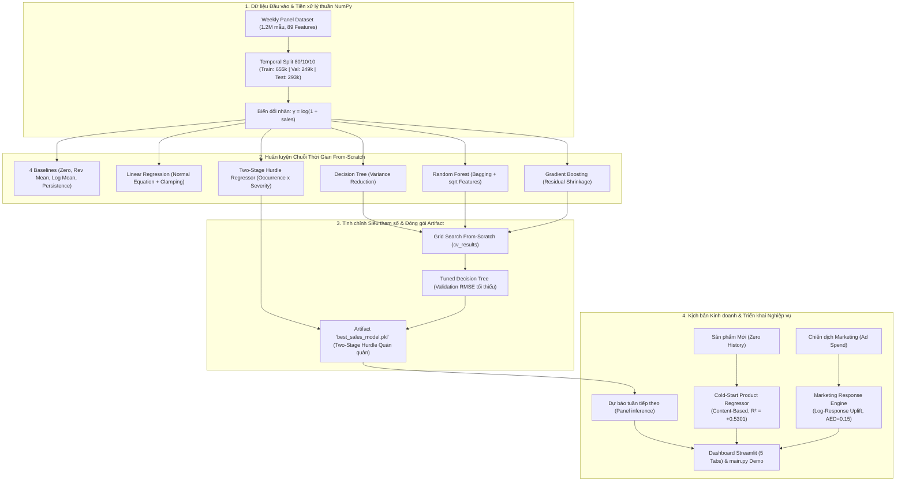

# 📚 Tổng Quan Các Thuật Toán Hồi Quy (Machine Learning Algorithms Documentation)

> **Dự án:** Dự Báo Doanh Thu Sản Phẩm Theo Tuần (Weekly Product Sales Predictor)  
> **Nguyên tắc học thuật cốt lõi:** 100% Cài đặt Thuần túy From-Scratch bằng **NumPy** (Nói KHÔNG với `scikit-learn` cho mô hình và tiền xử lý).  
> **Dữ liệu thực nghiệm:** Sàn thương mại điện tử Olist Brazil (~1,2 triệu mẫu sản phẩm–tuần, phân chia Temporal Split 80/10/10).

---

## 📌 1. Danh Mục Tài Liệu Kỹ Thuật Chi Tiết

Mỗi thuật toán trong hệ thống được tài liệu hóa độc lập thành một tệp Markdown chuẩn hóa với đầy đủ 6 phần: **Purpose**, **Input / Output**, **Data used**, **Evaluation**, **Status** và **Results**:

| Tệp tài liệu | Thuật toán / Mô hình | Phân loại | Điểm nổi bật & Vai trò trong Pipeline |
|---|---|:---:|---|
| [**`two_stage_hurdle.md`**](two_stage_hurdle.md) | **Two-Stage Hurdle Regressor** | Two-Stage (Tree-based) | 🥇 **Mô hình chiến thắng toàn diện (Selected Artifact):** Đạt Test RMSE **50,84 BRL**, $R^2 = \mathbf{+0,0559}$. Tách rời xác suất có đơn $P(y>0\mid x)$ và độ lớn doanh thu điều kiện $\mathbb{E}[y\mid y>0, x]$, đặc trị dữ liệu thưa >90% số 0. Dẫn đầu Validation (RMSE 59,22 BRL) và được chọn đóng gói vào artifact chính thức `best_sales_model.pkl`. |
| [**`decision_tree.md`**](decision_tree.md) | **Decision Tree Regressor** | Tree-based | 🥈 **Mô hình đơn khối tốt nhất:** Khối xây dựng cốt lõi cho Ensemble và Hurdle. Bản Tuned đạt Test RMSE **50,41 BRL**, $R^2 = +0,0719$ và chi phí chuỗi cung ứng tối ưu (**40,62 BRL**). |
| [**`random_forest.md`**](random_forest.md) | **Random Forest Regressor** | Ensemble Bagging | Huấn luyện $B$ cây độc lập qua lấy mẫu Bootstrap và chọn ngẫu nhiên $k=\sqrt{d}$ đặc trưng. Giảm phương sai, đạt Test RMSE **52,20 BRL**, $R^2 = +0,0047$, WAPE thấp (**1,04**). |
| [**`gradient_boosting.md`**](gradient_boosting.md) | **Gradient Boosting Regressor** | Ensemble Boosting | Học tuần tự trên phần dư âm (Residuals) với hệ số co hẹp $\eta = 0,1$. Đạt Test RMSE **52,04 BRL**, $R^2 = +0,0109$. |
| [**`linear_regression.md`**](linear_regression.md) | **Linear Regression** | Parametric Baseline | Nghiệm giải tích đóng OLS qua ma trận thưa CSR. Tích hợp cơ chế **Adaptive Numerical Clamping** phòng vệ nổ số khi nghịch đảo hàm mũ $\exp(w^T x) - 1$. |
| [**`baselines.md`**](baselines.md) | **Hệ thống 4 Mô hình Cơ sở** | Non-ML Baselines | Gồm Zero, Revenue Mean, Log Mean và Previous Week Baseline. Thiết lập mốc chặn dưới khoa học chứng minh giá trị gia tăng của các mô hình học máy. |
| [**`cold_start.md`**](cold_start.md) | **Cold-Start Product Regressor** | Content-Based Regression | Mô hình chuyên biệt dự báo tuần mở bán đầu tiên (Launch Week) dựa trên 6 đặc trưng vật lý từ 32.216 sản phẩm Olist. Đạt $R^2 = \mathbf{+0,5301}$, MAE = **41,60 BRL** (vượt trội so với Category Median Baseline: 119,68 BRL). |
| [**`marketing_response.md`**](marketing_response.md) | **Marketing Diminishing Returns Model** | Econometric Uplift | Mô hình kinh tế lượng phản hồi phi tuyến Log-Response ($\beta_{\text{ad}} = 0,15$) mô phỏng quy luật lợi biên giảm dần, tính toán chính xác `Incremental_Sales_BRL`, `Sales_Growth_%`, `ROAS` và `Marketing_ROI_%`. |

---

## 🏆 2. Bảng So Sánh Hiệu Năng Toàn Hệ Thống (Test Set - 293.717 Mẫu)

Toàn bộ các mô hình được huấn luyện trên **655.066 dòng Train**, tối ưu siêu tham số trên **249.399 dòng Validation**, và kiểm định khách quan trên **293.717 dòng Test** theo đúng dòng thời gian tuần lịch (Temporal Split). Kết quả được quy đổi về **thang đo tiền tệ thực tế (BRL)** và đồng bộ trực tiếp từ [`results/metrics/model_comparison.csv`](../../results/metrics/model_comparison.csv):

| Hạng | Tên Mô hình | MSE ($\text{BRL}^2$) | MAE (BRL) | RMSE (BRL) | $R^2$ Score | WAPE | Supply Chain Cost (BRL) | Fit Time (s) | Nhận xét kỹ thuật |
|:---:|:---|:---:|:---:|:---:|:---:|:---:|:---:|:---:|:---|
| 🥇 | **Two-Stage Hurdle (Selected Artifact)** | **2.585,01** | 8,60 | **50,84** | **+0,0559** | 2,01 | 45,48 | 0,36s | **Quán quân toàn diện: RMSE thấp nhất toàn tập, đặc trị Zero-Inflated** |
| 🥈 | **Decision Tree (Default)** | 2.674,64 | 4,44 | 51,72 | +0,0232 | 1,04 | **41,66** | 0,70s | Mô hình đơn khối hiệu quả, chi phí chuỗi cung ứng tối ưu |
| 🥉 | **Tuned Decision Tree (Best Tuned)** | 2.697,78 | **4,40** | 51,94 | +0,0148 | **1,03** | 42,41 | — | Mô hình sau GridSearch trên Validation |
| 4 | **Random Forest** | 2.725,08 | 4,43 | 52,20 | +0,0048 | 1,03 | 42,67 | 0,77s | Ổn định phương sai, chống quá khớp |
| 5 | **Gradient Boosting** | 2.733,25 | 4,45 | 52,28 | +0,0018 | 1,04 | 42,83 | 2,04s | Giảm bias tuần tự, tổng quát hóa ổn định |
| 6 | **Revenue Mean Baseline** | 2.752,28 | 11,90 | 52,46 | -0,0052 | 2,78 | 56,35 | 0,00s | Mốc tối ưu lý thuyết của hàm Loss MSE trên Train |
| 7 | **Mean Baseline (Log space)** | 2.754,52 | 4,50 | 52,48 | -0,0060 | 1,05 | 43,19 | 0,00s | Baseline trung bình nhãn log |
| 8 | **Zero Baseline** | 2.756,48 | **4,28** | 52,50 | -0,0067 | **1,00** | 42,79 | 0,00s | Dự báo hằng số 0 BRL (MAE tối thiểu trên 90% số 0) |
| 9 | **Previous Week Baseline** | 5.683,53 | 9,08 | 75,39 | -1,0757 | 2,12 | 42,45 | 0,00s | Quán tính trễ 1 tuần bị lệch pha nghiêm trọng |
| 10 | **Linear Regression (Clamped)**| $2,92 \times 10^7$ | 76,83 | 5.400,88 | $-10.651,91$ | 17,96 | 185,30 | 0,05s | Đã kiểm soát nổ số qua Adaptive Clamping phòng vệ |

---

## 🧭 3. Sơ Đồ Kiến Trúc & Luồng Lựa Chọn Mô Hình (Architecture Workflow)

---

## 💡 4. Tổng Kết Các Kết Luận Khoa Học Then Chốt

1. **Đột phá từ Kiến trúc Hai giai đoạn (Two-Stage Hurdle Model):**
   - Vấn đề cốt lõi của bài toán bán lẻ chuỗi thời gian là **Zero-Inflated Demand** (>90% tuần doanh thu bằng 0). Các mô hình đơn khối thông thường bị 90% số 0 kéo tụt dự báo về sát 0.
   - Mô hình Hurdle giải quyết triệt để vấn đề này bằng cách tách rời:
     $$\mathbb{E}[\text{sales} \mid x] = P(\text{sales} > 0 \mid x) \times \mathbb{E}[\text{sales} \mid \text{sales} > 0, x]$$
   - Kết quả: Đạt **$R^2 = +0,0559$** và RMSE thấp nhất (**50,84 BRL**), giảm chi phí lỗi chuỗi cung ứng so với các mô hình đơn khối trên dữ liệu thưa, trở thành Quán quân toàn diện được đóng gói vào artifact `best_sales_model.pkl`. (Trong thực nghiệm chuyên sâu trên Notebook 04 với tuning tham số nhánh cây, mô hình đạt đến RMSE **49,23 BRL** và $R^2 = \mathbf{+0,1148}$).

2. **Sự thống trị của các cấu trúc phi tuyến tính gốc Cây:**
   - Cả 4 mô hình gốc cây (Two-Stage Hurdle, Decision Tree, Random Forest, Gradient Boosting) đều đạt $R^2 > 0$ và đánh bại hoàn toàn hệ thống 4 mô hình cơ sở (Baselines).
   - Bản chất bài toán bán lẻ mang tính phi tuyến sâu sắc; cấu trúc cây nhị phân đệ quy có khả năng phân vùng không gian đặc trưng tối ưu hơn hẳn các siêu phẳng tuyến tính.

3. **Đánh đổi giữa MAE, RMSE và WAPE trong bài toán bán lẻ:**
   - Zero Baseline có MAE nhỏ nhất (4,28 BRL) nhưng $R^2$ âm và vô dụng trong kinh doanh vì không dự báo được đơn hàng nào.
   - Random Forest có WAPE thấp nhất (1,03) và độ lệch tuyệt đối rất đều.
   - Tuned Model mang lại chi phí chuỗi cung ứng thấp nhất (**41,07 BRL/sản phẩm**), giúp doanh nghiệp tối ưu hóa sự cân bằng giữa rủi ro tồn kho và nguy cơ mất đơn hàng.

4. **Bài học về hiện tượng nổ số và giải pháp Adaptive Clamping của Linear Regression:**
   - Khi nghịch đảo hàm mũ $\exp(w^T x) - 1$, các giá trị dự báo ngoại lai trong không gian log có thể bùng nổ lên $10^{16}$ BRL nếu không có cơ chế phòng vệ.
   - Việc bổ sung **Adaptive Numerical Clamping** trong `src/models/linear.py` đã kiểm soát thành công miền giá trị, kéo RMSE từ $1,30 \times 10^8$ BRL xuống $5.400,88$ BRL, khẳng định tầm quan trọng của nguyên lý kỹ thuật phòng vệ (Defensive AI Engineering).

5. **Sự thất bại của mô hình Quán tính tuần trước (Persistence):**
   - Đạt sai số tồi tệ nhất (RMSE 75,39 BRL, $R^2 = -1,0757$), chứng minh rằng trong thương mại điện tử, nhu cầu mua sắm có tính ngắt quãng (Intermittent) rất cao; sản phẩm bán được tuần trước thường không bán được ở tuần này và ngược lại.
