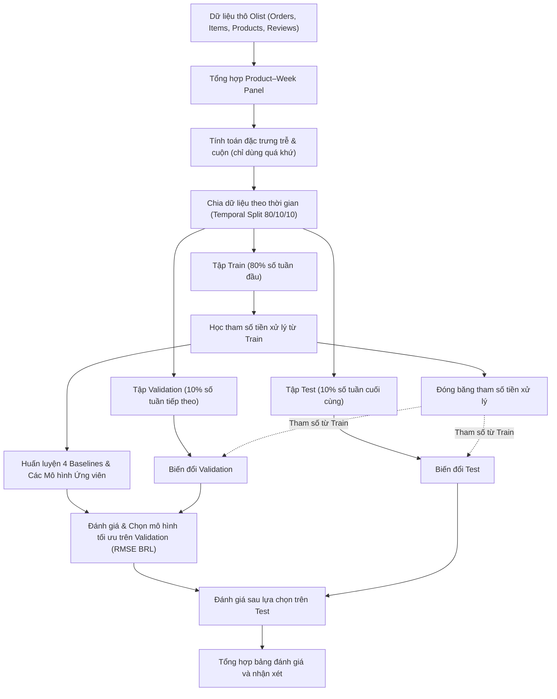

# Tổng Quan Về Các Mô Hình Trong Bài Lab Học Máy

Tài liệu giới thiệu các phương pháp dự kiến thử trong bài lab, cùng quy tắc chuẩn bị dữ liệu và so sánh mô hình. Các lựa chọn sẽ được đánh giá theo tiêu chí xác định trước.

---

## 1. Danh mục Tài liệu Thiết kế Thuật toán

| Tài liệu thiết kế | Mục tiêu trong bài lab |
| --- | --- |
| [Kế hoạch Tổng thể (5W1H)](design.md) | Kế hoạch tổng thể theo 5W1H, cấu trúc dự kiến và quy tắc chống rò rỉ dữ liệu. |
| [Mô hình Đối chứng Cơ sở (Baselines)](baselines.md) | Thiết lập 4 mốc chuẩn cơ sở: Zero, Revenue Mean, Log Mean và Previous Week để đối chiếu. |
| [Hồi quy Tuyến tính Điều chuẩn](linear_regression.md) | Mô hình tham số cơ sở giải bằng Normal Equation OLS có Ridge và Gradient Descent. |
| [Cây Quyết định Hồi quy](decision_tree.md) | Khối cây cơ sở phi tuyến tối ưu hóa mức giảm phương sai (Variance Reduction). |
| [Rừng Ngẫu nhiên Hồi quy](random_forest.md) | Phương pháp học kết hợp Bagging kết hợp lấy mẫu bootstrap và ngẫu nhiên đặc trưng. |
| [Tăng cường Độ dốc Hồi quy](gradient_boosting.md) | Phương pháp học kết hợp Boosting tối ưu hóa tuần tự trên phần dư của hàm mất mát. |
| [Mô hình Hai Giai đoạn (Two-Stage Hurdle)](two_stage_hurdle.md) | Kiến trúc chuyên biệt xử lý dữ liệu có nhiều số 0, tách xác suất và mức doanh thu bán. |
| [Proxy Doanh thu 7 Ngày Đầu](cold_start.md) | Ước lượng doanh thu khởi đầu dựa trên giao dịch đầu tiên đã biết và thuộc tính sản phẩm. |
| [Mô phỏng Kịch bản Tiếp thị](marketing_response.md) | Mô hình độ nhạy doanh thu theo giả định hàm logarit lợi suất giảm dần để chạy What-If. |
| [Quy chuẩn Dữ liệu Niêm yết](listing_data_contract.md) | Đặc tả yêu cầu dữ liệu bắt buộc cho bài toán dự báo cold-start trước khi ra mắt. |
| [Kế hoạch Kiểm tra Mô hình](experimental_validation.md) | Cách kiểm tra tính ổn định của mô hình qua nhiều mốc thời gian và lưu ý khi làm bài. |

---

## 2. Khung Đánh giá & Tiêu chuẩn So sánh Mô hình

Các mô hình dự báo tuần dự kiến được so sánh trên cùng các tập dữ liệu và tiêu chí:
- **Nguyên tắc chống rò rỉ dữ liệu (Data Leakage):** Chia theo thời gian với tỷ lệ dự kiến 80/10/10 theo số tuần trước khi học tham số điền thiếu, mã hóa và chuẩn hóa. Các tham số này chỉ học từ Train; tạo bảng tuần và đặc trưng lịch sử phải tuân thủ mốc dự báo của từng mẫu.
- **Tiêu chuẩn chọn mô hình:** Sử dụng **Root Mean Squared Error trên thang đo tiền tệ thực tế (Validation RMSE BRL)** sau khi chuyển đổi ngược từ không gian logarit: $\hat{s} = \max(0, \exp(\hat{y}) - 1)$.
- **Bộ chỉ số đo lường toàn diện:**
  1. **RMSE (BRL):** Tiêu chí đánh giá chính, phạt nặng các sai số dự báo lệch lớn.
  2. **MAE (BRL):** Đo lường độ lệch tuyệt đối trung bình trên từng đơn vị sản phẩm–tuần.
  3. **MSE ($\text{BRL}^2$):** Trung bình bình phương sai số.
  4. **$R^2$ Score:** Đo lường tỷ lệ phương sai doanh thu được giải thích so với mốc trung bình.
  5. **WAPE:** Sai số phần trăm có trọng số, không chia riêng cho từng mẫu bằng 0; cần quy ước nếu tổng doanh thu bằng 0.
  6. **Điểm phạt giả định:** So sánh mức phạt bất đối xứng giữa dự báo thiếu và dự báo thừa trên từng dòng sản phẩm–tuần.

---

## 3. Đặc Điểm Thiết Kế Của Các Thuật Toán

Nhóm dự kiến khảo sát các phương pháp sau:
1. **Baseline:** Zero, Revenue Mean, Log Mean và Previous Week làm mốc so sánh đơn giản.
2. **Linear Regression:** thử quan hệ tuyến tính trên nhãn log, có Ridge và giới hạn dự báo học từ Train để kiểm soát giá trị lớn.
3. **Decision Tree:** chia dữ liệu theo mức giảm phương sai; giới hạn độ sâu và số mẫu tại lá. Có thể dùng một tập ngưỡng phân vị để giảm số phép chia cần thử.
4. **Random Forest và Gradient Boosting:** lần lượt kết hợp các cây học trên mẫu bootstrap và chuỗi cây học phần dư.
5. **Two-Stage Hurdle:** tách ước lượng xác suất có bán và dự báo mức doanh thu khi có bán. Nghịch đảo trung bình log không mặc nhiên là trung bình doanh thu.

---

## 4. Các Phần Thử Nghiệm Mở Rộng

- **Cold-start proxy:** so sánh cây dự báo doanh thu bảy ngày từ giao dịch đầu đã biết với baseline một đơn vị và trung vị danh mục. Dữ liệu và cách chia được xác định riêng với bài toán tuần.
- **Mô phỏng marketing:** dùng hàm giả định $u(A)=1+\beta\ln(1+A/R)$ để quan sát độ nhạy. Do thiếu dữ liệu chiến dịch, không diễn giải mô phỏng như tác động quảng cáo đo được. Kịch bản giảm giá dùng sản lượng giả định để tính doanh thu.
- **Dữ liệu niêm yết:** nêu yêu cầu dữ liệu cho một hướng mở rộng trước lần bán đầu. Chỉ xem xét đánh giá khi có ngày niêm yết và cả sản phẩm chưa bán; dữ liệu giả lập chỉ giúp kiểm tra quy trình.

---

## 5. Quy Trình Các Bước Thực Hiện Bài Lab

Trong đánh giá tuần, lịch sử được cập nhật từ các tuần đã kết thúc, nhưng mô hình và tham số tiền xử lý giữ cố định. Khi dự báo minh họa, đầu vào đi qua cùng bộ tiền xử lý rồi mô hình; dự báo log được chuyển về BRL không âm. Điểm phạt thiếu/thừa chỉ dùng trọng số giả định, không phải chi phí kho thực tế.
