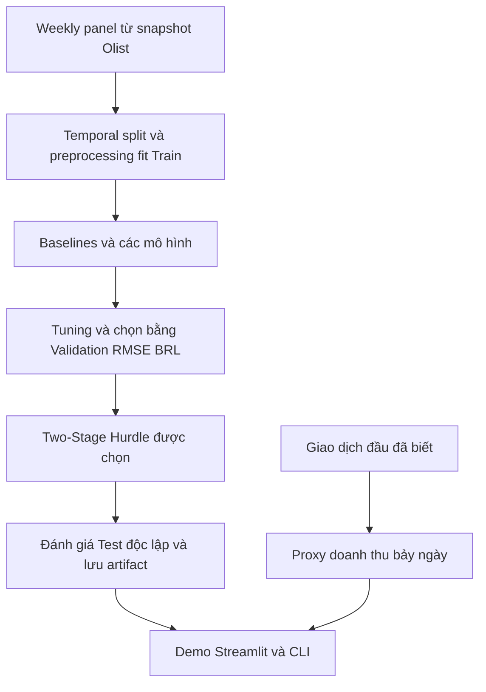

# Tổng quan thuật toán và kết quả thực nghiệm

> **Snapshot hiện tại:** artifact ghi `2026-10-27 16:26:38`, chế độ `full`, có tuning, 655.066 dòng Train. Nguồn: [Test](../../results/metrics/model_comparison.csv), [Validation](../../results/metrics/validation_comparison.csv), [tuning](../../results/metrics/tuning_history.csv). Thời gian fit thuộc lần chạy này. Kết quả dùng snapshot `delivered` cuối kỳ, chưa bảo đảm khả dụng tại forecast origin.

## 1. Tài liệu thuật toán

| Tài liệu | Vai trò |
| --- | --- |
| [Two-Stage Hurdle](two_stage_hurdle.md) | Chọn bằng Validation RMSE 55,9393 BRL; Test RMSE 49,2314 BRL, R² 0,1148. |
| [Decision Tree](decision_tree.md) | Tuned Model: depth=8, min_samples_leaf=10; Validation RMSE 59,2288 BRL. |
| [Random Forest](random_forest.md) | Bagging và feature subsampling. |
| [Gradient Boosting](gradient_boosting.md) | Học tuần tự trên residual. |
| [Linear Regression](linear_regression.md) | Normal Equation và Gradient Descent cùng quy ước Ridge; CLI dùng Normal Equation. |
| [Baselines](baselines.md) | Zero, Revenue Mean, Log Mean và Previous Week. |
| [Cold-start proxy](cold_start.md) | Bảy ngày từ giao dịch đầu đã biết. |
| [Marketing](marketing_response.md) | Mô phỏng giả định, chưa đo tác động nhân quả. |

## 2. Kết quả Test theo BRL

Xếp theo RMSE tăng dần. Artifact được chọn trên Validation trước khi xem Test.
`Cost_Per_Item_BRL` là điểm phạt giả định trên mỗi mẫu sản phẩm–tuần, không phải chi phí tồn kho đo thực tế.
`Fit Time (s)=0` ở Tuned Model là placeholder, không phải tuning không mất thời gian.

| Model | MSE | MAE | RMSE | R2 | WAPE | Cost_Per_Item_BRL | Fit Time (s) |
| --- | --- | --- | --- | --- | --- | --- | --- |
| Two-Stage Hurdle | 2423.7333 | 8.4426 | 49.2314 | 0.1148 | 1.9730 | 44.7952 | 15.0800 |
| Tuned Model | 2541.2236 | 4.2989 | 50.4106 | 0.0719 | 1.0046 | 40.6158 | 0.0000 |
| Decision Tree | 2615.3331 | 4.3274 | 51.1403 | 0.0449 | 1.0113 | 41.2640 | 16.5500 |
| Gradient Boosting | 2708.2243 | 4.4176 | 52.0406 | 0.0109 | 1.0323 | 42.4902 | 138.5000 |
| Random Forest | 2725.3346 | 4.4322 | 52.2047 | 0.0047 | 1.0357 | 42.6916 | 42.1100 |
| Revenue Mean Baseline | 2752.2779 | 11.8955 | 52.4622 | -0.0052 | 2.7798 | 56.3489 | 0.0000 |
| Mean Baseline | 2754.5202 | 4.5026 | 52.4835 | -0.0060 | 1.0522 | 43.1895 | 0.0000 |
| Zero Baseline | 2756.4820 | 4.2792 | 52.5022 | -0.0067 | 1.0000 | 42.7919 | 0.0000 |
| Previous Week Baseline | 5683.5250 | 9.0765 | 75.3892 | -1.0757 | 2.1211 | 42.4533 | 0.0000 |
| Linear Regression | 30378515.8542 | 44.3768 | 5511.6709 | -11093.4570 | 10.3704 | 120.7011 | 0.6200 |

## 3. Nhận xét và trade-offs

- Hurdle có RMSE thấp nhất trong các ứng viên, giảm khoảng 6,23% so với Zero Baseline. MAE 8,4426 BRL vẫn cao hơn Zero (4,2792 BRL); không thắng trên mọi tiêu chí.
- Tuned Decision Tree có điểm phạt giả định thấp nhất (40,6158). Zero có MAE và WAPE thấp nhất. Chưa suy ra lợi ích tồn kho thực tế từ các điểm số này.
- Linear Regression vẫn có RMSE lớn dù kẹp dự báo; không quy chênh lệch giữa các lần chạy cho clamping hoặc bản sửa Gradient Descent khi chưa có đối chứng.
- Previous Week có RMSE 75,3892 BRL, tệ nhất trong bốn baseline, nhưng vẫn thấp hơn Linear Regression.
- Hurdle nhân xác suất bán với dự báo dương nghịch đảo từ log; đại lượng sau không mặc nhiên là kỳ vọng số học có điều kiện.

## 4. Cold-start proxy

Nguồn: [evaluation](../../results/metrics/cold_start_evaluation.csv) và [manifest](../../results/metrics/cold_start_manifest.json).

| Model | MAE_BRL | RMSE_BRL | R2_Score | Test_Count |
| --- | --- | --- | --- | --- |
| CategoryMedianColdStartBaseline | 126.6543 | 313.9562 | 0.0022 | 8110 |
| SingleUnitPriceBaseline | 23.0145 | 120.9134 | 0.8520 | 8110 |
| ColdStartProductRegressor | 39.7939 | 135.4682 | 0.8142 | 8110 |

Train 23.428 sản phẩm, Test 8.110; purge 483 mẫu có nhãn vượt ranh giới. 85,47% sản phẩm Test chỉ bán một đơn vị; target chứa giao dịch đầu đã biết nên baseline giá dự báo đúng trên nhóm này. Baseline một đơn vị thắng cây về MAE và RMSE trên holdout hiện tại. Cây là ứng viên cố định, không chọn bằng Test; chưa kiểm chứng dự báo sản phẩm chưa bán.

## 5. Luồng thực nghiệm

