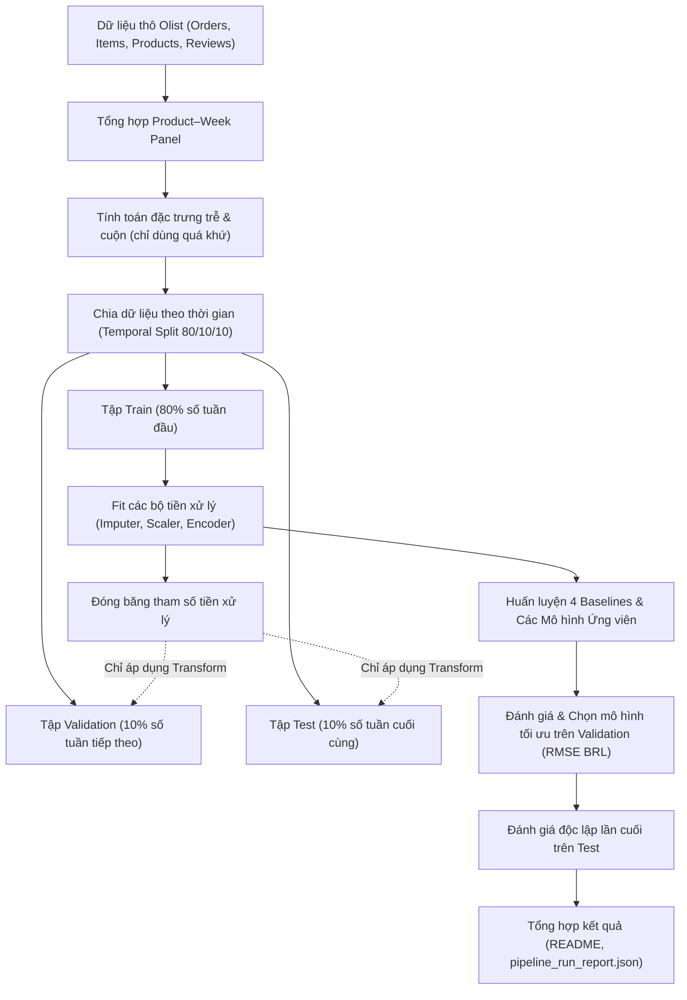

# Tổng Quan Về Các Mô Hình Trong Bài Lab Học Máy

Tài liệu này tổng hợp danh mục và mô tả ngắn gọn về các mô hình mà nhóm thử nghiệm trong bài lab môn Học Máy, đã được đối chiếu lại để khớp với mã nguồn trong [`src/`](../../src/) và kết quả chạy thực nghiệm mới nhất (`11/11/2026`).

---

## 1. Danh mục Tài liệu Thiết kế Thuật toán

| Tài liệu thiết kế | Mục tiêu trong bài lab |
| --- | --- |
| [Kế hoạch Tổng thể (5W1H)](design.md) | Kế hoạch tổng thể theo 5W1H, cấu trúc dự kiến và quy tắc chống rò rỉ dữ liệu. |
| [Mô hình Đối chứng Cơ sở (Baselines)](baselines.md) | Thiết lập 4 mốc chuẩn cơ sở: Zero, Revenue Mean, Log Mean và Previous Week để đối chiếu. |
| [Hồi quy Tuyến tính Điều chuẩn](linear_regression.md) | Mô hình tham số cơ sở giải bằng Normal Equation OLS có Ridge và Gradient Descent. |
| [Cây Quyết định Hồi quy](decision_tree.md) | Khối cây cơ sở phi tuyến tối ưu hóa mức giảm phương sai (Variance Reduction). |
| [Rừng Ngẫu nhiên Hồi quy](random_forest.md) | Phương pháp học kết hợp Bagging kết hợp lấy mẫu bootstrap và ngẫu nhiên đặc trưng. |
| [Tăng cường Độ dốc Hồi quy](gradient_boosting.md) | Phương pháp học kết hợp Boosting tối ưu hóa tuần tự trên phần dư của hàm mất mát. |
| [Mô hình Hai Giai đoạn (Two-Stage Hurdle)](two_stage_hurdle.md) | Kiến trúc chuyên biệt xử lý dữ liệu có nhiều số 0, tách xác suất và mức doanh thu bán. |
| [Proxy Doanh thu 7 Ngày Đầu](cold_start.md) | Ước lượng doanh thu khởi đầu dựa trên giao dịch đầu tiên đã biết và thuộc tính sản phẩm. |
| [Mô phỏng Kịch bản Tiếp thị](marketing_response.md) | Mô hình độ nhạy doanh thu theo giả định hàm logarit lợi suất giảm dần để chạy What-If. |
| [Quy chuẩn Dữ liệu Niêm yết](listing_data_contract.md) | Đặc tả yêu cầu dữ liệu bắt buộc cho bài toán dự báo cold-start trước khi ra mắt. |
| [Kế hoạch Kiểm tra Mô hình](experimental_validation.md) | Cách kiểm tra tính ổn định của mô hình qua nhiều mốc thời gian và lưu ý khi làm bài. |

---

## 2. Khung Đánh giá & Tiêu chuẩn So sánh Mô hình

Toàn bộ các mô hình được nhóm so sánh trên cùng một điều kiện:
- **Nguyên tắc chống rò rỉ dữ liệu (Data Leakage):** Phân chia tập dữ liệu theo thời gian (Temporal Split 80/10/10) TRƯỚC khi tiến hành tiền xử lý. Toàn bộ tham số thống kê chỉ được fit trên tập Train.
- **Tiêu chuẩn chọn mô hình:** Sử dụng **Root Mean Squared Error trên thang đo tiền tệ thực tế (Validation RMSE BRL)** sau khi chuyển đổi ngược từ không gian logarit: $\hat{s} = \max(0, \exp(\hat{y}) - 1)$.
- **Bộ chỉ số đo lường toàn diện:**
  1. **RMSE (BRL):** Tiêu chí đánh giá chính, phạt nặng các sai số dự báo lệch lớn.
  2. **MAE (BRL):** Đo lường độ lệch tuyệt đối trung bình trên từng đơn vị sản phẩm–tuần.
  3. **MSE ($\text{BRL}^2$):** Phản ánh phương sai sai số bình phương.
  4. **$R^2$ Score:** Đo lường tỷ lệ phương sai doanh thu được giải thích so với mốc trung bình.
  5. **WAPE:** Sai số phần trăm có trọng số, tránh lỗi chia cho 0 trên dữ liệu thưa.
  6. **Cost_Per_Item_BRL:** Độ đo chi phí bất đối xứng giữa dự báo thiếu và dự báo thừa trên từng dòng sản phẩm–tuần.

---

## 3. Đặc Điểm Kiến Trúc Của Các Thuật Toán Đang Cài Đặt

Nhóm cài đặt From-Scratch và khảo sát các họ thuật toán với các cơ chế toán học bổ trợ lẫn nhau:
1. **Baselines Cơ sở ([`src/models/baselines.py`](../../src/models/baselines.py)):** Bốn mô hình tham chiếu (Zero, Revenue Mean, Log Mean qua `MeanRegressorFromScratch`, Previous Week) thiết lập mốc đối chứng tối thiểu, làm thước đo để xem mô hình học máy có thực sự học được quy luật hay không.
2. **Linear Regression ([`src/models/linear.py`](../../src/models/linear.py)):** Mô hình tham số tuyến tính (`LinearRegressionFromScratch`) có điều chuẩn Ridge nhằm kiểm tra giả định tương quan tuyến tính của các biến trễ và biến danh mục, tích hợp cơ chế kẹp biên log thích ứng để hạn chế sai số tràn số.
3. **Cây Quyết định ([`src/models/tree.py`](../../src/models/tree.py)):** Mô hình phi tuyến (`DecisionTreeRegressorFromScratch`) dạng phân tách nhị phân theo độ giảm phương sai (dùng histogram binning trên dữ liệu lớn), tạo ra các quy tắc quyết định dạng If-Else dễ giải thích; bản chỉnh tham số (`Tuned Model`, `max_depth=8, min_samples_leaf=10`) đạt Validation RMSE `59.2288 BRL`.
4. **Học Kết hợp ([`src/models/ensemble.py`](../../src/models/ensemble.py)):** Hai hướng tiếp cận Ensemble tương phản: Bagging (`RandomForestRegressorFromScratch`, lấy mẫu bootstrap và đặc trưng ngẫu nhiên) và Boosting (`GradientBoostingRegressorFromScratch`, học tuần tự trên phần dư).
5. **Mô hình Hai Giai đoạn ([`src/models/hurdle.py`](../../src/models/hurdle.py)):** Kiến trúc `TwoStageHurdleRegressorFromScratch` phân tách bài toán nhiều số 0 thành hai giai đoạn độc lập: phân loại xác suất phát sinh đơn hàng (dùng `DecisionTreeRegressorFromScratch` trên nhãn `0/1` kẹp về `[0, 1]`) và hồi quy quy mô doanh thu khi có giao dịch; đang là mô hình được chọn (`Selected=True`) với Validation RMSE `55.9393 BRL` và Test RMSE `49.2314 BRL`.

---

## 4. Các Phần Thử Nghiệm Mở Rộng

- **Luồng Cold-start Proxy ([`src/models/cold_start.py`](../../src/models/cold_start.py), [`src/evaluation/cold_start.py`](../../src/evaluation/cold_start.py)):** Thử nghiệm ước lượng doanh thu 7 ngày đầu sau giao dịch đầu tiên đã biết bằng `ColdStartProductRegressor` (5 biến số `log1p` + Target Encoding `smoothing=10.0`). Nhóm đối chiếu với Baseline Giá bán đơn vị (`SingleUnitPriceBaseline`, vẫn vượt trội hơn với Test MAE `23.0145 BRL` so với `39.7939 BRL`) và Baseline Trung vị danh mục (`CategoryMedianColdStartBaseline`).
- **Luồng Mô phỏng Kịch bản Tiếp thị ([`src/deployment/predictor.py`](../../src/deployment/predictor.py)):** Thiết lập hàm phản hồi phi tuyến $u(A) = 1 + \beta \ln(1 + A/R)$ để khảo sát độ nhạy doanh thu theo ngân sách quảng cáo dựa trên giả định toán học, phục vụ trực quan hóa What-If trong tab 5 của [`app.py`](../../app.py).
- **Quy chuẩn Dữ liệu Niêm yết ([`src/data/launch.py`](../../src/data/launch.py), [`src/evaluation/listing_launch.py`](../../src/evaluation/listing_launch.py)):** Xác lập hợp đồng dữ liệu và bộ pipeline kiểm thử trên dữ liệu giả lập cho bài toán dự báo trước khi sản phẩm ra mắt, sẵn sàng khi có bảng catalog thực tế.

---

## 5. Quy Trình Các Bước Thực Hiện Bài Lab

