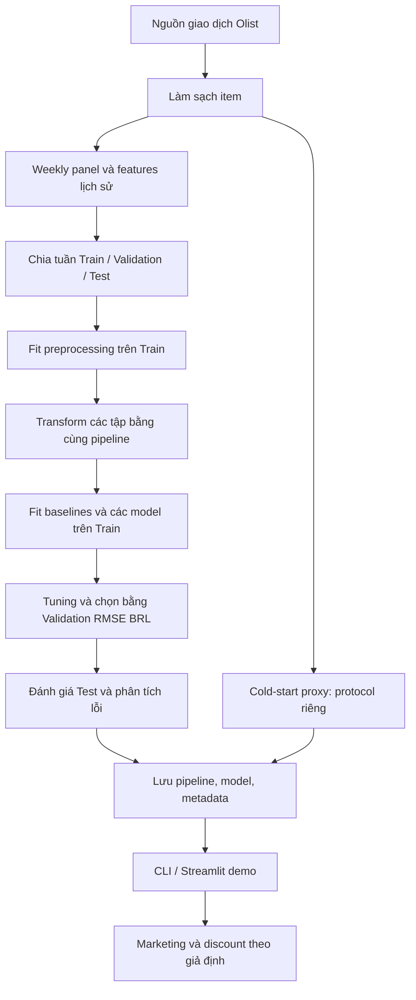

# Thiết kế Sales Predictor theo 5W1H và Target Structure

Tài liệu mô tả thiết kế đang triển khai để nhóm phát triển, người đọc báo cáo và người đánh giá đồ án thống nhất bài toán, luồng xử lý và hợp đồng dự báo. Nội dung bám theo [main.py](../../main.py) và các module hiện có; số liệu thực nghiệm nằm trong [tổng quan thuật toán](README.md).

## 1. What — Hệ thống giải quyết bài toán gì?

Bài toán chính là **regression dự báo doanh thu của từng sản phẩm trong một tuần đích**, dùng lịch sử đã quan sát trước tuần đó. Đơn vị dự báo là sản phẩm–tuần, đơn vị tiền tệ là BRL. Doanh thu được tính từ tổng `price` của các item hợp lệ, không cộng `freight_value`.

| Luồng             | Đầu ra                                                       | Phạm vi diễn giải                                                      |
| ------------------ | -------------------------------------------------------------- | ------------------------------------------------------------------------- |
| Weekly forecast    | Doanh thu tuần của sản phẩm đã có lịch sử             | Backtest one-week-ahead; model học trên weekly panel                    |
| Cold-start proxy   | Doanh thu bảy ngày kể từ giao dịch đầu đã biết       | Target bao gồm giao dịch đầu; chưa phải dự báo trước niêm yết |
| Listing cold-start | Doanh thu bảy ngày từ ngày niêm yết                      | Luồng riêng cần catalog thực, gồm cả sản phẩm không bán         |
| Marketing          | Doanh thu và incremental revenue theo giả định ngân sách | Mô phỏng độ nhạy, chưa xác định tác động nhân quả           |
| Discount scenario  | Doanh thu từ giá giảm và sản lượng giả định          | Phép tính kịch bản, chưa dự báo phản ứng nhu cầu theo giá      |

Weekly forecast là luồng chọn và lưu model chính. Các luồng khác có target hoặc giả định khác, nên không gộp metrics thành một bảng xếp hạng chung.

## 2. Why — Vì sao chọn thiết kế này?

- **Weekly panel giữ tuần bằng 0:** Chỉ học trên giao dịch phát sinh sẽ bỏ mất những tuần không bán. Panel giúp đánh giá cả sai số dự báo thừa lẫn thiếu trong phạm vi sản phẩm đã xuất hiện.
- **Baseline trước model phức tạp:** Zero, Revenue Mean, Log Mean và Previous Week cung cấp đối chứng rõ ràng. Độ phức tạp chỉ có ý nghĩa khi kết quả cải thiện theo tiêu chí đã chọn.
- **From-Scratch để giải thích thuật toán:** Logic estimator được cài bằng NumPy; Pandas và SciPy hỗ trợ dữ liệu/ma trận. Đây không phải hệ thống không dùng dependency.
- **Temporal split:** Giữ thứ tự tuần để mô phỏng dự báo tương lai; preprocessing chỉ fit Train. Cách chia này chưa tự xử lý được thông tin trạng thái giao hàng ghi nhận hồi cứu.
- **Log-transform:** Giảm độ lệch của target khi huấn luyện, nhưng MSE log và RMSE BRL là hai mục tiêu khác nhau. Nghịch đảo trung bình log không mặc nhiên bằng kỳ vọng doanh thu số học.
- **Metric chính:** Validation RMSE trên BRL dùng chọn model. MAE, R², WAPE và điểm phạt bất đối xứng bổ sung góc nhìn; cải thiện RMSE không đồng nghĩa cải thiện mọi metric hay lợi nhuận tồn kho.

Thiết kế ưu tiên baseline và các mô hình có thể phân tích. Hurdle tách xác suất bán và mức doanh thu dương để xử lý dữ liệu thưa, nhưng không được mặc định là model tốt nhất cho mọi lần chạy.

## 3. Who — Ai sử dụng và chịu trách nhiệm?

| Vai trò                         | Nhu cầu                                       | Trách nhiệm                                                                             |
| -------------------------------- | ---------------------------------------------- | ----------------------------------------------------------------------------------------- |
| Người phụ trách dữ liệu    | Có panel và features đúng thời điểm     | Kiểm tra schema, giao dịch trùng, tuần không bán và khả dụng dữ liệu           |
| Người phát triển model       | So sánh thuật toán có thể tái lập       | Xây baseline, ghi cấu hình, kiểm soát random seed và tuning                         |
| Người đánh giá              | Hiểu model tốt ở đâu, thất bại ở đâu | Chốt metric, đối chiếu baseline, phân tích nhóm và giới hạn thực nghiệm       |
| Người phát triển giao diện  | Dùng đúng pipeline/model đã fit           | Giữ thứ tự features, đơn vị BRL và nhãn phân biệt dự báo với mô phỏng      |
| Người dùng demo, giảng viên | Hiểu kết quả và phương pháp             | Đọc dự báo cùng giả định; không xem demo là chứng nhận hiệu quả triển khai |

Các vai trò mô tả trách nhiệm kỹ thuật, không thay đổi phân công nhân sự của dự án.

## 4. When — Dữ liệu và dự báo được xác định khi nào?

Gọi `t` là 00:00 thứ Hai đầu tuần đích. Hệ thống dự báo doanh thu trong **[t, t + 7 ngày)**, dựa trên lịch sử trước `t`. Trong panel, `order_purchase_timestamp` đã được chuyển thành mốc đầu tuần đích, không còn là timestamp riêng của một giao dịch.

Ví dụ minh họa: dự báo tuần bắt đầu 2018-07-02 dùng lịch sử trước 2018-07-02; target cộng các item trong khoảng từ 2018-07-02 đến trước 2018-07-09. `last_week_sales` là doanh thu tuần bắt đầu 2018-06-25.

| Thời điểm               | Quy tắc                                                                                                                                 |
| -------------------------- | ---------------------------------------------------------------------------------------------------------------------------------------- |
| Tạo panel                 | Builder bỏ tuần biên đầu/cuối của dữ liệu nguồn, giữ tuần không bán từ lần bán đầu trong phần dữ liệu được giữ |
| Tạo mẫu đầu tiên      | Tuần bán đầu làm lịch sử; chỉ tạo mẫu khi đã có `last_week_sales`                                                         |
| Tạo features              | Lag/rolling dịch về quá khứ; giá là giá lịch sử; review dùng thời điểm trả lời trước tuần đích                       |
| Split                      | Khoảng 80/10/10 theo số tuần phân biệt, không phải tỷ lệ số dòng; mọi sản phẩm trong cùng tuần thuộc cùng tập         |
| Fit                        | Preprocessing và model học từ Train; Validation dùng tuning/chọn ứng viên                                                         |
| Test                       | Báo cáo model đã chọn; không dùng Test để quyết định model trong luồng CLI                                                  |
| Suy luận qua nhiều tuần | Cập nhật lịch sử đã quan sát trước từng tuần đích; không phải multi-step từ một origin cố định                       |

Nguồn đối chiếu: [builder.py](../../src/data/builder.py), [weekly_split_data](../../src/data/preprocessing.py).

**Giới hạn thời gian:** Lọc `delivered` từ trạng thái cuối kỳ rồi nhóm theo ngày mua chưa bảo đảm trạng thái ấy đã biết tại forecast origin. Bỏ tuần biên cũng không chứng minh mọi tuần ở giữa được thu thập đầy đủ. Vì vậy đây vẫn là backtest ngoại tuyến; cần dữ liệu trạng thái theo thời gian và mốc bao phủ quan sát để kiểm chứng point-in-time. Test đã được xem trong các vòng phân tích trước, nên không coi là holdout mù mới.

## 5. Where — Các thành phần nằm ở đâu?

| Thành phần | Vị trí                                                              | Vai trò                                                                    |
| ------------ | --------------------------------------------------------------------- | --------------------------------------------------------------------------- |
| Điều phối | [main.py](../../main.py)                                               | Chạy luồng dữ liệu, training, tuning, đánh giá, persistence và demo |
| Cấu hình   | [src/config.py](../../src/config.py)                                   | Khai báo target, features, tỷ lệ split và đường dẫn                 |
| Dữ liệu    | [src/data/](../../src/data)                                            | Nạp, làm sạch, tạo panel, features và preprocessing                    |
| Thuật toán | [src/models/](../../src/models)                                        | Baselines, hồi quy, Hurdle, tuning và lưu artifact                       |
| Đánh giá  | [src/evaluation/](../../src/evaluation)                                | Metrics, biểu đồ, error analysis và thí nghiệm đối chứng           |
| Suy luận    | [src/deployment/predictor.py](../../src/deployment/predictor.py)       | Chuyển đầu vào thành dự báo và xử lý các kịch bản              |
| Giao diện   | [app.py](../../app.py)                                                 | Demo tương tác trên pipeline/model đã lưu                            |
| Cache        | `data/processed/`                                                   | Ma trận X/y, tên features, pipeline và khóa sản phẩm–tuần           |
| Kết quả    | `results/metrics/`, `results/figures/`, `results/saved_models/` | CSV, biểu đồ và artifact triển khai                                    |

Các đường dẫn đầu ra được quản lý trong config. Tài liệu này không đề xuất di chuyển module hoặc thay đổi kiến trúc.

## 6. How — Hệ thống xử lý và lựa chọn thuật toán như thế nào?

### 6.1. Luồng xử lý chính



Pipeline fit một lần trên Train rồi transform Validation/Test, giữ cùng feature order. `main.py` có cache fingerprint để kiểm tra sự phù hợp của cache với dữ liệu và các file xử lý liên quan. EDA trong luồng chính dùng phần Train.

### 6.2. Vai trò và trade-offs của thuật toán

| Thuật toán                             | Vai trò                                  | Trade-off / failure mode                                                                       |
| ---------------------------------------- | ----------------------------------------- | ---------------------------------------------------------------------------------------------- |
| [Zero Baseline](baselines.md)             | Luôn dự báo 0 BRL                      | Có thể đạt MAE thấp trên dữ liệu thưa nhưng bỏ lỡ doanh thu dương                |
| [Revenue Mean](baselines.md)              | Trung bình BRL trên Train               | Không phân biệt sản phẩm hoặc thời gian                                                 |
| [Log Mean](baselines.md)                  | Trung bình nhãn log trên Train         | Cùng không gian học với regressors, khác trung bình BRL                                  |
| [Previous Week](baselines.md)             | Sao chép doanh thu tuần trước         | Dễ lệch khi nhu cầu ngắt quãng; cần đúng cột lag và scaler                           |
| [Linear Regression](linear_regression.md) | Baseline tham số                         | Nhanh, dễ phân tích; ngoại suy log có thể khuếch đại lỗi BRL                         |
| [Decision Tree](decision_tree.md)         | Học quy tắc phân vùng                 | Dễ diễn giải; nhạy với dữ liệu và độ sâu, split chỉ xét tập ứng viên           |
| [Random Forest](random_forest.md)         | Kết hợp cây bootstrap                  | Tốn thêm tài nguyên; feature subsampling có thể bỏ qua tín hiệu ở một nút          |
| [Gradient Boosting](gradient_boosting.md) | Học tuần tự trên residual             | Phụ thuộc learning rate, depth và số cây; implementation chưa có early stopping         |
| [Two-Stage Hurdle](two_stage_hurdle.md)   | Xác suất bán × mức doanh thu dương | Nhánh dương học log; dự báo kết hợp không mặc nhiên là kỳ vọng BRL không chệch |

### 6.3. Huấn luyện, lựa chọn và đánh giá

1. Chốt target và Validation RMSE BRL trước khi so sánh ứng viên.
2. Fit bốn baseline và năm họ model bằng Train theo cấu hình CLI. Previous Week cần thông tin cột và scaler từ pipeline.
3. Tìm tham số cho Decision Tree, Random Forest và Gradient Boosting trên Validation. Luồng này là grid search với một holdout thời gian, không phải k-fold CV dù một số thông báo dùng tên `GridSearchCV`.
4. So sánh các ứng viên mặc định và model thắng tuning bằng cùng Validation RMSE BRL; chọn trước khi báo cáo Test.
5. Xuất metrics Test và phân tích lỗi; đọc rõ thang đo ở từng đầu ra vì model trả log còn báo cáo doanh thu cần BRL.
6. Lưu model được chọn cùng pipeline đã fit và metadata. Luồng chính hiện không refit model thắng trên Train+Validation trước khi lưu.

`--fast-mode` có thể lấy tối đa 20.000 dòng Train cho các model và thu nhỏ cấu hình; baseline được fit trước bước lấy mẫu. Vì vậy kết quả fast/full không phải so sánh cùng ngân sách học. `--skip-tuning` dùng một cấu hình Random Forest cố định thay bước search; hệ thống vẫn so sánh ứng viên bằng Validation, không bảo đảm cấu hình đó tối ưu.

RMSE phạt mạnh lỗi lớn; MAE mô tả sai số tuyệt đối trung bình. R² so với trung bình của tập đánh giá, WAPE là tỷ lệ và cần quy ước khi tổng actual bằng 0. `Cost_Per_Item_BRL` là điểm phạt giả định theo sai số BRL trên mỗi mẫu sản phẩm–tuần, chưa phải chi phí tồn kho thực đo. Chi tiết implementation nằm trong [metrics.py](../../src/evaluation/metrics.py).

### 6.4. Suy luận và kiểm chứng thiết kế

Suy luận phải dùng cùng pipeline, feature order và model trong artifact. Dự báo log được đổi về BRL bằng `max(0, expm1(prediction))`. Kiểm tra giá trị hữu hạn vẫn cần thiết; chặn dưới bằng 0 không xử lý mọi NaN/overflow.

Các tiêu chí cần kiểm chứng khi thay đổi thiết kế:

- Một dòng panel tương ứng một khóa sản phẩm–tuần; không nhân doanh thu do join trùng.
- Features chỉ lấy lịch sử phù hợp với origin; preprocessing không fit lại trên Validation/Test.
- Cùng đầu vào và artifact cho đầu ra nhất quán; kết quả không phụ thuộc việc encoder tự fit trên dữ liệu suy luận.
- So sánh cùng target, horizon, thang đo và tập mẫu; chọn bằng Validation.
- Trường hợp tuần 0, không có mẫu dương, ít lịch sử và thiếu dữ liệu phải có hành vi được mô tả.

Xem [kiểm chứng thực nghiệm](experimental_validation.md), [cold-start proxy](cold_start.md) và [marketing](marketing_response.md). Test phần mềm xác minh hành vi implementation; không thay thế bằng chứng về hiệu quả ngoài thực tế.

## 7. Target Structure — Cấu trúc hệ thống và biến mục tiêu

### 7.1. Cấu trúc hệ thống

```text
main.py
app.py
src/
├── config.py
├── data/
│   ├── loader.py
│   ├── builder.py
│   ├── preprocessing.py
│   ├── feature_engineering.py
│   └── launch.py
├── models/
│   ├── base.py
│   ├── baselines.py
│   ├── linear.py
│   ├── tree.py
│   ├── ensemble.py
│   ├── hurdle.py
│   ├── cold_start.py
│   ├── regressors.py
│   ├── tuning.py
│   └── persistence.py
├── evaluation/
│   ├── metrics.py
│   ├── error_analysis.py
│   ├── visualization.py
│   ├── experiments.py
│   ├── cold_start.py
│   └── listing_launch.py
└── deployment/
    └── predictor.py
```

`regressors.py` re-export estimator để điều phối dùng giao diện chung; thuật toán nằm trong các module riêng. `tree.py` cung cấp cây thành phần cho ensemble và Hurdle. Luồng listing cold-start dùng `launch.py` và `listing_launch.py`, tách khỏi weekly forecast.

| Ranh giới                 | Input                                | Output / hợp đồng                                            |
| -------------------------- | ------------------------------------ | --------------------------------------------------------------- |
| Item → panel              | DataFrame giao dịch đã làm sạch | Khóa sản phẩm–tuần, sales BRL và features lịch sử       |
| Panel → preprocessing     | Train/Validation/Test theo tuần     | X có cùng số và thứ tự cột; y tương ứng từng dòng   |
| Preprocessing → estimator | X `(N, D)`, y log `(N,)`         | `fit(X, y)`; `predict(X)` trả vector log `(N,)`          |
| Estimator → đánh giá   | y thật và dự báo cùng hàng     | Chuyển về BRL khi tính metrics tiền tệ                     |
| Training → persistence    | Pipeline, model đã fit, metadata   | Gói artifact dùng lại cho suy luận                          |
| Artifact → demo           | Đầu vào hợp lệ theo pipeline    | Dự báo hoặc bảng kịch bản có diễn giải đúng phạm vi |

Ma trận pipeline có thể là sparse; các estimator cây chuyển sang dense nội bộ nên cần xét bộ nhớ theo `N × D`. `D` phụ thuộc encoder đã fit, không phải hằng số luôn bằng 89.

Theo [persistence.py](../../src/models/persistence.py), artifact gồm `pipeline`, `model`, `model_type`, `cold_start_model`, `saved_at`, `metadata`. Metadata do luồng gọi cung cấp; không tự coi mọi gói pickle là đã được kiểm định cùng protocol.

### 7.2. Cấu trúc target dự báo

Với sản phẩm `p`, tuần bắt đầu tại `t` và tập item hợp lệ `I` sau làm sạch:

$$
s_{p,t}=\sum_{i\in I}\mathbf{1}(product_i=p)\mathbf{1}(t\le purchase_i<t+7\text{ ngày})\,price_i.
$$

Đây là doanh thu theo thời điểm mua của các item được giữ trong dữ liệu, không phải số lượng đơn hàng hay doanh thu theo ngày giao. Bộ lọc `delivered` hồi cứu vẫn là hạn chế đã nêu ở mục 4.

| Trường / đại lượng     | Kiểu, đơn vị          | Ý nghĩa                                                                                                                     |
| ---------------------------- | ------------------------- | ----------------------------------------------------------------------------------------------------------------------------- |
| `product_id`               | Định danh               | Thành phần khóa panel; không dùng làm target                                                                            |
| `order_purchase_timestamp` | Datetime đầu tuần      | Mốc `t` của tuần đích trong panel                                                                                      |
| `sales`                    | Số thực không âm, BRL | Target gốc `s[p,t]`, tổng price, không gồm freight                                                                      |
| `log_sales` / y            | Số thực, log1p(BRL)     | Tên cấu hình cho không gian nhãn; y huấn luyện là `log1p(sales)`, không bắt buộc builder tạo cột `log_sales` |
| `last_week_sales`          | BRL trước preprocessing | Doanh thu tuần `t−1`, làm baseline và feature                                                                           |
| X                            | Ma trận `(N, D)`       | Features lịch sử/lịch và danh mục sau preprocessing                                                                      |
| `model.predict(X)`         | Vector `(N,)`, log      | Giao diện chung của estimator weekly                                                                                        |
| Dự báo BRL                 | Vector `(N,)`, BRL      | `max(0, expm1(model.predict(X)))`                                                                                           |

Quy tắc target và mẫu:

- Target tuần không bán bằng 0 trong phần panel được giữ. Không tự thêm sản phẩm chưa từng bán khi thiếu catalog.
- `units` được đếm từ số dòng item; không dùng trị số `order_item_id` làm số lượng.
- Source yêu cầu `product_id`, `price`, timestamp; giá không hữu hạn hoặc không dương bị loại. Khi có cả `order_id` và `order_item_id`, builder loại dòng trùng theo cặp này.
- Cột target và định danh không được đưa vào X như tín hiệu tương lai. Doanh thu các tuần trước có thể dùng làm lag; doanh thu tuần đích chỉ dùng làm nhãn.
- Các hàng X, y và khóa sản phẩm–tuần phải giữ cùng thứ tự để nối kết quả và phân tích lỗi.
- Forecast horizon là một tuần. Cách gọi “tuần tiếp theo” lấy mốc từ lịch sử đã hoàn tất; timestamp của hàng panel chính là tuần cần dự báo.

Target cold-start proxy khác target tuần: cửa sổ bắt đầu từ giao dịch đầu đã biết và bao gồm giao dịch ấy. Target listing cold-start bắt đầu tại `listing_date`, cần catalog có cả sản phẩm không bán và mốc kết thúc quan sát. Hợp đồng chi tiết nằm tại [listing_data_contract.md](listing_data_contract.md); không thay thế ngày niêm yết bằng ngày bán đầu.
