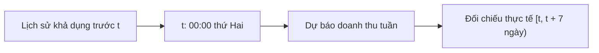
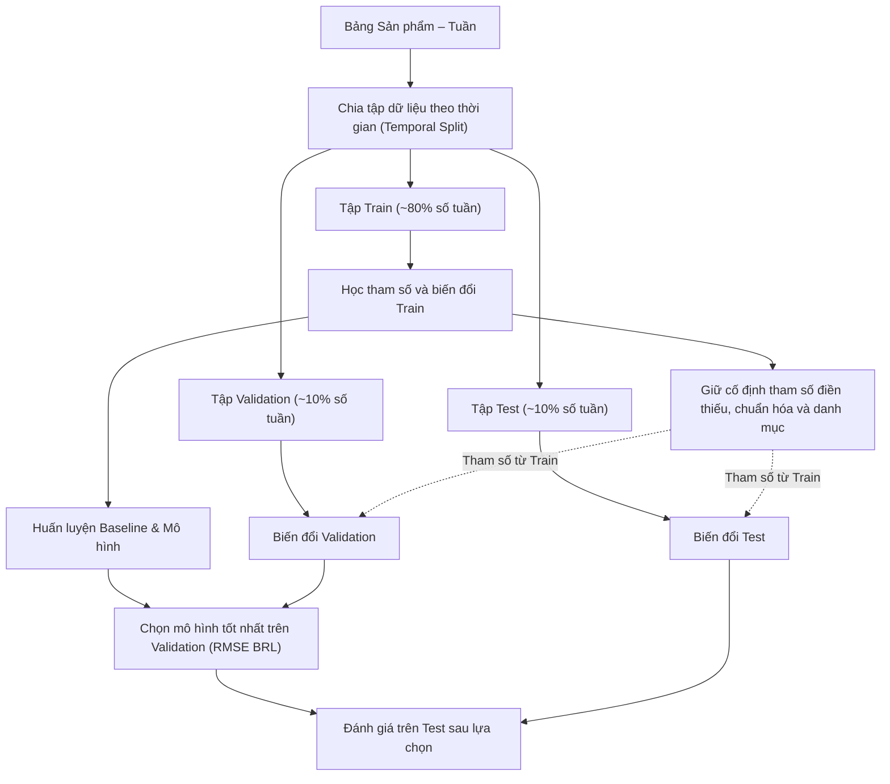

# Kế Hoạch Thực Hiện Bài Lab Dự Báo Doanh Thu Theo 5W1H và Target Structure

Tài liệu này đề xuất cách thực hiện bài lab dự báo doanh thu sản phẩm theo tuần từ dữ liệu Olist. Nội dung tập trung vào bài toán, dữ liệu cần chuẩn bị, cách so sánh mô hình và tổ chức các bước làm bài.

## 1. What — Bài lab cần giải quyết bài toán gì?

### 1.1. Bài toán và đầu ra mong đợi

Nhóm xác định mục tiêu là bài toán hồi quy chuỗi thời gian (time-series regression) nhằm dự báo tổng doanh thu trong 7 ngày của tuần kế tiếp cho từng sản phẩm có lịch sử bán hàng trên bảng Sản phẩm – Tuần (Product–Week Panel).
Mỗi bản ghi được nhận diện bằng mã sản phẩm và ngày bắt đầu tuần, lấy mốc 00:00 thứ Hai. Doanh thu mục tiêu $s_{p,t}$ được tính bằng tổng giá bán các mặt hàng hợp lệ trong tuần:

```math
s_{p,t} = \sum_{i \in I_{p,t}} \text{price}_i
```

Trong đó $I_{p,t}$ là tập các mặt hàng hợp lệ được đặt mua trong tuần $t$. Doanh thu tính theo đồng BRL, không bao gồm phí vận chuyển. Đầu ra mong đợi là giá trị doanh thu dự báo không âm cho từng sản phẩm.

### 1.2. Giới hạn phạm vi bài lab

Phạm vi bài lab là thực hành xử lý dữ liệu, xây dựng mô hình và đánh giá dự báo trên dữ liệu lịch sử. Ứng dụng minh họa chỉ phục vụ chạy thử trên máy cá nhân.

| Luồng phân tích | Đầu ra mong đợi                                    | Giới hạn và giả định khi làm bài                                     |
| ------------------ | ------------------------------------------------------ | ----------------------------------------------------------------------------- |
| Weekly forecast    | Doanh thu sản phẩm trong tuần kế tiếp             | Luồng chính; học trên chuỗi lịch sử quan sát của sản phẩm          |
| Cold-start proxy   | Doanh thu 7 ngày đầu từ giao dịch đầu tiên     | Ước lượng khởi đầu; Nhãn bao gồm giao dịch đầu tiên được biết tại mốc dự báo |
| Marketing scenario | Doanh thu thay đổi theo giả định ngân sách      | Mô phỏng độ nhạy toán học; chưa đo lường tác động nhân quả    |
| Discount scenario  | Doanh thu theo giá giảm và sản lượng giả định | Khảo sát kịch bản; chưa mô hình hóa độ co giãn cầu theo giá      |

Các dự báo dự kiến được dùng để so sánh mô hình và minh họa cách sử dụng, chưa làm căn cứ đặt hàng hay điều hành kinh doanh.

### 1.3. Dữ liệu nguồn

Dữ liệu đầu vào sử dụng tập dữ liệu công khai Olist gồm các bảng quan hệ:

| Bảng dữ liệu | Đơn vị bản ghi | Thông tin cần dùng | Vai trò trong bài lab |
| --- | --- | --- | --- |
| Mặt hàng trong đơn | Một món trong đơn hàng | Mã đơn, số thứ tự món, mã sản phẩm, giá bán | Tổng hợp doanh thu và số món bán |
| Đơn hàng | Một đơn hàng | Mã đơn, thời điểm mua, trạng thái giao hàng | Xác định tuần và phạm vi giao dịch |
| Sản phẩm | Một sản phẩm | Mã sản phẩm, danh mục, thuộc tính vật lý | Bổ sung thông tin mô tả sản phẩm |
| Khách hàng | Một định danh khách gắn với đơn | Mã khách trong đơn và mã nhận diện khách qua nhiều đơn | Tính lịch sử mua hàng |
| Đánh giá | Một đánh giá đơn hàng | Mã đơn, điểm đánh giá, thời điểm trả lời | Tổng hợp phản hồi có trước tuần dự báo |

Nhóm dự kiến liên kết mặt hàng với đơn hàng và sản phẩm theo quan hệ nhiều-một, đồng thời kiểm tra khóa để tránh nhân bản doanh thu. Mỗi món được nhận diện bằng cặp mã đơn và số thứ tự món; số thứ tự này không phải số lượng. Các đánh giá cần được tổng hợp riêng theo sản phẩm và thời điểm có thể sử dụng. Dữ liệu thiếu trường bắt buộc, giá không hợp lệ hoặc thời gian không hợp lệ được loại trước khi tạo bảng tuần. Khi có trạng thái đơn hàng, phạm vi quan sát được giới hạn ở các đơn đã giao; hạn chế của lựa chọn này được nêu tại mục 4.3.

## 2. Why — Vì sao nhóm chọn hướng thiết kế này?

### 2.1. Giữ các tuần không phát sinh giao dịch

Nếu chỉ giữ tuần có đơn hàng, mô hình sẽ không được học từ các tuần không bán. Nhóm dự kiến tạo lưới tuần liên tục từ lần bán đầu của từng sản phẩm đến cuối khoảng quan sát, điền doanh thu bằng 0 cho tuần không có giao dịch. Hai tuần ở biên đầu và cuối nguồn được bỏ vì có thể chưa đủ ngày. Tuần bán đầu trong khoảng còn lại dùng làm lịch sử; mẫu dự báo bắt đầu từ tuần sau. Sản phẩm chưa từng bán không thuộc luồng dự báo tuần này.

### 2.2. Ưu tiên baseline trước khi thử nghiệm mô hình phức tạp

Nhóm xây dựng các baseline Zero, Revenue Mean, Log Mean và Previous Week trước để có mốc so sánh. Các mô hình phức tạp hơn vẫn được thử nhằm học cách hoạt động; việc chọn mô hình sử dụng dựa trên RMSE của tập Validation, không mặc định mô hình phức tạp sẽ tốt hơn.

### 2.3. Tự cài đặt thuật toán để hiểu sâu kiến thức

Nhóm dự kiến xây dựng thuật toán từ các phép toán cơ bản để thực hành cách tính hàm mất mát, học trọng số và chọn nhánh cây. Đây là phần học tập chính của bài lab.

### 2.4. Chia tập dữ liệu trước và tối ưu trên thang log

Doanh thu thương mại điện tử lệch phải rất mạnh, nhóm chọn biến đổi mục tiêu sang không gian $y = \log(1 + s)$ để giảm khoảng chênh lệch giữa các giá trị lớn và nhỏ. Cách biến đổi này không bảo đảm tối ưu sai số trên BRL, nên sai số cần được đánh giá lại trên thang tiền tệ BRL gốc sau khi chuyển ngược.

## 3. Who — Phân công vai trò trong nhóm thực hiện bài lab

| Vai trò trong nhóm                  | Công việc phụ trách                                                            | Yêu cầu thực hiện                                                   |
| ------------------------------------- | ------------------------------------------------------------------------------------ | ----------------------------------------------------------------------- |
| Thành viên phụ trách dữ liệu    | Xây dựng panel sản phẩm–tuần, kiểm soát tính toàn vẹn và mốc thời gian | Ngăn chặn trùng lặp item, bảo toàn tuần doanh thu bằng 0        |
| Thành viên phát triển mô hình   | Xây dựng baseline, cài đặt thuật toán hồi quy và tối ưu siêu tham số    | Tuân thủ hạt giống ngẫu nhiên (seed), ghi nhận cấu hình        |
| Thành viên đánh giá & kiểm thử | Đo lường sai số trên tập Validation/Test, phân tích lỗi phân phối         | Không dùng Test để chọn mô hình; đánh giá trên BRL |
| Giảng viên hướng dẫn / Reviewer  | Hướng dẫn phương pháp và nhận xét bài lab                                                | Đối chiếu cách làm với các nguyên lý học máy cơ bản         |

## 4. When — Trục thời gian và kỷ luật chia tập dữ liệu

### 4.1. Mốc dự báo (Forecast Origin) và Horizon

Mốc dự báo $t$ được chốt tại 00:00 thứ Hai đầu tuần cần dự báo. Khoảng thời gian dự báo (horizon) là 7 ngày kế tiếp $[t, t + 7)$. Các đặc trưng lịch sử phải có trước $t$; đặc trưng lịch như tháng của tuần đích được biết sẵn. Thuộc tính sản phẩm được giả định là có thể sử dụng tại mốc dự báo, với giới hạn snapshot nêu ở mục 4.3.

Đánh giá dự kiến theo cách dự báo từng tuần một (rolling-origin one-week-ahead): sau mỗi tuần, lịch sử thực tế của tuần vừa qua có thể được dùng cho tuần kế tiếp, kể cả trong giai đoạn Validation hoặc Test. Tham số mô hình và tiền xử lý được giữ cố định. Thiết kế này không nhằm dự báo nhiều tuần liên tiếp chỉ từ một mốc lịch sử ban đầu.



### 4.2. Phân chia Train, Validation, Test theo thời gian (Temporal Split)

Nhóm chọn chia theo thứ tự tuần để các mẫu đánh giá nằm sau các mẫu huấn luyện, thay vì xáo trộn ngẫu nhiên:

- **Tập Train (khoảng 80% số tuần đầu):** Dùng để học tham số mô hình và học các tham số tiền xử lý.
- **Tập Validation (khoảng 10% số tuần kế tiếp):** Dùng để tinh chỉnh siêu tham số và lựa chọn mô hình.
- **Tập Test (khoảng 10% số tuần cuối cùng):** Đánh giá sau khi chọn mô hình; không dùng để điều chỉnh siêu tham số.

Tỷ lệ trên được tính theo số tuần, không phải số dòng. Mọi mẫu cùng tuần phải thuộc cùng một tập; số sản phẩm thay đổi theo thời gian nên tỷ lệ dòng có thể khác tỷ lệ tuần.

### 4.3. Giới hạn quan sát của dữ liệu Olist

Dữ liệu Olist là snapshot lịch sử. Trạng thái đã giao và thuộc tính sản phẩm có thể chỉ được ghi nhận sau mốc dự báo, nên bài lab chưa tái dựng đầy đủ thông tin sẵn có tại từng thời điểm. Doanh thu bằng 0 cũng chưa phân biệt được không có nhu cầu, hết hàng hoặc ngừng bán. Vì vậy, thiết kế hướng đến đánh giá dự báo doanh thu quan sát được trên dữ liệu lịch sử, không xem đây là phép đo đầy đủ nhu cầu thực tế.

## 5. Where — Tổ chức dữ liệu và phân tầng bài lab

Công việc được chia thành bốn nhóm chức năng để thuận tiện thực hiện và kiểm tra:

- **Lớp dữ liệu:** Tiếp nhận dữ liệu nguồn Olist thô, làm sạch và tạo lập bảng Sản phẩm – Tuần.
- **Lớp phân chia & tiền xử lý:** Chia tách dữ liệu theo thời gian, học tham số tiền xử lý từ Train rồi áp dụng cho Validation/Test.
- **Lớp mô hình:** Cài đặt các baseline tham chiếu và các thuật toán học máy ứng viên.
- **Lớp đánh giá & tổng hợp:** Tính toán các độ đo sai số BRL, phân tích sai số trên các nhóm sản phẩm. Mô hình được chọn sẽ được lưu cùng bộ tiền xử lý và thông tin đặc trưng để dùng trong phần dự báo minh họa.

## 6. How — Quy trình xử lý và huấn luyện không rò rỉ dữ liệu

### 6.1. Nguyên tắc cốt lõi: Chia dữ liệu TRƯỚC, Tiền xử lý SAU (Data Leakage Prevention)

Nguyên tắc là chỉ học các thống kê tiền xử lý từ Train. Việc kiểm tra dữ liệu hợp lệ, tổng hợp doanh thu tuần và tạo đặc trưng lịch sử có thể thực hiện trước khi chia, miễn là mỗi đặc trưng chỉ dùng thông tin có trước tuần đích. Các bước học trung vị, mode, danh mục và tham số chuẩn hóa phải thực hiện sau khi chia.

- **Thống kê toàn cục:** không dùng Validation hoặc Test để tính các tham số điền thiếu và chuẩn hóa.
- **Thứ tự thời gian:** không dùng giao dịch hay đánh giá xuất hiện từ tuần đích trở đi để tạo đặc trưng lịch sử của tuần đó.



### 6.2. Không gian đặc trưng và quy tắc tiền xử lý

| Nhóm đặc trưng | Thông tin dự kiến sử dụng | Quy tắc thời gian và xử lý |
| --- | --- | --- |
| Giá bán | Giá trung bình của tuần gần nhất có giao dịch | Chỉ dùng giá trước tuần đích; giữ giá lịch sử cho tuần không bán |
| Doanh thu trễ | Doanh thu cách 1, 2 và 4 tuần | Tính theo tuần lịch, giữ cả tuần bằng 0 |
| Thống kê trượt | Trung bình và độ lệch chuẩn doanh thu bốn tuần | Cửa sổ kết thúc trước tuần đích |
| Sản lượng và vòng đời | Số món bán tuần trước; số tuần từ lần bán đầu | Không dùng số lượng bán trong tuần đích |
| Đánh giá | Số đánh giá và điểm trung bình tích lũy | Dùng thời điểm trả lời đánh giá làm mốc khả dụng, phải trước tuần đích |
| Lịch sử khách hàng | Chi tiêu và số đơn trước đó của nhóm khách mua gần nhất; số bang của nhóm khách | Tổng hợp từ các giao dịch quá khứ, không dùng danh sách khách mua của tuần đích |
| Danh mục và lịch | Danh mục sản phẩm; biểu diễn sin/cos của tháng; cờ mùa mua sắm cuối năm | Danh mục học từ Train; lịch được xác định theo tuần đích |

Giá trị điền thiếu (median, mode), danh sách danh mục và các tham số chuẩn hóa được học từ Train rồi giữ cố định khi xử lý Validation và Test. Với One-Hot Encoding, danh mục chưa gặp ở Train được biểu diễn bằng vector toàn 0, không bổ sung một cột mới lúc dự báo. Số cột đầu ra phụ thuộc danh mục có trong Train.

### 6.3. Baseline và các thuật toán học máy ứng viên

| Mô hình              | Cơ chế hoạt động                                   | Mục đích so sánh                           |
| ---------------------- | ------------------------------------------------------- | -------------------------------------------------------------------------- |
| Zero Baseline          | Dự báo toàn bộ bằng 0                              | Mốc tham chiếu khi nhiều tuần không có doanh thu   |
| Revenue Mean Baseline  | Dự báo hằng số bằng trung bình doanh thu Train    | Kiểm tra hiệu quả của mô hình hằng số trên thang đo tiền tệ    |
| Log Mean Baseline      | Dự báo bằng trung bình logarit doanh thu Train      | Đối chứng mô hình hằng số trong không gian tối ưu log            |
| Previous Week Baseline | Dự báo bằng doanh thu tuần trước ($s_{p, t-1}$) | Kiểm chứng giả định chuỗi thời gian có quán tính ngắn hạn      |
| Linear Regression      | Hồi quy tuyến tính có điều chuẩn Ridge ($L_2$) | Mô hình tuyến tính dễ giải thích; dùng Ridge để ổn định phép giải     |
| Decision Tree          | Cây phân tách nhị phân theo giảm phương sai     | Học quan hệ phi tuyến; kiểm soát độ sâu để tránh quá khớp     |
| Random Forest          | Học kết hợp Bagging trên mẫu bootstrap             | Thử giảm độ biến động bằng cách kết hợp nhiều cây   |
| Gradient Boosting      | Học kết hợp Boosting tuần tự trên phần dư       | Thử cải thiện dự báo qua học phần dư; điều chỉnh tốc độ học |
| Two-Stage Hurdle       | Tách xác suất bán (P > 0) và hồi quy mức bán    | Thử tách tuần không bán và mức doanh thu khi có bán        |

Hurdle kết hợp xác suất bán $\hat{p}(x)$ với hồi quy mức bán dương $\hat{y}_{pos}(x)$: $\hat{s}(x) = \hat{p}(x) \cdot \max(0, \exp(\hat{y}_{pos}(x)) - 1)$.

Do phần hồi quy dương học trên nhãn log, nghịch đảo dự báo log không mặc nhiên bằng doanh thu trung bình có điều kiện. Đây là điểm cần lưu ý khi diễn giải Hurdle.

### 6.4. Đánh giá và lựa chọn mô hình

Tiêu chí chính để chọn mô hình là **Validation RMSE trên đơn vị tiền tệ BRL** sau khi chuyển đổi ngược: $\hat{s} = \max(0, \exp(\hat{y}) - 1)$.

```math
\text{RMSE} = \sqrt{\frac{1}{N}\sum_{i=1}^{N}(s_i - \hat{s}_i)^2}
```

Các độ đo bổ trợ được định nghĩa như sau:

- **MAE:** Sai số tuyệt đối trung bình tính bằng BRL: $\text{MAE} = \frac{1}{N}\sum |s_i - \hat{s}_i|$.
- **$R^2$ Score:** Hệ số xác định, đánh giá tỷ lệ phương sai mà mô hình giải thích được so với mốc trung bình.
- **WAPE:** Sai số phần trăm có trọng số $\frac{\sum |s_i - \hat{s}_i|}{\sum s_i}$, không chia riêng cho doanh thu từng mẫu. Khi tổng doanh thu của cả tập bằng 0, công thức không xác định; cần ghi rõ quy ước xử lý nếu gặp trường hợp này.

Nhóm dự kiến thử một số cấu hình của Decision Tree, Random Forest và Gradient Boosting rồi so sánh ứng viên sau tuning với các baseline và mô hình ban đầu, trong đó có Hurdle. Nếu baseline có Validation RMSE thấp nhất, baseline sẽ được giữ làm mô hình tham chiếu chính.

Có thể bổ sung điểm phạt giả định với trọng số 10 cho mỗi BRL dự báo thiếu và 2 cho mỗi BRL dự báo thừa, lấy trung bình theo mẫu sản phẩm–tuần. Điểm này phục vụ so sánh độ nhạy với hai loại sai số, không đại diện cho chi phí tồn kho đo thực tế và không thay thế tiêu chí chọn mô hình.

### 6.5. Các phần mở rộng thêm của bài lab

- **Cold-start proxy:** dùng thuộc tính sản phẩm và giá giao dịch đầu tiên để ước lượng doanh thu trong cửa sổ bảy ngày tính từ giao dịch đó, bao gồm giao dịch đã biết. Chỉ giữ cửa sổ có đủ thời gian quan sát; chia theo thời điểm bán đầu và loại các mẫu Train có cửa sổ nhãn chồng lấn giai đoạn Test. Cây có cấu hình định trước được đối chiếu với baseline giá một đơn vị và trung vị danh mục, không chọn lại bằng Test. Phần này không đánh giá sản phẩm chưa bán hoặc dự báo trước ngày niêm yết.
- **Mô phỏng marketing:** khi chưa có dữ liệu chiến dịch, dự báo cơ sở không thay đổi theo ngân sách. Một nhánh giả định dùng hàm $\text{uplift}(a) = 1 + \beta \ln(1 + a / S_{ref})$ để khảo sát độ nhạy, với hệ số và ngân sách tham chiếu được nêu rõ. Không diễn giải thành tác động nhân quả hay hiệu quả quảng cáo đã đo.
- **Mô phỏng giảm giá:** tính doanh thu từ giá sau giảm và số lượng giả định; tính thêm số lượng cần bán để giữ doanh thu tham chiếu. Phản ứng của nhu cầu với giá nằm ngoài phạm vi mô hình.

## 7. Target Structure — Cấu trúc bài lab và ranh giới dữ liệu

### 7.1. Cấu trúc thư mục định hướng & Tiêu chí phân chia

**Tiêu chí phân chia cấu trúc dự án:**
1. **Tách dữ liệu gốc và dữ liệu đã xử lý:** giữ nguồn ban đầu riêng để có thể đối chiếu. Khu vực dữ liệu đã xử lý có thể chứa bảng tổng hợp, các tập đã biến đổi và thông tin tiền xử lý; cần biết chúng thuộc lần chuẩn bị nào.
2. **Chia công việc theo chức năng:** tách phần dữ liệu, mô hình, đánh giá và dự báo minh họa. Phần khám phá được tổ chức riêng để thuận tiện trình bày các bước làm bài.
3. **Lưu đầu ra riêng:** dành chỗ cho bảng đánh giá, biểu đồ và mô hình đã học để thuận tiện kiểm tra sau mỗi lần chạy.
4. **Ghi nhận cấu hình:** lưu lựa chọn về khoảng quan sát, tỷ lệ chia theo tuần, seed và tham số mô hình để có thể thực hiện lại cùng một thí nghiệm.
5. **Tổ chức kiểm thử:** kiểm tra riêng cách chia thời gian, tạo đặc trưng, tính toán mô hình và chuyển đổi đơn vị dự báo.

Cách tổ chức dự kiến theo nội dung công việc:

```text
Bài lab dự báo doanh thu
├── Dữ liệu
│   ├── Dữ liệu nguồn
│   └── Dữ liệu đã chuẩn bị
├── Tài liệu
│   ├── Đề bài và kế hoạch
│   ├── Cơ sở các phương pháp
│   └── Hướng dẫn thực hành
├── Khám phá dữ liệu
├── Các phần xử lý
│   ├── Chuẩn bị dữ liệu
│   ├── Xây dựng mô hình
│   ├── Đánh giá và phân tích sai số
│   └── Dự báo minh họa
├── Đầu ra dự kiến
│   ├── Bảng đánh giá và biểu đồ
│   └── Mô hình cùng thông tin tiền xử lý
├── Kiểm tra tính đúng đắn
└── Hướng dẫn sử dụng bài lab
```


### 7.2. Ranh giới dữ liệu giữa các bước thực hiện

| Ranh giới luồng      | Dữ liệu đầu vào                           | Dữ liệu đầu ra                                   | Điều kiện kiểm soát chống rò rỉ dữ liệu                                   |
| ---------------------- | ---------------------------------------------- | ---------------------------------------------------- | ----------------------------------------------------------------------------------- |
| Nguồn → Panel        | Các bảng dữ liệu Olist                     | Bảng Sản phẩm – Tuần                            | Kiểm tra khóa chính, giữ tuần không phát sinh đơn hàng                    |
| Panel → Split         | Bảng Sản phẩm – Tuần xếp theo thời gian | 3 tập theo thời gian: Train, Validation, Test           | Không trùng tuần giữa các tập; chia trước khi học thống kê tiền xử lý |
| Split → Preprocessing | Tập Train, Validation, Test thô              | Dữ liệu đã biến đổi và bộ tham số tiền xử lý | Chỉ học tham số từ Train; áp dụng cùng tham số cho Validation/Test    |
| Preprocessing → Model | Ma trận đặc trưng $X$ và nhãn $y$    | Các mô hình và baseline đã huấn luyện        | Huấn luyện trên Train; tinh chỉnh siêu tham số duy nhất trên Validation     |
| Model → Evaluation    | Dự báo và nhãn thực tế                   | Bảng RMSE, MAE, R², WAPE và điểm phạt giả định                  | Chuyển ngược về thang BRL; không dùng điểm Test để điều chỉnh mô hình     |

Luồng dự báo minh họa dự kiến sử dụng mô hình cùng các tham số tiền xử lý sau huấn luyện: tiếp nhận tuần đích, danh mục, giá và các giá trị lịch sử → kiểm tra đầu vào → biến đổi bằng tham số từ Train → dự báo → chuyển về doanh thu BRL không âm. Mỗi đầu vào sản phẩm–tuần có một giá trị dự báo. Cần kiểm tra tuần đích và thông tin lịch sử trước khi dự báo. Khi thiếu dữ liệu, giả định thay thế phải được nêu rõ để người sử dụng hiểu phạm vi của dự báo. Luồng suy luận không học lại tham số từ dữ liệu cần dự báo; proxy bảy ngày sử dụng nhánh riêng.

## 8. Tiêu chuẩn đánh giá và hoàn thành bài lab

1. **Giữ đúng thời gian:** các đặc trưng lịch sử chỉ dùng thông tin trước tuần đích; các thống kê tiền xử lý chỉ học từ Train sau khi chia tập.
2. **Có baseline để so sánh:** thử cả cách dự báo đơn giản và mô hình học máy, lựa chọn theo Validation RMSE đã xác định trước.
3. **Đánh giá trên BRL:** chuyển dự báo về đơn vị doanh thu trước khi tính các chỉ số chính.
4. **Giữ vai trò của Test:** không dùng điểm Test để chọn mô hình hoặc siêu tham số.
5. **Có thể thực hiện lại:** ghi nhận dữ liệu, seed và cấu hình của thí nghiệm; thời gian xử lý không bắt buộc giống nhau giữa các máy.
6. **Hoàn thành các phần thiết kế:** có quy trình chuẩn bị dữ liệu, so sánh mô hình, phân tích sai số và luồng dự báo minh họa trong phạm vi bài lab.
7. **Diễn giải có giới hạn:** nêu rõ giả định dữ liệu và kịch bản, không suy ra hiệu quả kinh doanh chỉ từ chỉ số dự báo; chấp nhận baseline nếu phù hợp hơn với tiêu chí đã chọn.
