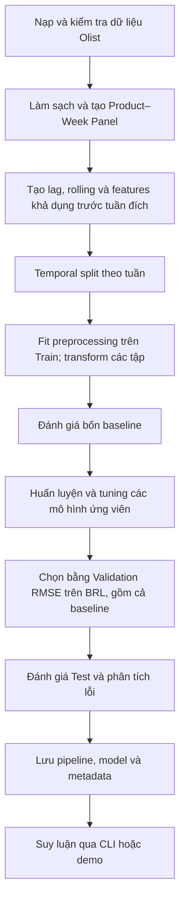

# Thiết kế Sales Predictor theo 5W1H và Target Structure

Tài liệu trình bày cách thiết kế hệ thống dự báo doanh thu sản phẩm theo tuần, từ việc xác định bài toán đến tổ chức các module và đánh giá mô hình. Người đọc chính là nhóm phát triển và giảng viên đánh giá đồ án.

Nội dung được viết theo góc nhìn trước khi triển khai: mỗi lựa chọn cần có lý do, đầu vào và đầu ra rõ ràng, cùng cách kiểm tra kết quả. Cấu trúc đề xuất bám theo cách tổ chức của dự án để thuận tiện đối chiếu, nhưng không có nghĩa mọi yêu cầu dưới đây đã được đáp ứng. Kết quả thực nghiệm được trình bày riêng trong [tổng quan thuật toán](README.md).

## 1. What — Hệ thống cần giải quyết bài toán gì?

### 1.1. Bài toán và đầu ra

Hệ thống cần dự báo **tổng doanh thu trong tuần tiếp theo của từng sản phẩm đã có lịch sử bán hàng**. Đây là bài toán time-series regression trên bảng sản phẩm–tuần (Product–Week Panel).

Mỗi dòng dữ liệu tương ứng với một sản phẩm `p` và một tuần bắt đầu tại `t`. Khóa của dòng là `(product_id, order_purchase_timestamp)`, trong đó `order_purchase_timestamp` được quy về ngày thứ Hai đầu tuần, không còn là thời điểm mua của một giao dịch riêng lẻ.

Doanh thu mục tiêu được xác định như sau:

```math
s_{p,t} = \sum_{i \in I_{p,t}} \mathrm{price}_i
```

Ở đây, `I` là tập các dòng item hợp lệ của sản phẩm trong khoảng `[t, t + 7 ngày)`. Doanh thu có đơn vị BRL, không gồm `freight_value`. Số lượng bán được tính bằng số dòng item; `order_item_id` là số thứ tự item trong đơn hàng nên không được dùng làm số lượng để cộng dồn.

Đầu ra nghiệp vụ tối thiểu gồm mã sản phẩm, tuần dự báo và doanh thu dự báo không âm. Đây là dự báo doanh thu, nên chưa đủ để trực tiếp quyết định số lượng nhập kho nếu thiếu thông tin giá, tồn kho và thời gian cung ứng.

### 1.2. Phạm vi chức năng

| Luồng | Đầu ra cần có | Giới hạn phạm vi |
| --- | --- | --- |
| Weekly forecast | Doanh thu của sản phẩm trong tuần lịch tiếp theo | Luồng chính dùng để so sánh và lưu mô hình |
| Cold-start proxy | Doanh thu bảy ngày kể từ giao dịch đầu tiên đã biết | Target bao gồm giao dịch đầu; không đại diện cho dự báo trước lần bán đầu |
| Listing cold-start | Doanh thu bảy ngày kể từ ngày niêm yết | Cần catalog thực có cả sản phẩm chưa bán và thuộc tính khả dụng khi niêm yết |
| Marketing scenario | Doanh thu thay đổi theo ngân sách và hệ số phản hồi giả định | Mô phỏng độ nhạy; chưa phải ước lượng tác động nhân quả |
| Discount scenario | Doanh thu theo giá giảm và sản lượng giả định | Chưa dự báo được phản ứng nhu cầu theo giá |

Các luồng có target hoặc giả định khác nhau phải được đánh giá riêng. Kết quả mô phỏng marketing không được dùng làm bằng chứng về độ chính xác của weekly forecast.

## 2. Why — Vì sao chọn hướng thiết kế này?

### 2.1. Giữ cả những tuần không bán được hàng

Nếu chỉ tổng hợp những tuần có giao dịch, dữ liệu sẽ bỏ mất các lần doanh thu bằng 0. Mô hình khi đó học trên một tập đã được chọn theo việc có bán hàng và dễ dự báo cao hơn thực tế.

Với mỗi sản phẩm, panel cần giữ các tuần từ lần bán đầu được ghi nhận đến cuối giai đoạn quan sát chung. Tuần không có giao dịch được gán `sales = 0` trong phạm vi nguồn được xem là có quan sát. Không mở rộng ngược về trước lần bán đầu vì Olist không cung cấp ngày niêm yết để xác định sản phẩm đã có mặt trên sàn hay chưa.

Cách làm này vẫn có giới hạn: không có giao dịch chưa chứng minh nhu cầu bằng 0. Sản phẩm có thể hết hàng, ngừng bán hoặc thiếu dữ liệu. Vì vậy, target phản ánh doanh thu ghi nhận, không phải nhu cầu tiềm ẩn.

### 2.2. Dùng baseline trước khi tăng độ phức tạp

Bốn baseline gồm Zero, Revenue Mean, Log Mean và Previous Week tạo các mốc đối chiếu dễ giải thích. Một mô hình phức tạp chỉ đáng chọn nếu cải thiện tiêu chí đã thống nhất và chi phí tính toán phù hợp.

Nếu không có ứng viên nào vượt baseline tốt nhất trên Validation, hệ thống cần giữ baseline làm lựa chọn chính và báo cáo kết quả đó. Không bắt buộc phải chọn một mô hình phức tạp để hoàn thành đồ án.

### 2.3. Cài đặt From-Scratch để giải thích được thuật toán

Mô hình, preprocessing và metrics được tự cài đặt nhằm làm rõ cách học tham số, chia nhánh, lấy mẫu và tính sai số. NumPy là nền tảng tính toán; Pandas hỗ trợ xử lý bảng và SciPy hỗ trợ ma trận thưa. Không dùng Scikit-Learn cho các thành phần này.

Đổi lại, nhóm phải tự kiểm tra tính đúng đắn và độ ổn định số học. From-Scratch phục vụ mục tiêu học thuật; bản thân cách cài đặt không bảo đảm mô hình chính xác hơn hoặc đáng tin cậy hơn thư viện đã được kiểm chứng.

### 2.4. Chia theo thời gian và học trên log doanh thu

Temporal split giữ thứ tự quá khứ–tương lai, phù hợp với cách hệ thống được sử dụng. Preprocessing chỉ fit trên Train để tránh dùng thống kê của giai đoạn đánh giá.

Doanh thu thường lệch phải nên hướng thiết kế ban đầu là học trên:

```math
y_{p,t} = \log(1 + s_{p,t})
```

Phép biến đổi làm giảm ảnh hưởng của các giá trị rất lớn khi tối ưu, nhưng MSE trong không gian log không tương đương MSE trên BRL. Đặc biệt, nghịch đảo trung bình log không mặc nhiên là kỳ vọng doanh thu số học. Vì vậy, mô hình vẫn phải được lựa chọn bằng sai số sau khi chuyển dự báo về BRL.

## 3. Who — Ai sử dụng và ai chịu trách nhiệm?

| Vai trò | Nhu cầu | Trách nhiệm trong thiết kế |
| --- | --- | --- |
| Người dùng demo | Xem dự báo của sản phẩm và thử kịch bản | Cung cấp đầu vào hợp lệ, đọc kết quả cùng các giả định |
| Người phụ trách dữ liệu | Có panel và features đúng thời điểm | Kiểm tra schema, phép join, tuần không bán và khả dụng của dữ liệu |
| ML Engineer | So sánh các mô hình trên cùng điều kiện | Xây baseline, cài thuật toán, tuning, ghi random seed và cấu hình |
| Người đánh giá | Biết mô hình cải thiện ở đâu và sai ở đâu | Kiểm tra metrics, phân tích lỗi và giới hạn của backtest |
| Người phát triển giao diện | Dùng đúng pipeline và model đã lưu | Kiểm tra đầu vào, giữ đúng feature schema, phân biệt dự báo với mô phỏng |
| Giảng viên hoặc reviewer | Đánh giá phương pháp và khả năng giải thích | Đối chiếu thiết kế, công thức, code và bằng chứng thực nghiệm |

Một thành viên có thể đảm nhận nhiều vai trò. Bảng này phân chia trách nhiệm kỹ thuật, không yêu cầu dự án phải có đội ngũ nhân sự tương ứng.

## 4. When — Dự báo khi nào và được dùng dữ liệu đến đâu?

### 4.1. Forecast origin và horizon

Gọi `t` là 00:00 thứ Hai đầu tuần cần dự báo. Horizon là bảy ngày, từ `t` đến trước `t + 7 ngày`. Features chỉ được lấy từ thông tin đã khả dụng trước `t`, ngoại trừ thông tin lịch của tuần đích vốn đã biết trước.

Ví dụ, dự báo tuần bắt đầu ngày 2018-07-02 sử dụng lịch sử trước ngày đó. `last_week_sales` lấy doanh thu tuần bắt đầu 2018-06-25; target là doanh thu từ ngày 2018-07-02 đến trước ngày 2018-07-09.


Backtest theo từng tuần được phép cập nhật lịch sử đã quan sát trước tuần kế tiếp. Đây là rolling one-week-ahead, không phải dự báo nhiều tuần từ một origin cố định.

### 4.2. Chia Train, Validation và Test

Thiết kế dùng khoảng 80% số tuần đầu cho Train, 10% tiếp theo cho Validation và 10% cuối cho Test. Tỷ lệ được tính theo các tuần phân biệt, không theo số dòng. Toàn bộ sản phẩm của một tuần phải nằm trong cùng một tập.

- **Train:** học trọng số và fit imputer, encoder, scaler.
- **Validation:** tuning và chọn mô hình theo RMSE trên BRL.
- **Test:** đánh giá cấu hình đã chốt; không dùng kết quả để chọn lại ứng viên.

Các tuần biên cần được kiểm tra độ đầy đủ; cửa sổ target chưa đủ bảy ngày phải bị loại. Với cold-start, mẫu Train có cửa sổ nhãn vượt sang giai đoạn đánh giá cũng phải bị loại để tránh chồng lấn nhãn.

### 4.3. Giới hạn thời gian của dữ liệu Olist

Olist cung cấp snapshot trạng thái cuối kỳ. Nếu lọc đơn `delivered` rồi gom doanh thu theo ngày mua, trạng thái giao thành công có thể chưa được biết tại forecast origin. Chia theo thời gian và dịch lag không tự giải quyết được vấn đề này.

Vì vậy, backtest trên snapshot cần được ghi rõ là đánh giá ngoại tuyến. Để kiểm chứng theo thời điểm thực, phải thống nhất doanh thu đặt hàng hay doanh thu hoàn tất, đồng thời có lịch sử trạng thái đơn và mốc bao phủ quan sát đáng tin cậy. Review cũng phải được lọc theo `review_answer_timestamp` trước tuần dự báo.

Nguyên tắc thiết kế là giữ Test độc lập trong quá trình lựa chọn. Với dữ liệu dự án đã được xem qua các vòng phân tích, không gọi việc chạy lại trên cùng Test là một kiểm định mù mới.

## 5. Where — Dữ liệu, logic và kết quả nằm ở đâu?

Hệ thống chạy ngoại tuyến để phục vụ đồ án: nạp dữ liệu, tạo features, huấn luyện, đánh giá rồi lưu artifact cho CLI hoặc giao diện demo. Chưa đặt yêu cầu về hạ tầng phục vụ thời gian thực.

Các thành phần được chia thành bốn lớp: dữ liệu, mô hình, đánh giá và suy luận. `main.py` điều phối quá trình; `app.py` nhận đầu vào và hiển thị kết quả. Logic tạo features và tính dự báo cần nằm trong module dùng chung để training và demo không áp dụng hai cách xử lý khác nhau.

Dữ liệu nguồn nằm trong `data/raw/`; dữ liệu xử lý và cache nằm trong `data/processed/`. Metrics, hình vẽ và mô hình đã lưu được tổ chức trong `results/`. Cây thư mục và trách nhiệm từng module được trình bày ở phần Target Structure.

## 6. How — Hệ thống xử lý và học như thế nào?

### 6.1. Luồng xử lý chính



Khi join dữ liệu, cần kiểm tra số dòng và doanh thu trước/sau join để phát hiện nhân bản item. Với weekly panel, lag và rolling phải tính theo từng sản phẩm trên lịch tuần đầy đủ; rolling chỉ lấy các tuần trước tuần đích. Tuần bán đầu được dùng làm lịch sử; chỉ tạo mẫu dự báo khi đã có `last_week_sales`.

Các bước học thống kê từ dữ liệu, như imputation, encoding và scaling, chỉ fit sau khi chia tập. Việc tạo features trên toàn panel chỉ hợp lệ khi mỗi dòng được tính từ lịch sử cho phép, không lấy thống kê toàn kỳ.

### 6.2. Đặc trưng và preprocessing

| Nhóm | Features dự kiến | Quy tắc sử dụng |
| --- | --- | --- |
| Giá lịch sử | `price` | Giá ở tuần gần nhất có giao dịch trước tuần đích |
| Doanh thu trễ | `last_week_sales`, `sales_lag_2_weeks`, `sales_lag_4_weeks` | Lấy theo tuần lịch, gồm cả tuần bằng 0 |
| Rolling | `sales_mean_4_weeks`, `sales_std_4_weeks` | Dịch về quá khứ trước khi tính cửa sổ |
| Sản lượng và vòng đời | `last_week_units`, `weeks_since_first_sale` | Không sử dụng sản lượng tuần đích |
| Review | `past_review_count`, `past_review_rating` | Chỉ lấy phản hồi đã có trước forecast origin |
| Khách hàng và địa lý | `customer_past_spend`, `customer_past_orders`, `customer_state_count` | Tổng hợp từ lịch sử và nhóm khách đã biết; không lấy danh tính người mua trong tuần đích |
| Lịch | `month`, `quarter`, `week_of_year`, `is_peak_shopping_season` | Tính từ tuần đích, khả dụng trước dự báo |
| Danh mục | Các cột `category_*` | Học vocabulary từ Train, quy định cách xử lý danh mục chưa gặp |

Giá trị thiếu cần được xử lý theo ý nghĩa: tuần đã quan sát nhưng không bán có doanh thu bằng 0; thiếu lịch sử hoặc thiếu metadata không mặc nhiên đồng nghĩa với 0. Biến số có thể được điền median, biến phân loại được điền mode theo Train. Encoder giữ nguyên thứ tự cột; danh mục chưa gặp được xử lý theo quy ước của pipeline và ghi lại trong metadata.

Scaler dùng thống kê Train. Với cây, chuẩn hóa không phải điều kiện bắt buộc của thuật toán; nếu dùng pipeline chung thì cần giữ cách biến đổi nhất quán.

Số chiều sau encoding là `D`, phụ thuộc schema và danh mục có trong Train. Không cố định thiết kế ở 89 features hoặc 73 danh mục. Danh sách feature thực tế phải được xuất cùng pipeline của từng lần chạy.

### 6.3. Baseline và các mô hình ứng viên

Tất cả estimator của luồng tuần dùng giao diện `fit(X, y)` và `predict(X)`, với `y = log1p(sales)`. Dự báo trả về vector log có cùng số dòng với đầu vào. Lớp cơ sở dự kiến là `BaseRegressorFromScratch`.

**Bốn baseline** được đánh giá trên cùng các dòng với ứng viên:

| Baseline | Dự báo trên BRL | Mục đích đối chiếu |
| --- | --- | --- |
| Zero | 0 | Kiểm tra ảnh hưởng của các tuần không bán |
| Revenue Mean | Trung bình `sales` của Train | Đối chứng hằng số trên thang tiền tệ |
| Log Mean | `expm1(mean(log1p(sales_train)))` | Đối chứng cùng không gian tối ưu log |
| Previous Week | `last_week_sales` | Kiểm tra giả định quán tính tuần trước |

Để giữ giao diện chung, baseline chuyển dự báo BRL sang `log1p` trước khi trả kết quả. Previous Week phải lấy doanh thu trễ ở thang gốc hoặc khôi phục đúng từ pipeline; không dùng trực tiếp giá trị đã chuẩn hóa như doanh thu.

**Linear Regression** là ứng viên dễ giải thích bằng hệ số. Với ma trận đã thêm cột intercept, hướng giải là least squares có điều chuẩn nhỏ:

```math
(X_b^T X_b + \lambda R)w = X_b^T y
```

`R` có phần tử ứng với intercept bằng 0 và các phần tử đường chéo còn lại bằng 1. Bộ giải cần xử lý ma trận suy biến bằng phương pháp số phù hợp, chẳng hạn pseudo-inverse, thay vì tính nghịch đảo trực tiếp hoặc dùng định thức làm tiêu chí ổn định. Gradient Descent là bộ giải tùy chọn để đối chiếu hội tụ, không phải cơ chế fallback tự động. Mô hình tuyến tính có thể bỏ sót tương tác và tạo sai số BRL lớn khi nghịch đảo log; kẹp dự báo chỉ là biện pháp kiểm soát số học, không bảo đảm độ chính xác.

**Decision Tree** học quan hệ phi tuyến bằng cách chọn phép chia làm giảm phương sai nhãn nhiều nhất:

```math
\Delta V = V(D) - \frac{|D_L|}{|D|}V(D_L) - \frac{|D_R|}{|D|}V(D_R)
```

Mỗi lá dự báo trung bình nhãn log của các mẫu trong lá. Các ngưỡng phân vị, dự kiến 16 ứng viên mỗi feature, giúp giảm chi phí tìm kiếm. Cần tuning độ sâu và số mẫu tối thiểu mỗi lá vì cây dễ overfit, nhất là khi số tuần doanh thu dương ít.

**Random Forest** huấn luyện nhiều cây trên các mẫu bootstrap, chọn ngẫu nhiên một tập con features tại mỗi node rồi lấy trung bình dự báo log. Cách này nhằm giảm phương sai so với một cây, đổi lại tốn bộ nhớ và thời gian hơn. Số cây, độ sâu và số features xét tại node được chọn bằng Validation.

**Gradient Boosting** khởi tạo bằng trung bình nhãn log, sau đó lần lượt fit cây nông lên phần dư. Với loss bằng một nửa bình phương sai số:

```math
r_{im} = y_i - F_{m-1}(x_i), \qquad
F_m(x) = F_{m-1}(x) + \nu h_m(x)
```

Learning rate `nu` và số vòng lặp kiểm soát mức độ cập nhật. Mô hình có thể học tương tác nhưng huấn luyện tuần tự và dễ overfit nếu tăng số cây mà không theo dõi Validation.

**Two-Stage Hurdle** là ứng viên khi dữ liệu có nhiều tuần bằng 0. Nhánh đầu ước lượng xác suất có doanh thu bằng cây học nhãn nhị phân; trung bình nhãn tại lá là xác suất thực nghiệm. Nhánh sau học `log1p(sales)` chỉ trên mẫu dương. Hai nhánh được kết hợp như sau:

```math
\hat{s}(x) = \hat{p}(x)\max(0, \operatorname{expm1}(\hat{y}_{pos}(x)))
```

Estimator trả `log1p` của kết quả kết hợp để giữ giao diện chung. Đây là cách kết hợp xác suất với dự báo dương nghịch đảo từ log, không mặc nhiên là kỳ vọng số học của doanh thu. Khi quá ít mẫu dương, cần fallback theo thống kê Train; không có mẫu dương thì dự báo 0. Failure modes cần kiểm tra gồm xác suất chưa được hiệu chỉnh và nhánh dương học thiếu dữ liệu.

Mọi ứng viên dùng cùng temporal split và feature schema. Tuning giới hạn trong tập cấu hình đã ghi nhận; lưu seed, thời gian fit và lượng dữ liệu để có thể tái lập, đồng thời đánh giá được chi phí tăng thêm so với baseline.

### 6.4. Đánh giá trước khi chọn mô hình

Metric chính là **Validation RMSE trên BRL**:

```math
\operatorname{RMSE} = \sqrt{\frac{1}{N}\sum_{i=1}^{N}(s_i-\hat{s}_i)^2}
```

Trước khi tính metrics, chuyển dự báo về BRL:

```math
\hat{s}_i = \max(0, \operatorname{expm1}(\hat{y}_i))
```

Cần kiểm tra giá trị hữu hạn và kiểm soát overflow khi nghịch đảo. Bất kỳ ngưỡng kẹp nào cũng phải dựa trên quy tắc đã chốt từ Train, lưu trong metadata và áp dụng nhất quán. Không điều chỉnh ngưỡng theo kết quả Test.

Báo cáo bổ sung MAE, MSE, R² và WAPE để nhìn thấy các khía cạnh khác nhau. MSE có đơn vị BRL²; MAE và RMSE có đơn vị BRL. WAPE tính bằng tổng sai số tuyệt đối chia tổng doanh thu thực tế; khi mẫu số bằng 0 thì ghi không xác định. R² cũng cần xử lý trường hợp nhãn không có phương sai. Tránh dùng MAPE làm metric chính vì nhiều nhãn bằng 0.

Phân tích lỗi cần tách tuần bằng 0 và tuần dương, nhóm danh mục, mức doanh thu và tuổi sản phẩm; xem thêm các ca có sai số tuyệt đối lớn nhất. Nếu dùng điểm phạt bất đối xứng cho dự báo thừa/thiếu, phải công khai hệ số giả định. Điểm phạt trên sai lệch doanh thu chưa phải chi phí tồn kho thực tế.

### 6.5. Các luồng bổ trợ

Cold-start proxy dùng thuộc tính sản phẩm và giá giao dịch đầu đã biết để ước lượng doanh thu bảy ngày từ giao dịch đó. Cần so sánh ít nhất với trung vị danh mục và baseline `sales = first_price`, vì target đã chứa giao dịch đầu. Loại cửa sổ quan sát chưa đủ bảy ngày và purge các nhãn Train vượt ranh giới đánh giá. Không dùng Test để chọn mô hình.

Listing cold-start cần catalog có `listing_date`, `listed_price`, thời điểm thuộc tính khả dụng và cả sản phẩm chưa bán. Nhãn 0 chỉ được gán khi cửa sổ bảy ngày đã được quan sát đầy đủ. Hợp đồng dữ liệu được mô tả riêng tại [listing_data_contract.md](listing_data_contract.md); thiếu nguồn này thì chưa thể kiểm chứng dự báo trước lần bán đầu.

Marketing scenario có thể dùng hàm phản hồi lợi suất giảm dần:

```math
\mathrm{uplift}(a) = 1 + \beta\ln(1 + a/S_{ref})
```

Với ngân sách `a >= 0`, `S_ref > 0` và hệ số `beta >= 0`, doanh thu kịch bản bằng doanh thu nền nhân uplift. Các hệ số là giả định nếu chưa có dữ liệu chiến dịch để ước lượng. Discount scenario cũng cần tách giá giảm và sản lượng giả định, không suy ra tăng nhu cầu chỉ từ mức giảm giá.

## 7. Target Structure — Cấu trúc mục tiêu và hợp đồng giữa các module

### 7.1. Cây thư mục đề xuất

Cây dưới đây mô tả cách tổ chức mục tiêu, bám theo tên module của dự án. Đây là bản đồ trách nhiệm, không phải yêu cầu tạo thêm thư mục hay thay đổi code trong lần chỉnh tài liệu này.

```text
sales_predictor/
├── data/
│   ├── raw/                        # Dữ liệu nguồn
│   └── processed/                  # Panel và cache đã xử lý
├── src/
│   ├── config.py                   # Đường dẫn và cấu hình dùng chung
│   ├── data/
│   │   ├── loader.py               # Nạp bảng và kiểm tra schema
│   │   ├── builder.py              # Làm sạch, tạo weekly panel và lịch sử
│   │   ├── feature_engineering.py  # Các phép tạo feature dùng chung
│   │   ├── preprocessing.py        # Temporal split, imputer, encoder, scaler
│   │   └── launch.py               # Dữ liệu proxy và listing cold-start
│   ├── models/
│   │   ├── base.py                 # Giao diện estimator và kiểm tra đầu vào
│   │   ├── baselines.py            # Bốn baseline của luồng tuần
│   │   ├── linear.py               # Linear Regression
│   │   ├── tree.py                 # Decision Tree
│   │   ├── ensemble.py             # Random Forest và Gradient Boosting
│   │   ├── hurdle.py               # Two-Stage Hurdle
│   │   ├── cold_start.py           # Mô hình nội dung và baseline liên quan
│   │   ├── tuning.py               # Tìm cấu hình theo Validation
│   │   └── persistence.py          # Lưu và tải artifact
│   ├── evaluation/
│   │   ├── metrics.py              # Metrics trên BRL và điểm phạt giả định
│   │   ├── error_analysis.py       # Phân tích lỗi và nhóm sản phẩm
│   │   ├── visualization.py        # Biểu đồ đánh giá
│   │   ├── experiments.py          # Thực nghiệm đối chứng bổ sung
│   │   ├── cold_start.py           # Đánh giá proxy sau giao dịch đầu
│   │   ├── listing_launch.py       # Đánh giá với catalog có ngày niêm yết
│   │   └── reporting.py            # Tổng hợp kết quả đã lưu
│   └── deployment/
│       └── predictor.py            # Nạp artifact và suy luận
├── results/
│   ├── metrics/                    # Bảng kết quả và manifest lần chạy
│   ├── figures/                    # Hình phân tích
│   └── saved_models/               # Pipeline, model và metadata
├── tests/                          # Kiểm tra logic và tích hợp
├── docs/algorithms/                # Thiết kế và giải thích thuật toán
├── main.py                         # Điều phối luồng thực nghiệm
└── app.py                          # Giao diện demo
```

### 7.2. Hợp đồng Input/Output

| Ranh giới | Input | Output | Điều kiện cần giữ |
| --- | --- | --- | --- |
| Nguồn → Loader | Các bảng Olist theo schema đã thống nhất | Bảng có kiểu dữ liệu và khóa được kiểm tra | Thiếu cột bắt buộc phải báo lỗi; kiểm tra tính duy nhất và cardinality khi join |
| Loader → Panel builder | Item, thời điểm mua, sản phẩm và các bảng bổ trợ | Panel có khóa sản phẩm–tuần, `sales` và lịch sử | Không nhân bản doanh thu; giữ tuần không bán trong phạm vi quan sát |
| Panel → Split | Panel theo tuần tăng dần | Train, Validation, Test | Không có tuần thuộc nhiều tập; lưu mốc chia thực tế |
| Split → Preprocessing | Features của từng tập và nhãn riêng | Pipeline đã fit, ma trận `X` và vector `y` | Chỉ fit Train; cùng số cột và thứ tự; không đưa target hoặc khóa định danh vào `X` |
| Preprocessing → Estimator | `X` có kích thước `N × D`, `y` có `N` phần tử | Estimator đã fit và vector dự báo log | Kiểm tra shape, giá trị hữu hạn và khả năng nhận sparse/dense của từng estimator |
| Estimator → Evaluation | Dự báo log và doanh thu thật trên cùng các dòng | Metrics trên BRL và phân tích lỗi | Chuyển thang đúng một lần, giữ ánh xạ sản phẩm–tuần để truy vết |
| Training → Persistence | Pipeline, mô hình được chọn, cấu hình và thông tin đánh giá | Artifact có thể tải lại | Lưu feature names, target transform, mốc split, seed và quy tắc kẹp |
| Artifact → Predictor | Lịch sử hợp lệ, sản phẩm và tuần đích | Doanh thu dự báo BRL cùng định danh tuần và sản phẩm | Dùng pipeline đã fit; kiểm tra schema, sắp cột theo schema đã lưu; báo lỗi khi thiếu đầu vào bắt buộc |
| Predictor → UI | Kết quả dự báo hoặc mô phỏng | Giá trị và giả định dễ đọc | Hiển thị đúng đơn vị và loại kết quả; không hứa khoảng dự báo khi chưa có phương pháp kiểm chứng |

Feature schema cần được lưu cùng artifact để tránh training và inference dùng khác cột. Ma trận thưa giảm bộ nhớ sau encoding, nhưng các mô hình cần dense có thể làm tăng bộ nhớ khi chuyển đổi; phải kiểm tra trước khi chạy toàn bộ dữ liệu.

Artifact của weekly forecast và cold-start được quản lý riêng vì khác target, features và quy trình đánh giá. Chỉ tải artifact từ nguồn tin cậy; không cho giao diện nhận file pickle tùy ý từ người dùng.

## 8. Điều kiện đánh giá thiết kế và nghiệm thu

1. **Bài toán nhất quán:** target là doanh thu sản phẩm–tuần, horizon bảy ngày, đơn vị BRL; không lẫn doanh thu, sản lượng và lợi nhuận.
2. **Dữ liệu có thể truy vết:** khóa sản phẩm–tuần không trùng, phép join không làm tăng doanh thu ngoài dự kiến, tuần bằng 0 và cửa sổ thiếu quan sát được xử lý rõ ràng.
3. **Thời gian được kiểm soát:** tập dữ liệu không trùng tuần; features tuân thủ mốc khả dụng. Giới hạn snapshot `delivered` được công khai, không khẳng định point-in-time khi chưa có dữ liệu kiểm chứng.
4. **Có đối chứng:** bốn baseline được đánh giá cùng ứng viên. Chọn bằng Validation RMSE trên BRL; nếu baseline thắng thì giữ baseline và giải thích kết quả.
5. **Có thể tái lập:** lưu cấu hình, seed, mốc split, feature schema và phiên bản dữ liệu hoặc thông tin nhận diện snapshot.
6. **Suy luận nhất quán:** artifact tải lại cho dự báo tương đương trong sai số số học cho phép; đầu ra không âm và hữu hạn; trường hợp sai schema có thông báo rõ ràng.
7. **Báo cáo đúng giới hạn:** Test không dùng để tuning; RMSE tốt hơn chưa chứng minh lợi ích vận hành. Proxy sau giao dịch đầu và mô phỏng theo giả định phải được phân biệt với dự báo trước bán và hiệu quả nhân quả.

Các điều kiện này là mục tiêu cần kiểm tra khi triển khai. Tài liệu thiết kế không thay thế báo cáo thực nghiệm hay xác nhận hệ thống đã sẵn sàng vận hành.
