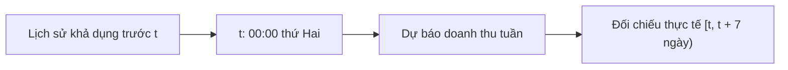
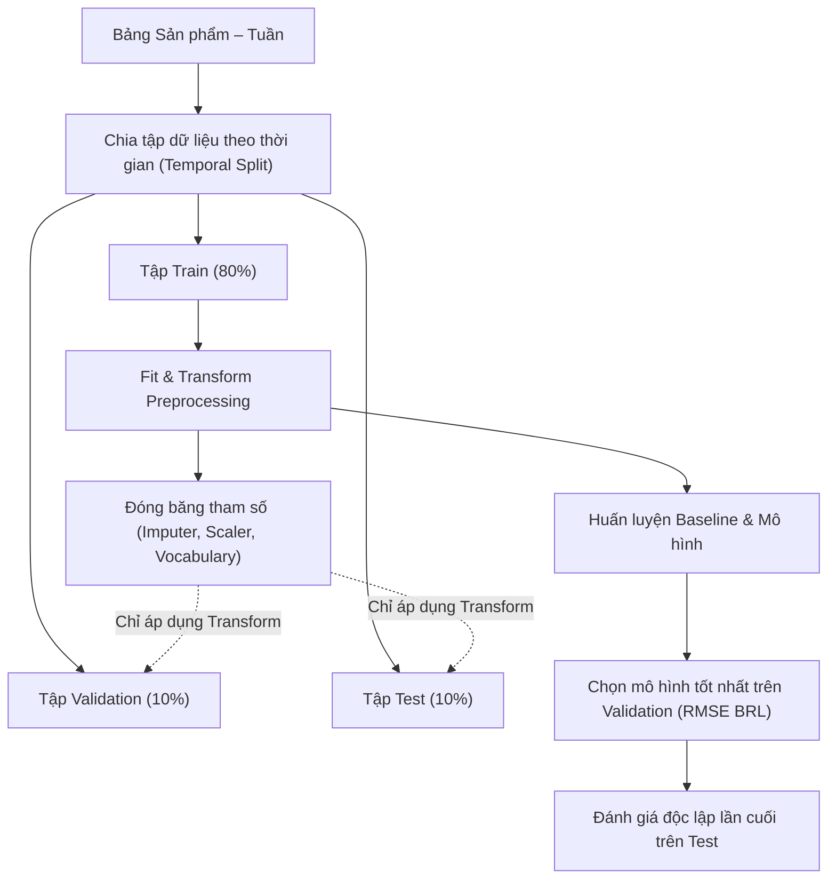

# Kế Hoạch Thực Hiện Bài Lab Dự Báo Doanh Thu Theo 5W1H và Target Structure

Tài liệu trình bày kế hoạch thực hiện bài thực hành (lab) môn Học Máy (Machine Learning), nhằm thử nghiệm bài toán dự báo doanh thu sản phẩm theo tuần từ tập dữ liệu thương mại điện tử Olist. Kế hoạch định hình cấu trúc dữ liệu và các bước làm bài ngay từ giai đoạn khởi đầu, hoàn toàn không đề cập đến mã nguồn cụ thể hay bất kỳ kết quả thực nghiệm nào.

## 1. What — Bài lab cần giải quyết bài toán gì?

### 1.1. Bài toán và đầu ra mong đợi

Nhóm xác định mục tiêu là bài toán hồi quy chuỗi thời gian (time-series regression) nhằm dự báo tổng doanh thu trong 7 ngày của tuần kế tiếp cho từng sản phẩm có lịch sử bán hàng trên bảng Sản phẩm – Tuần (Product–Week Panel).
Khóa định danh của mỗi bản ghi là `(product_id, week_start)`, với `week_start` được quy chuẩn về 00:00 thứ Hai đầu tuần. Doanh thu mục tiêu $s_{p,t}$ được tính bằng tổng giá bán các mặt hàng hợp lệ trong tuần:

```math
s_{p,t} = \sum_{i \in I_{p,t}} \text{price}_i
```

Trong đó $I_{p,t}$ là tập các mặt hàng hợp lệ được đặt mua trong tuần $t$. Doanh thu tính theo đồng BRL, không bao gồm phí vận chuyển (`freight_value`). Đầu ra mong đợi là giá trị doanh thu dự báo không âm cho từng sản phẩm.

### 1.2. Giới hạn phạm vi bài lab

Đây thuần túy là một bài thực hành môn học phục vụ học tập, không phải một dự án thương mại hay hệ thống phần mềm triển khai thực tế.

| Luồng phân tích | Đầu ra mong đợi                                    | Giới hạn và giả định khi làm bài                                     |
| ------------------ | ------------------------------------------------------ | ----------------------------------------------------------------------------- |
| Weekly forecast    | Doanh thu sản phẩm trong tuần kế tiếp             | Luồng chính; học trên chuỗi lịch sử quan sát của sản phẩm          |
| Cold-start proxy   | Doanh thu 7 ngày đầu từ giao dịch đầu tiên     | Ước lượng khởi đầu; nhãn đã chứa giao dịch đầu tiên đã biết |
| Marketing scenario | Doanh thu thay đổi theo giả định ngân sách      | Mô phỏng độ nhạy toán học; chưa đo lường tác động nhân quả    |
| Discount scenario  | Doanh thu theo giá giảm và sản lượng giả định | Khảo sát kịch bản; chưa mô hình hóa độ co giãn cầu theo giá      |

Kết quả đầu ra chỉ phục vụ so sánh kết quả giữa các mô hình trong bài lab, không dùng để điều hành kinh doanh hay tự động hóa đặt hàng thực tế.

### 1.3. Dữ liệu nguồn

Dữ liệu đầu vào sử dụng tập dữ liệu công khai Olist gồm các bảng quan hệ:

| Tên bảng nguồn                   | Đơn vị bản ghi và khóa | Các trường thông tin chính               | Vai trò trong bài lab                                      |
| ----------------------------------- | ---------------------------- | --------------------------------------------- | ------------------------------------------------------------ |
| `olist_order_items_dataset.csv`   | Từng mặt hàng trong đơn | `order_id`, `product_id`, `price`       | Xác định sản phẩm, đơn giá và doanh thu mục tiêu  |
| `olist_orders_dataset.csv`        | Một đơn hàng             | `order_id`, `order_purchase_timestamp`    | Cung cấp mốc thời gian mua hàng để gom tuần           |
| `olist_products_dataset.csv`      | Một sản phẩm              | `product_id`, `product_category_name`     | Cung cấp phân loại ngành hàng và thuộc tính vật lý |
| `olist_customers_dataset.csv`     | Một khách hàng            | `customer_id`, `customer_unique_id`       | Định danh khách hàng duy nhất để tính tần suất mua |
| `olist_order_reviews_dataset.csv` | Đánh giá đơn hàng      | `order_id`, `review_score`, `timestamp` | Tín hiệu chất lượng khả dụng trước mốc dự báo    |

Nhóm liên kết các bảng theo quan hệ nhiều-một từ mặt hàng sang đơn hàng và sản phẩm. Dữ liệu thiếu trường bắt buộc bị loại bỏ trước khi tổng hợp bảng tuần.

## 2. Why — Vì sao nhóm chọn hướng thiết kế này?

### 2.1. Giữ các tuần không phát sinh giao dịch

Nếu chỉ tổng hợp những tuần có đơn hàng, dữ liệu sẽ bị thiên lệch chọn mẫu (selection bias). Do đó, nhóm quyết định giữ lại toàn bộ các tuần có doanh thu bằng 0 kể từ giao dịch đầu tiên của sản phẩm đến hết kỳ quan sát, giúp mô hình học được xác suất không bán được hàng.

### 2.2. Ưu tiên baseline trước khi thử nghiệm mô hình phức tạp

Theo nguyên tắc nền tảng của học máy, nhóm luôn xây dựng các mô hình tham chiếu cơ sở (Zero, Revenue Mean, Log Mean, Previous Week) làm mốc so sánh. Một mô hình phức tạp chỉ được xem xét nếu chứng minh được sự vượt trội rõ rệt so với baseline trên tập Validation.

### 2.3. Tự cài đặt thuật toán để hiểu sâu kiến thức

Nhóm lựa chọn phương hướng tự cài đặt các thuật toán nền tảng từ đầu (From-Scratch) trên các thư viện đại số tuyến tính cơ bản để hiểu sâu cơ chế cập nhật trọng số, hàm mất mát và phân tách nhánh cây, phục vụ mục tiêu học tập.

### 2.4. Chia tập dữ liệu trước và tối ưu trên thang log

Doanh thu thương mại điện tử lệch phải rất mạnh, nhóm chọn biến đổi mục tiêu sang không gian $y = \log(1 + s)$ để ổn định quá trình tối ưu. Tuy nhiên, sai số bắt buộc phải được đánh giá lại trên thang tiền tệ BRL gốc sau khi chuyển ngược.

## 3. Who — Phân công vai trò trong nhóm thực hiện bài lab

| Vai trò trong nhóm                  | Công việc phụ trách                                                            | Yêu cầu thực hiện                                                   |
| ------------------------------------- | ------------------------------------------------------------------------------------ | ----------------------------------------------------------------------- |
| Thành viên phụ trách dữ liệu    | Xây dựng panel sản phẩm–tuần, kiểm soát tính toàn vẹn và mốc thời gian | Ngăn chặn trùng lặp item, bảo toàn tuần doanh thu bằng 0        |
| Thành viên phát triển mô hình   | Xây dựng baseline, cài đặt thuật toán hồi quy và tối ưu siêu tham số    | Tuân thủ hạt giống ngẫu nhiên (seed), ghi nhận cấu hình        |
| Thành viên đánh giá & kiểm thử | Đo lường sai số trên tập Validation/Test, phân tích lỗi phân phối         | Giữ tập Test độc lập tuyệt đối, đánh giá trên thang đo BRL |
| Giảng viên hướng dẫn / Reviewer  | Hướng dẫn và đánh giá kết quả bài lab                                                | Đối chiếu cách làm với các nguyên lý học máy cơ bản         |

## 4. When — Trục thời gian và kỷ luật chia tập dữ liệu

### 4.1. Mốc dự báo (Forecast Origin) và Horizon

Mốc dự báo $t$ được chốt tại 00:00 thứ Hai đầu tuần cần dự báo. Khoảng thời gian dự báo (horizon) là 7 ngày kế tiếp $[t, t + 7)$. Toàn bộ đặc trưng đầu vào chỉ được thu thập từ thông tin phát sinh trước thời điểm $t$.



### 4.2. Phân chia Train, Validation, Test theo thời gian (Temporal Split)

Để mô phỏng đúng bài toán thực tế dự báo tương lai từ quá khứ, nhóm kiên quyết bác bỏ phương pháp chia ngẫu nhiên (Random Split). Thay vào đó, toàn bộ dữ liệu panel được chia theo thứ tự thời gian tuần:

- **Tập Train (khoảng 80% số tuần đầu):** Dùng để học tham số mô hình và học các tham số tiền xử lý.
- **Tập Validation (khoảng 10% số tuần kế tiếp):** Dùng để tinh chỉnh siêu tham số và lựa chọn mô hình tối ưu.
- **Tập Test (khoảng 10% số tuần cuối cùng):** Đánh giá khách quan lần cuối; tuyệt đối không dùng để chọn mô hình.

### 4.3. Giới hạn quan sát của dữ liệu Olist

Dữ liệu Olist là bản ghi ảnh chụp tĩnh (snapshot). Để đảm bảo tính trung thực khi làm bài, nhóm ghi nhận giới hạn rằng trạng thái giao hàng thành công tại thời điểm $t$ có thể chưa hoàn tất ngoài thực tế, do đó bài lab được xác định là thử nghiệm offline trên máy.

## 5. Where — Tổ chức dữ liệu và phân tầng bài lab

Bài lab được thiết kế phân tầng ngoại tuyến chặt chẽ gồm bốn lớp chức năng:

- **Lớp dữ liệu:** Tiếp nhận dữ liệu nguồn Olist thô, làm sạch và tạo lập bảng Sản phẩm – Tuần.
- **Lớp phân chia & tiền xử lý:** Chia tách dữ liệu theo thời gian, fit tiền xử lý trên Train và transform sang Validation/Test.
- **Lớp mô hình:** Cài đặt các baseline đối chuẩn và các thuật toán học máy ứng viên.
- **Lớp đánh giá & tổng hợp:** Tính toán các độ đo sai số BRL, phân tích sai số trên các phân khúc sản phẩm.

## 6. How — Quy trình xử lý và huấn luyện không rò rỉ dữ liệu

### 6.1. Nguyên tắc cốt lõi: Chia dữ liệu TRƯỚC, Tiền xử lý SAU (Data Leakage Prevention)

Trong học máy (Machine Learning), bạn luôn phải chia dữ liệu (Train/Test Split) TRƯỚC, rồi mới tiến hành xử lý dữ liệu (Preprocessing). Nếu tính toán thống kê (imputation, encoding, scaling) trên toàn bộ dữ liệu trước khi chia tách, thông tin phân phối từ tương lai và tập kiểm thử sẽ bị rò rỉ (Data Leakage) vào tập huấn luyện, làm vô hiệu hóa kết quả đánh giá của bài lab.

- **Rò rỉ qua thống kê toàn cục:** Tính toán mean/median/std trên toàn bộ tập dữ liệu trước khi split khiến tập Train "biết trước" phân phối tương lai của Test.
- **Rò rỉ qua thứ tự thời gian:** Dùng dữ liệu phát sinh sau mốc dự báo $t$ để tạo đặc trưng sẽ làm sai lệch bản chất hồi quy dự báo.



### 6.2. Không gian đặc trưng và quy tắc tiền xử lý

| Nhóm đặc trưng       | Tên đặc trưng dự kiến                                         | Quy tắc thời gian và chống rò rỉ                                            |
| ------------------------ | ------------------------------------------------------------------- | --------------------------------------------------------------------------------- |
| Doanh thu trễ           | `last_week_sales`, `sales_lag_2_weeks`, `sales_lag_4_weeks`   | Lấy theo tuần lịch, giữ cả tuần bằng 0, không lấy tuần đích           |
| Thống kê cuộn         | `sales_mean_4_weeks`, `sales_std_4_weeks`                       | Tính trên cửa sổ trượt quá khứ, kết thúc trước thời điểm $t$     |
| Quán tính sản lượng | `last_week_units`, `weeks_since_first_sale`                     | Chỉ tính sản lượng các tuần trước, không dùng số lượng tuần đích |
| Đánh giá khách hàng | `past_review_count`, `past_review_rating`                       | Chỉ lấy phản hồi có mốc thời gian trước thời điểm dự báo $t$      |
| Ngữ cảnh & Thời gian  | `product_category_name`, `month`, `quarter`, `week_of_year` | Mã hóa danh mục theo Train; biến lịch tính từ tuần đích                 |

Quy tắc tiền xử lý đóng băng: Mọi giá trị điền khuyết (median, mode), từ điển mã hóa danh mục và tỷ lệ chuẩn hóa CHỈ được fit duy nhất trên tập Train. Validation và Test chỉ nhận phép biến đổi (`transform`) thụ động. Danh mục mới chưa thấy ở Train sẽ được gán nhãn `unknown`.

### 6.3. Baseline và các thuật toán học máy ứng viên

| Mô hình              | Cơ chế hoạt động                                   | Mục đích đối chuẩn và kiểm soát rủi ro                           |
| ---------------------- | ------------------------------------------------------- | -------------------------------------------------------------------------- |
| Zero Baseline          | Dự báo toàn bộ bằng 0                              | Kiểm chuẩn độ thưa của dữ liệu; mốc tối thiểu cần vượt qua   |
| Revenue Mean Baseline  | Dự báo hằng số bằng trung bình doanh thu Train    | Kiểm tra hiệu quả của mô hình hằng số trên thang đo tiền tệ    |
| Log Mean Baseline      | Dự báo bằng trung bình logarit doanh thu Train      | Đối chứng mô hình hằng số trong không gian tối ưu log            |
| Previous Week Baseline | Dự báo bằng doanh thu tuần trước ($s_{p, t-1}$) | Kiểm chứng giả định chuỗi thời gian có quán tính ngắn hạn      |
| Linear Regression      | Hồi quy tuyến tính có điều chuẩn Ridge ($L_2$) | Mốc chuẩn tham chiếu dễ giải thích; kiểm soát đa cộng tuyến     |
| Decision Tree          | Cây phân tách nhị phân theo giảm phương sai     | Học quan hệ phi tuyến; kiểm soát độ sâu để tránh quá khớp     |
| Random Forest          | Học kết hợp Bagging trên mẫu bootstrap             | Giảm phương sai dự báo và hạn chế quá khớp của cây đơn lẻ   |
| Gradient Boosting      | Học kết hợp Boosting tuần tự trên phần dư       | Nâng cao độ chính xác; kiểm soát tốc độ học để tránh overfit |
| Two-Stage Hurdle       | Tách xác suất bán (P > 0) và hồi quy mức bán    | Đặc trị dữ liệu thưa có tỷ lệ tuần doanh thu bằng 0 lớn        |

Hurdle kết hợp xác suất bán $\hat{p}(x)$ với hồi quy mức bán dương $\hat{y}_{pos}(x)$: $\hat{s}(x) = \hat{p}(x) \cdot \max(0, \exp(\hat{y}_{pos}(x)) - 1)$.

### 6.4. Đánh giá và lựa chọn mô hình

Tiêu chí tiên quyết để chọn mô hình là **Validation RMSE trên đơn vị tiền tệ BRL** sau khi chuyển đổi ngược: $\hat{s} = \max(0, \exp(\hat{y}) - 1)$.

```math
\text{RMSE} = \sqrt{\frac{1}{N}\sum_{i=1}^{N}(s_i - \hat{s}_i)^2}
```

Các độ đo bổ trợ được định nghĩa như sau:

- **MAE:** Sai số tuyệt đối trung bình, đo lường độ lệch điển hình tính bằng BRL: $\text{MAE} = \frac{1}{N}\sum |s_i - \hat{s}_i|$.
- **$R^2$ Score:** Hệ số xác định, đánh giá tỷ lệ phương sai mà mô hình giải thích được so với mốc trung bình.
- **WAPE:** Sai số phần trăm có trọng số $\frac{\sum |s_i - \hat{s}_i|}{\sum s_i}$, tránh chia cho 0 khi doanh thu bằng 0.

Nếu không có thuật toán học máy nào vượt qua baseline tốt nhất trên tập Validation, nhóm sẽ giữ baseline làm kết quả chính thức của bài lab.

### 6.5. Các phần mở rộng thêm của bài lab

- **Cold-start proxy:** Dùng thuộc tính sản phẩm và giá giao dịch đầu tiên để ước lượng doanh thu 7 ngày đầu. Bắt buộc so sánh với baseline giá bán đơn vị và trung vị danh mục; loại bỏ các mẫu có nhãn vượt ranh giới split để tránh rò rỉ.
- **Mô phỏng kịch bản (Scenario):** Áp dụng hàm phản hồi phi tuyến $\text{uplift}(a) = 1 + \beta \ln(1 + a / S_{ref})$ để khảo sát độ nhạy doanh thu theo giả định ngân sách tiếp thị $a$.

## 7. Target Structure — Cấu trúc bài lab và ranh giới dữ liệu

### 7.1. Cấu trúc thư mục định hướng & Tiêu chí phân chia

**Tiêu chí phân chia cấu trúc dự án:**
1. **Chống rò rỉ dữ liệu (Tiêu chí cốt lõi):** Tách bạch dữ liệu gốc bất biến (`data/raw/`) với bảng tổng hợp tuần (`data/processed/`). Bảng tuần chỉ lưu dữ liệu thô, tuyệt đối không điền khuyết hay chuẩn hóa tại đây. Việc chia tập theo thời gian (Train/Val/Test) bắt buộc phải diễn ra TRƯỚC mọi bước tiền xử lý (chỉ fit trên Train, đóng băng transform sang Val/Test).
2. **Phân tách trách nhiệm (Separation of Concerns):** Mỗi thư mục trong `src/` chỉ thực hiện một nhiệm vụ độc lập theo luồng một chiều (`data` $\to$ `models` $\to$ `evaluation` $\to$ `deployment`). Thư mục `notebooks/` dành riêng cho việc phân tích khám phá (EDA) và thử nghiệm ban đầu mà không làm ảnh hưởng đến mã nguồn chính.
3. **Cô lập mã nguồn và kết quả:** Toàn bộ sản phẩm sinh ra sau khi chạy (bảng độ đo sai số, mô hình đóng gói) được tách riêng vào `results/` (`metrics/`, `saved_models/`), tránh ghi đè làm bẩn thư mục code `src/`.
4. **Tập trung cấu hình & Khả năng tái lập:** Mọi mốc thời gian chia tuần, tỷ lệ split 80/10/10 và hạt giống ngẫu nhiên (seed) được quản lý tập trung duy nhất tại `src/config.py`.
5. **Kiểm thử độc lập:** Các bài kiểm tra logic chia tập không rò rỉ và tính đúng đắn của thuật toán From-Scratch được tổ chức độc lập tại `tests/`.

```text
sales_predictor/
├── data/
│   ├── raw/                  # Bảng dữ liệu gốc từ Olist (các tệp CSV ban đầu)
│   └── processed/            # Panel sản phẩm–tuần thô trước khi split (chưa scale)
├── docs/
│   ├── algorithms/           # Tài liệu thiết kế ban đầu về mô hình và bài lab
│   ├── description_for_AI_working/ # Nhật ký kỹ thuật và tiến trình các phiên bản
│   ├── report/               # Báo cáo tổng kết bài lab môn học
│   └── ML project_ Predicting Product Sales.pdf # Đề bài gốc của môn học
├── notebooks/                # Các notebook phân tích dữ liệu và thử nghiệm (01 đến 05)
├── src/
│   ├── config.py             # Cấu hình tập trung: mốc thời gian, tỷ lệ split, seed
│   ├── data/                 # Nạp dữ liệu thô, làm sạch và tạo bảng Product–Week
│   ├── models/               # Cài đặt baseline và các thuật toán From-Scratch
│   ├── evaluation/           # Tính toán các độ đo sai số BRL và phân tích lỗi
│   ├── deployment/           # Đóng gói suy luận dự báo phục vụ ứng dụng
│   └── utils/                # Các hàm tiện ích bổ trợ
├── results/
│   ├── metrics/              # Bảng số liệu sai số các mô hình (CSV/JSON)
│   └── saved_models/         # File đóng gói artifact mô hình sau huấn luyện
├── tests/                    # Kiểm thử tự động tính toàn vẹn và logic bài lab
├── app.py                    # Giao diện Web tương tác demo kết quả
├── main.py                   # Điểm khởi chạy tự động toàn bộ luồng bài lab
├── requirements.txt          # Khai báo các thư viện phụ thuộc
└── README.md                 # Hướng dẫn tổng quan và báo cáo kết quả bài lab
```

### 7.2. Ranh giới dữ liệu giữa các bước thực hiện

| Ranh giới luồng      | Dữ liệu đầu vào                           | Dữ liệu đầu ra                                   | Điều kiện kiểm soát chống rò rỉ dữ liệu                                   |
| ---------------------- | ---------------------------------------------- | ---------------------------------------------------- | ----------------------------------------------------------------------------------- |
| Nguồn → Panel        | Các bảng dữ liệu Olist                     | Bảng Sản phẩm – Tuần                            | Kiểm tra khóa chính, giữ tuần không phát sinh đơn hàng                    |
| Panel → Split         | Bảng Sản phẩm – Tuần xếp theo thời gian | 3 tập độc lập: Train, Validation, Test           | Tuyệt đối không trùng lặp tuần; chia tách TRƯỚC mọi bước tiền xử lý |
| Split → Preprocessing | Tập Train, Validation, Test thô              | Dữ liệu đã chuẩn hóa và Pipeline đóng băng | Bộ tiền xử lý CHỈ fit trên Train; Validation/Test chỉ áp dụng transform    |
| Preprocessing → Model | Ma trận đặc trưng $X$ và nhãn $y$    | Các mô hình và baseline đã huấn luyện        | Huấn luyện trên Train; tinh chỉnh siêu tham số duy nhất trên Validation     |
| Model → Evaluation    | Dự báo và nhãn thực tế                   | Bảng độ đo RMSE, MAE, R², WAPE                  | Chuyển ngược về thang BRL; chỉ đánh giá Test đúng một lần duy nhất     |

## 8. Tiêu chuẩn đánh giá và hoàn thành bài lab

1. **Nguyên tắc chống rò rỉ:** Phân chia tập dữ liệu theo thời gian TRƯỚC khi tiền xử lý; tham số tiền xử lý chỉ học trên Train.
2. **So sánh với baseline:** Bắt buộc có baseline làm chuẩn đối chiếu; mô hình phức tạp phải chứng minh cải thiện trên Validation.
3. **Độ đo thực tế:** Đánh giá trên thang đo tiền tệ BRL, không lấy sai số trên không gian log làm kết luận cuối cùng.
4. **Bảo toàn tập Test:** Giữ tập Test độc lập hoàn toàn, không sử dụng kết quả Test để can thiệp hay chọn siêu tham số.
5. **Khả năng tái lập:** Cố định hạt giống ngẫu nhiên (seed) và mốc thời gian để kết quả bài lab có thể chạy lại nhất quán.
6. **Độc lập mã nguồn và kết quả:** Bản kế hoạch định hình các bước làm bài ban đầu, không phụ thuộc chi tiết cài đặt hay kết quả có sẵn.
7. **Tính trung thực khi làm bài:** Báo cáo khách quan mọi hạn chế của mô hình và sẵn sàng chấp nhận baseline nếu mô hình bị quá khớp.
