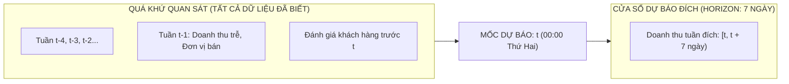
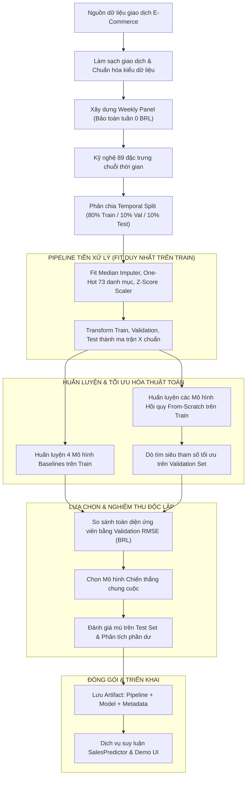

# Thiết Kế Hệ Thống Sales Predictor: Đặc Tả Kiến Trúc & Giải Thuật (5W1H & Target Structure)

> **Tài liệu đặc tả kỹ thuật (Technical Specification & Architecture Design)**  
> Bản đặc tả này thiết lập bài toán, ranh giới kiến trúc, hợp đồng dữ liệu, công thức toán học và nguyên tắc thiết kế thuật toán cho hệ thống **Dự Báo Doanh Thu Sản Phẩm Theo Tuần (Weekly Product Sales Predictor)** trước khi triển khai mã nguồn. Mọi thành phần mã nguồn và quy trình thực nghiệm phải tuân thủ nghiêm ngặt các ranh giới quy định trong tài liệu này.

---

## 1. What — Hệ thống giải quyết bài toán gì?

### 1.1. Định nghĩa bài toán kỹ thuật
Bài toán trọng tâm của hệ thống là **Hồi quy chuỗi thời gian dạng bảng (Tabular Time-Series Regression)** nhằm dự báo tổng doanh thu bán hàng của từng sản phẩm cụ thể trong một tuần dương lịch kế tiếp, chỉ sử dụng toàn bộ thông tin lịch sử đã phát sinh và được ghi nhận trước thời điểm bắt đầu tuần dự báo đó.

- **Đơn vị phân tích (Granularity / Primary Key):** Cặp `(product_id, order_purchase_timestamp)` — đại diện cho từng Sản phẩm – Tuần.
- **Biến mục tiêu gốc (Raw Target):** Tổng giá trị bán hàng phát sinh trong tuần của sản phẩm:

$$
s_{p,t} = \sum_{i \in I_{p,t}} \mathrm{price}_i \quad (\text{đơn vị: Brazilian Real - BRL})
$$

*(Trong đó $I_{p,t}$ là tập hợp các đơn vị sản phẩm $p$ được đặt mua trong tuần $t$; không bao gồm phí vận chuyển `freight_value`).*

- **Tính chất dữ liệu:** Dữ liệu có tính thưa cực đoan (Zero-Inflation: >90% tuần không phát sinh đơn hàng đối với phần lớn sản phẩm) và phân phối doanh thu dương bị lệch phải nghiêm trọng (Heavy-Tailed Right-Skewed Distribution).

### 1.2. Phân định phạm vi các luồng chức năng (Functional Scope)

Hệ thống được thiết kế phân rã thành 3 luồng chức năng độc lập với hợp đồng dữ liệu và mục tiêu chuyên biệt:

| Luồng chức năng | Mục tiêu đầu ra | Phương pháp thiết kế | Tiêu chuẩn nghiệm thu |
| :--- | :--- | :--- | :--- |
| **1. Weekly Forecast (Luồng lõi)** | Dự báo doanh thu tuần $[t, t+7\text{ ngày})$ cho các sản phẩm đã có lịch sử bán hàng trong hệ thống. | Huấn luyện trên bảng chuỗi thời gian Sản phẩm – Tuần (Weekly Panel) bảo toàn các tuần 0 BRL; sử dụng các mô hình hồi quy From-Scratch. | Chọn mô hình có **Validation RMSE (BRL)** thấp nhất; kiểm định mù trên Test Set độc lập theo thời gian. |
| **2. Cold-Start Proxy (Luồng dự phòng)** | Dự báo doanh thu tích lũy trong 7 ngày đầu tiên cho sản phẩm mới niêm yết (chưa có dữ liệu trễ bán hàng). | Trích xuất đặc trưng nội dung (danh mục, kích thước, khối lượng, giá niêm yết ban đầu) kết hợp với baseline đơn giá ngành hàng. | Đánh giá sai số MAE và RMSE trên tập các sản phẩm mới xuất hiện ở giai đoạn sau của chuỗi dữ liệu. |
| **3. Mô phỏng Kịch bản Kinh tế (Simulation Engine)** | Ước lượng độ nhạy doanh thu theo biến động ngân sách Marketing hoặc kịch bản chiết khấu giá (Discount). | Áp dụng mô hình phản hồi phi tuyến (Diminishing Marginal Returns / Elasticity) theo giả định kinh tế lượng. | Trực quan hóa đường cong phản hồi và kiểm tra tính hợp lý của tỷ suất sinh lời gia tăng (Marginal ROAS). |

> [!IMPORTANT]
> **Ranh giới nghiệm thu:** Luồng 1 (Weekly Forecast) là luồng duy nhất quyết định việc lựa chọn và lưu trữ Mô hình chính (Primary Model Artifact). Các luồng Cold-Start và Simulation được thiết kế dưới dạng các module bổ trợ (Auxiliary Modules) và không được gộp chung thang đo đánh giá với luồng chính.

---

## 2. Why — Tại sao lựa chọn các giải pháp kiến trúc này?

Mọi quyết định thiết kế kỹ thuật trong hệ thống đều phải giải trình rõ ràng về mặt lý thuyết học máy và kiểm soát rủi ro:

### 2.1. Tại sao xây dựng Product–Week Panel bảo toàn tuần 0 BRL?
- **Vấn đề nếu chỉ gom theo giao dịch:** Nếu chỉ gom dữ liệu trên các tuần có phát sinh giao dịch, tập dữ liệu sẽ bỏ qua hoàn toàn các tuần sản phẩm không bán được hàng. Điều này dẫn đến hiện tượng **Sai lệch sinh tồn (Survivorship Bias)**, khiến mô hình bị lạc quan quá mức và mất khả năng nhận diện các giai đoạn nhu cầu ngắt quãng.
- **Giải pháp thiết kế:** Khởi tạo lưới đầy đủ mọi tuần từ thời điểm sản phẩm phát sinh giao dịch đầu tiên đến hết kỳ quan sát. Các tuần không có đơn hàng được điền giá trị $0.0\text{ BRL}$. Nhờ đó, mô hình học được cả xác suất không bán được hàng và mức độ doanh số khi có nhu cầu.

### 2.2. Tại sao tuân thủ nguyên tắc Baseline-First?
- Theo kỷ luật học thuật và kỹ thuật AI, không một mô hình phức tạp nào được phép triển khai nếu không chứng minh được sự vượt trội có ý nghĩa thống kê so với các mô hình cơ sở đối chứng (Baselines).
- Hệ thống thiết kế bắt buộc 4 tầng Baseline đối chuẩn trước:
  1. *Zero Baseline:* Luôn dự báo bằng 0 BRL (thước đo độ thưa của bài toán).
  2. *Revenue Mean Baseline:* Dự báo bằng giá trị trung bình doanh thu toàn bộ tập huấn luyện.
  3. *Log Mean Baseline:* Dự báo bằng nghịch đảo trung bình nhãn logarit của tập huấn luyện.
  4. *Persistence Baseline (Previous Week):* Lấy nguyên doanh thu tuần trước $(t-1)$ làm dự báo cho tuần này $(t)$.

### 2.3. Tại sao cài đặt thuật toán From-Scratch thuần NumPy/SciPy?
- **Mục tiêu học thuật:** Nhằm làm chủ hoàn toàn cơ chế toán học bên dưới: hiểu sâu bản chất nghiệm giải tích của Normal Equation, cơ chế phân nhánh dựa trên giảm phương sai (Variance Reduction) của Decision Tree, cơ chế lấy mẫu Bootstrap và subsampling của Random Forest, cũng như cơ chế học trên phần dư của Gradient Boosting.
- **Kiểm soát rủi ro:** Tránh hiện tượng "hộp đen" từ các thư viện cấp cao; cho phép can thiệp trực tiếp vào từng bước tính gradient, kẹp giá trị (clamping), và xử lý tối ưu bộ nhớ trên ma trận thưa (Sparse CSR Matrix).

### 2.4. Tại sao chia tập dữ liệu theo thứ tự thời gian (Temporal Split)?
- Dữ liệu bán hàng có tính phụ thuộc thời gian mạnh mẽ (xu hướng và mùa vụ).
- Việc chia ngẫu nhiên (Random K-Fold) sẽ gây rò rỉ dữ liệu tương lai vào tập huấn luyện (Data Leakage), làm điểm số đánh giá cao một cách giả tạo nhưng thất bại hoàn toàn khi suy luận thực tế.
- Thiết kế quy định phân chia 80% Train – 10% Validation – 10% Test hoàn toàn dựa trên các mốc tuần lịch kế tiếp nhau.

### 2.5. Tại sao tối ưu trong không gian Log và nghịch đảo ra BRL?
- Phân phối doanh số bán hàng trong thương mại điện tử có đuôi dài (Heavy-Tailed). Áp dụng hàm mất mát MSE trực tiếp trên thang đo BRL sẽ khiến các sản phẩm có doanh thu đột biến (outliers) chi phối toàn bộ gradient, làm mô hình mất ổn định.
- Huấn luyện trên không gian $y = \log(1 + s)$ giúp nén độ lệch phân phối, đưa hàm mất mát về dạng tối ưu đối xứng hơn.
- **Trade-off cần kiểm soát:** Cực tiểu hóa MSE trên không gian log không đồng nhất với cực tiểu hóa RMSE trên thang tiền tệ BRL. Do đó, mô hình phải được đánh giá và chọn lọc cuối cùng dựa trên sai số thực tế sau khi đã nghịch đảo:

$$
\hat{s} = \max\left(0.0, \; \exp(\hat{y}) - 1.0\right)
$$

---

## 3. Who — Ranh giới trách nhiệm & Các tác nhân trong hệ thống

Hệ thống phân định rõ trách nhiệm kỹ thuật giữa các vai trò nhằm bảo đảm tính toàn vẹn của dữ liệu và mã nguồn:

| Vai trò kiến trúc | Tác nhân phụ trách | Ranh giới trách nhiệm kỹ thuật |
| :--- | :--- | :--- |
| **Data Engineering** | Kỹ sư dữ liệu (Data Pipeline Owner) | • Xây dựng quy trình nạp, làm sạch và tạo bảng Product–Week Panel.<br>• Thiết lập pipeline tiền xử lý một chiều (Chỉ ước lượng Median, Mode, Scaler trên tập Train).<br>• Bảo đảm triệt tiêu hoàn toàn rò rỉ dữ liệu thời gian trong quá trình tạo biến lag/rolling. |
| **Model Development** | Kỹ sư học máy (ML Engineer) | • Thiết kế và cài đặt các thuật toán hồi quy From-Scratch (Baselines, OLS, Tree, Ensembles, Hurdle).<br>• Đảm bảo tính ổn định số học (Numerical Stability), chống tràn số (Overflow/Underflow).<br>• Thiết kế lưới tìm kiếm siêu tham số trên tập Validation độc lập. |
| **Model Evaluation & Audit** | Kỹ sư kiểm định (Evaluation & QA) | • Định nghĩa và tính toán bộ chỉ số sai số tiền tệ chuẩn mực: MSE, MAE, RMSE, $R^2$, WAPE.<br>• Xây dựng ma trận tổn thất tài chính (Cost Matrix: phạt tồn kho vs đứt hàng).<br>• Mổ xẻ nguyên nhân kinh tế và cơ chế lỗi của Top các đơn hàng dự báo lệch nhất. |
| **Serving & Deployment** | Kỹ sư triển khai (Backend/Inference) | • Thiết kế lớp suy luận `SalesPredictor` tiếp nhận dữ liệu đầu vào và tải Model Artifact.<br>• Đảm bảo tính nhất quán tuyệt đối về thứ tự đặc trưng (Feature Order) giữa Training và Serving.<br>• Cung cấp giao diện tương tác và giải trình các kịch bản mô phỏng kinh doanh. |
| **Stakeholder / Reviewer** | Giảng viên & Người đánh giá đồ án | • Kiểm tra tính hợp lệ của phương pháp luận toán học và cơ chế chống rò rỉ dữ liệu.<br>• Đối chiếu hiệu năng mô hình phức tạp với 4 tầng Baseline cơ sở. |

---

## 4. When — Ranh giới thời gian & Giao thức Chống rò rỉ dữ liệu (Anti-Leakage)

Khung thời gian là yếu tố sống còn trong bài toán chuỗi thời gian. Mọi đặc trưng và nhãn mục tiêu phải tuân thủ nghiêm ngặt ranh giới sau:



### 4.1. Quy ước mốc thời gian (Cadence & Horizon)
- **Chu kỳ dự báo (Cadence):** Theo tuần lịch (Thứ Hai 00:00:00 đến Chủ Nhật 23:59:59).
- **Mốc gốc dự báo (Forecast Origin $t$):** Thời điểm 00:00:00 thứ Hai đầu tuần đích.
- **Khoảng thời gian mục tiêu (Forecast Horizon):** Đúng 7 ngày tiếp theo: $[t, t + 7\text{ ngày})$.
- **Quy tắc trễ (Lag Rule):** Mọi đặc trưng đầu vào chỉ được phép sử dụng thông tin phát sinh trước thời điểm $t$. Doanh thu tuần $t-1$ (từ $t-7\text{ ngày}$ đến $t$) là thông tin gần nhất được phép đưa vào ma trận đặc trưng.

### 4.2. Giao thức Temporal Split 80/10/10
Dữ liệu chuỗi thời gian không được phép xáo trộn ngẫu nhiên. Tập dữ liệu tuần được sắp xếp tăng dần theo thời gian và chia thành 3 phân vùng độc lập:

1. **Tập Huấn luyện (Train Set - 80% số tuần đầu):** Dùng để học trọng số mô hình và ước lượng các tham số tiền xử lý (Imputer, Scaler, Categories).
2. **Tập Kiểm định (Validation Set - 10% số tuần tiếp theo):** Dùng để tinh chỉnh siêu tham số (Hyperparameter Tuning) và lựa chọn mô hình chiến thắng.
3. **Tập Kiểm tra (Test Set - 10% số tuần cuối cùng):** Tập kiểm định mù (Blind Holdout) đại diện cho tương lai hoàn toàn chưa biết, chỉ được suy luận một lần duy nhất để báo cáo năng lực tổng quát hóa.

### 4.3. Ràng buộc chống rò rỉ thông tin hồi cứu (Retrospective Leakage Guard)
- Trạng thái đơn hàng `delivered`: Trong dữ liệu thực tế, đơn hàng có thể mất vài tuần để chuyển trạng thái từ lúc đặt sang giao thành công. Khi thiết kế hệ thống, cần ghi nhận rõ ràng: việc lọc đơn hàng theo trạng thái giao hàng cuối kỳ là một giả định hồi cứu cần lưu ý khi chuyển giao sang môi trường sản xuất thực tế.
- Đặc trưng đánh giá khách hàng (Review Features): Chỉ tính trung bình điểm đánh giá và số lượng đánh giá có ngày phản hồi (`review_answer_timestamp`) trước thời điểm $t$.

---

## 5. Where — Kiến trúc phân lớp & Bản đồ Module dự kiến

Hệ thống được thiết kế theo mô hình **Kiến trúc phân lớp hướng module (Modular Layered Architecture)** nhằm bảo đảm nguyên tắc phân tách trách nhiệm (Separation of Concerns):

```text
sales_predictor/
├── src/
│   ├── config.py                 # Định nghĩa tham số hệ thống, đường dẫn, siêu tham số mặc định
│   ├── data/                     # TẦNG DỮ LIỆU (DATA LAYER)
│   │   ├── loader.py             # Nạp dữ liệu thô và kiểm toán cấu trúc ban đầu
│   │   ├── builder.py            # Chuyển đổi giao dịch thành Product–Week Panel bảo toàn tuần 0
│   │   ├── preprocessing.py      # Pipeline tiền xử lý một chiều (Imputer, Scaler, Encoder)
│   │   ├── feature_engineering.py# Tạo hệ thống 89 đặc trưng chuỗi thời gian
│   │   └── launch.py             # Xử lý dữ liệu đặc thù cho luồng Cold-Start
│   ├── models/                   # TẦNG THUẬT TOÁN HỌC MÁY (MODEL LAYER)
│   │   ├── base.py               # Lớp trừu tượng BaseEstimator quy định giao diện fit/predict
│   │   ├── baselines.py          # 4 mô hình cơ sở đối chuẩn (Zero, Mean, LogMean, Persistence)
│   │   ├── linear.py             # Hồi quy tuyến tính OLS (Normal Equation & Gradient Descent)
│   │   ├── tree.py               # Cây quyết định hồi quy (Variance Reduction & Quantile Split)
│   │   ├── ensemble.py           # Rừng ngẫu nhiên (Bagging) & Tăng cường độ dốc (Boosting)
│   │   ├── hurdle.py             # Mô hình hai giai đoạn Two-Stage Hurdle (Classifier x Regressor)
│   │   ├── cold_start.py         # Mô hình hồi quy nội dung cho sản phẩm mới
│   │   ├── tuning.py             # Bộ máy dò tìm siêu tham số trên tập Validation
│   │   └── persistence.py        # Đóng gói và lưu trữ Model Artifact
│   ├── evaluation/               # TẦNG ĐÁNH GIÁ & KIỂM ĐỊNH (EVALUATION LAYER)
│   │   ├── metrics.py            # Thước đo sai số tiền tệ (MSE, MAE, RMSE, R2, WAPE, Cost Matrix)
│   │   ├── error_analysis.py     # Phân tích phần dư và mổ xẻ Top 20 ca dự báo lệch nhất
│   │   ├── visualization.py      # Vẽ biểu đồ khoa học chuẩn xuất bản
│   │   └── experiments.py        # Quản lý thí nghiệm và đối chứng kết quả
│   └── deployment/               # TẦNG TRIỂN KHAI & PHỤC VỤ (SERVING LAYER)
│       └── predictor.py          # Lớp dịch vụ suy luận nhất quán cho môi trường thực tế
├── main.py                       # File điều phối kịch bản thực nghiệm từ đầu đến cuối
└── app.py                        # Giao diện tương tác người dùng (Streamlit UI)
```

---

## 6. How — Thiết kế Giải thuật, Luồng xử lý & Cơ chế kiểm soát

### 6.1. Sơ đồ luồng xử lý toàn trình (End-to-End Workflow)



### 6.2. Thiết kế toán học của các giải thuật From-Scratch

Toàn bộ các mô hình phải kế thừa từ lớp trừu tượng `BaseEstimator` với giao diện thống nhất:
- `fit(X, y)`: Tiếp nhận ma trận đặc trưng $X \in \mathbb{R}^{N \times D}$ và vector nhãn $y \in \mathbb{R}^N$.
- `predict(X)`: Trả về vector dự báo trong không gian huấn luyện $\hat{y} \in \mathbb{R}^N$.

#### 1. Hệ thống 4 Mô hình Cơ sở (Baselines)
- **Zero Baseline:** Luôn dự báo bằng 0 trong không gian nhãn cho mọi quan sát:

$$
\hat{y}_i = 0.0 \quad (\forall i)
$$

- **Revenue Mean Baseline:** Dự báo bằng giá trị trung bình doanh thu thực tế trên toàn bộ tập huấn luyện, quy đổi sang không gian log:

$$
\hat{y}_i = \log(1 + \bar{s}_{\mathrm{train}}), \quad \text{với } \bar{s}_{\mathrm{train}} = \frac{1}{N} \sum_{k=1}^N s_k
$$

- **Log Mean Baseline:** Dự báo bằng trung bình cộng của nhãn log trên tập huấn luyện:

$$
\hat{y}_i = \bar{y}_{\mathrm{train}} = \frac{1}{N} \sum_{k=1}^N y_k
$$

- **Persistence Baseline:** Lấy nguyên giá trị doanh thu tuần trước $(t-1)$ từ cột `last_week_sales` làm dự báo cho tuần này:

$$
\hat{y}_i(t) = \log\left(1 + \mathrm{sales}_i(t-1)\right)
$$

#### 2. Hồi quy Tuyến tính (Linear Regression with Normal Equation & Ridge Fallback)
Tìm vector trọng số $w \in \mathbb{R}^{D+1}$ giải bài toán bình phương tối thiểu có điều chuẩn $L_2$:

$$
w = \left( X^T X + \lambda I \right)^{-1} X^T y
$$

- **Cơ chế phòng vệ:** Nếu ma trận $X^T X$ suy biến hoặc có định thức gần bằng 0 ($\det \approx 0$), hệ thống tự động bổ sung hệ số điều chuẩn Ridge $\lambda > 0$ hoặc chuyển sang tối ưu bằng Hạ độ dốc (Gradient Descent):

$$
w^{(t+1)} = w^{(t)} - \eta \cdot \frac{1}{N} X^T (X w^{(t)} - y)
$$

#### 3. Cây Quyết định Hồi quy (Decision Tree Regressor)
- **Tiêu chuẩn phân nhánh (Splitting Criterion):** Tối đa hóa mức giảm phương sai (Variance Reduction):

$$
\Delta \mathrm{Var} = \mathrm{Var}(D) - \left( \frac{|D_L|}{|D|} \mathrm{Var}(D_L) + \frac{|D_R|}{|D|} \mathrm{Var}(D_R) \right)
$$

- **Tối ưu tốc độ huấn luyện (Quantile Split Candidates):** Để xử lý hàng trăm nghìn mẫu dữ liệu, không quét toàn bộ giá trị liên tục mà chọn ra 16 điểm phân vị (Percentiles) trên mỗi đặc trưng làm ngưỡng chia nhị phân.
- **Giá trị tại nút lá:** Trung bình cộng nhãn của các mẫu rơi vào lá:

$$
\hat{y}_{\mathrm{leaf}} = \frac{1}{|D_{\mathrm{leaf}}|} \sum_{i \in D_{\mathrm{leaf}}} y_i
$$

#### 4. Rừng Ngẫu Nhiên (Random Forest Regressor)
- **Kỹ thuật Bagging & Feature Subsampling:** Khởi tạo $B$ cây quyết định con độc lập. Mỗi cây $b$ được huấn luyện trên một tập dữ liệu Bootstrap $D_b$ (lấy mẫu có hoàn lại từ $D$).
- Tại mỗi node phân nhánh, chỉ xét ngẫu nhiên một tập con đặc trưng có kích thước $m = \sqrt{D}$ hoặc $m = \lfloor D/3 \rfloor$.
- **Dự báo tổng hợp:** Lấy trung bình cộng dự báo của toàn bộ các cây con:

$$
\hat{y}(x) = \frac{1}{B} \sum_{b=1}^B \hat{y}_b(x)
$$

#### 5. Tăng Cường Độ Dốc (Gradient Boosting Regressor)
- Khởi tạo giá trị cơ sở:

$$
F_0(x) = \arg\min_{\gamma} \sum_{i=1}^N L(y_i, \gamma) = \bar{y}
$$

- Với mỗi vòng lặp $m = 1, \dots, M$:
  1. Tính phần dư âm (Negative Gradient / Pseudo-Residuals) theo hàm mất mát MSE:

$$
r_{im} = -\left[ \frac{\partial L(y_i, F(x_i))}{\partial F(x_i)} \right]_{F = F_{m-1}} = y_i - F_{m-1}(x_i)
$$

  2. Huấn luyện một cây hồi quy nông $h_m(x)$ khớp với các phần dư $r_{im}$.
  3. Cập nhật mô hình tổng hợp với hệ số co hẹp tốc độ học $\nu \in (0, 1]$ (Learning Rate Shrinkage):

$$
F_m(x) = F_{m-1}(x) + \nu \cdot h_m(x)
$$

#### 6. Mô hình Hai Giai Đoạn (Two-Stage Hurdle Regressor)
Mô hình chuyên biệt xử lý dữ liệu lạm phát số không (Zero-Inflation) bằng cách tách bài toán thành 2 bước xác suất độc lập:

$$
\mathbb{E}[S \mid x] = P(S > 0 \mid x) \times \mathbb{E}[S \mid S > 0, x]
$$

- **Giai đoạn 1 (Occurrence Stage):** Mô hình phân loại nhị phân ước lượng xác suất bán được hàng:

$$
\hat{p}(x) = P(s > 0 \mid x)
$$

- **Giai đoạn 2 (Severity Stage):** Mô hình hồi quy huấn luyện duy nhất trên tập con các mẫu có doanh số dương ($s > 0$), dự báo mức doanh thu kỳ vọng $\hat{s}_{>0}(x)$.
- **Dự báo kết hợp:**

$$
\hat{s}_{\mathrm{final}} = \hat{p}(x) \times \hat{s}_{>0}(x)
$$

---

## 7. Target Structure — Cấu trúc hệ thống và Hợp đồng giao tiếp

### 7.1. Cấu trúc ranh giới hệ thống & Hợp đồng Input/Output

Để hệ thống hoạt động ổn định và có thể tái lập kết quả, các ranh giới giữa các module được chuẩn hóa theo bảng hợp đồng kỹ thuật sau:

| Ranh giới Module | Thành phần Đầu vào (Input) | Hợp đồng Đầu ra (Output) | Ràng buộc kỹ thuật & Xử lý biên |
| :--- | :--- | :--- | :--- |
| **Raw Data $\to$ Panel Builder** | 6 DataFrames giao dịch gốc từ Olist. | DataFrame Product–Week Panel chứa khóa `(product_id, timestamp)`, cột `sales` gốc và các cột trễ. | • Bỏ tuần biên đầu và tuần biên cuối của dữ liệu do không đủ 7 ngày.<br>• Giữ trọn vẹn các tuần 0 BRL từ tuần bán đầu tiên. |
| **Panel $\to$ Preprocessing** | Panel chia theo Temporal Split (Train, Val, Test). | Pipeline đã fit trên Train; ma trận đặc trưng $X$ và vector $y$. | • $X$ có cùng số cột $D$ và thứ tự cột tuyệt đối không đổi giữa Train, Val, Test.<br>• $y = \log(1 + \text{sales})$. |
| **Preprocessing $\to$ Estimators** | Ma trận $X \in \mathbb{R}^{N \times D}$, vector $y \in \mathbb{R}^N$. | Đối tượng mô hình đã huấn luyện có phương thức `predict(X)`. | • Mô hình chỉ tiếp nhận dữ liệu số đã qua chuẩn hóa.<br>• `predict(X)` trả về vector nhãn trong không gian log. |
| **Estimators $\to$ Evaluator** | Vector dự báo log $\hat{y}$ và nhãn thực tế $y$. | Bảng số liệu chỉ số đánh giá theo tiền tệ thực tế (BRL). | • Bắt buộc chuyển đổi về BRL: $\hat{s} = \max(0, \exp(\hat{y}) - 1)$ trước khi tính RMSE, MAE, WAPE. |
| **Training $\to$ Persistence** | Pipeline tiền xử lý, Mô hình chiến thắng, Metadata. | Tệp nhị phân đóng gói `best_sales_model.pkl`. | • Lưu kèm mã băm schema (schema hash) và danh sách tên đặc trưng để đối soát khi phục vụ. |
| **Artifact $\to$ Inference Service** | Dữ liệu đầu vào mới từ API hoặc giao diện. | Doanh số dự báo bằng BRL kèm khoảng tin cậy/giải trình kịch bản. | • Từ chối suy luận nếu thiếu các đặc trưng bắt buộc hoặc thứ tự cột bị xáo trộn. |

### 7.2. Đặc tả toán học biến mục tiêu & Ma trận dữ liệu

#### 1. Biến mục tiêu (Target Variable Specification)
Với mỗi sản phẩm $p$ và tuần lịch bắt đầu tại mốc thời gian $t$:

$$
s_{p,t} = \sum_{i \in I} \mathbf{1}(\mathrm{product}_i = p) \cdot \mathbf{1}(t \le \mathrm{purchase}_i < t + 7\text{ ngày}) \cdot \mathrm{price}_i
$$

- **Miền giá trị hợp lệ:** $s_{p,t} \in [0, +\infty)$.
- **Không gian huấn luyện (Training Space):**

$$
y_{p,t} = \log(1 + s_{p,t})
$$

- **Quy tắc giải mã suy luận (Inference Inversion & Clamping Guard):**

$$
\hat{s}_{p,t} = \max\left(0.0, \; \exp(\hat{y}_{p,t}) - 1.0\right)
$$

*(Cơ chế kẹp ngưỡng $\max(0, \cdot)$ triệt tiêu hoàn toàn khả năng dự báo doanh thu âm, bảo đảm tính logic kinh tế).*

#### 2. Cấu trúc ma trận đặc trưng $X$ (Feature Matrix Contract)
Ma trận đặc trưng $X$ có kích thước $N \times D$, trong đó mỗi dòng tương ứng với một bản ghi Sản phẩm – Tuần:

| Nhóm đặc trưng | Số lượng cột dự kiến | Danh sách biến tiêu biểu | Ràng buộc chống rò rỉ dữ liệu |
| :--- | :---: | :--- | :--- |
| **Quán tính doanh thu trễ** | 3 | `last_week_sales`, `sales_lag_2_weeks`, `sales_lag_4_weeks` | Chỉ sử dụng doanh số của các tuần hoàn tất trước mốc $t$. |
| **Thống kê trượt (Rolling Stats)** | 2 | `sales_mean_4_weeks`, `sales_std_4_weeks` | Cửa sổ trượt chỉ quét trên các tuần lịch sử. |
| **Sản lượng & Vòng đời** | 2 | `last_week_units`, `weeks_since_first_sale` | `units` đếm từ số dòng item, không cộng dồn `order_item_id`. |
| **Đánh giá khách hàng (Review)** | 2 | `past_review_count`, `past_review_rating` | Chỉ tính trên các review có thời điểm gửi trước mốc $t$. |
| **Hành vi khách hàng & Địa lý** | 3 | `customer_past_spend`, `customer_past_orders`, `customer_state_count` | Lũy kế lịch sử người mua trước tuần đích. |
| **Mùa vụ & Lịch dương** | 4 | `is_peak_shopping_season`, `is_holiday_week`, `month_sin`, `month_cos` | Tính toán từ mốc thời gian $t$ của tuần đích. |
| **Mã hóa ngành hàng (One-Hot)** | 73 | `category_agro_industria_e_comercio`, ... | Vector nhị phân 0/1 cho 73 danh mục sản phẩm Olist. |
| **Tổng số chiều đặc trưng ($D$)** | **89** | Ma trận $X \in \mathbb{R}^{N \times 89}$ | Cố định thứ tự cột từ lúc fit pipeline đến lúc inference. |

---

## 8. Tiêu chuẩn Đánh giá & Chấp nhận Nghiệm thu (Acceptance Criteria)

Để đảm bảo tính khách quan và khoa học, hệ thống thiết lập các tiêu chí chấp nhận kỹ thuật trước khi mã nguồn được coi là hoàn thiện:

1. **Tiêu chuẩn vượt Baseline:** Mô hình học máy chiến thắng phải có chỉ số **Validation RMSE (BRL)** thấp hơn tất cả 4 mô hình Baselines (đặc biệt là Zero Baseline và Previous Week Baseline).
2. **Kiểm tra tính toàn vẹn (No Data Leakage):** Tuyệt đối không có sự trùng lặp mốc tuần lịch giữa tập Train, Validation và Test. Không có bất kỳ đặc trưng tương lai nào xuất hiện trong ma trận $X$.
3. **Tính nhất quán giải mã (Numerical Integrity):** Phép nghịch đảo doanh thu từ không gian log ra BRL không phát sinh lỗi tràn số `NaN` hoặc `Inf`.
4. **Độc lập kiểm định:** Tập Test chỉ được giải mã và đánh giá một lần duy nhất sau khi mô hình đã được chốt từ tập Validation; không dùng kết quả Test để điều chỉnh ngược lại tham số mô hình.
